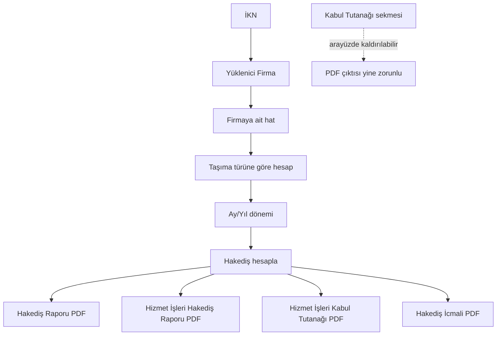

# OEHS devam notu — 15 Ekim 2026

## Kesin karar: PDF çıktısı dört belge kalacak

**Dört PDF çıktı kuralı değiştirilmeyecek.** Kullanıcı, bazı arayüz sekmelerini kaldırmayı istemişti; bu, belge çıktılarından birini kaldırma yetkisi vermez. Özellikle Kabul Tutanağı sekmesi/giriş ekranı kaldırılabilir, fakat **Hizmet İşleri Kabul Tutanağı dördüncü PDF olarak üretimde kalmalıdır**.

Zorunlu dört çıktı:
1. Hakediş Raporu
2. Hizmet İşleri Hakediş Raporu
3. Hizmet İşleri Kabul Tutanağı
4. Hakediş İcmali

Dört belgeyi üçe düşüren hiçbir geçici kod/test/CI metni kabul edilmeyecek. Yarın ilk iş, mevcut dala dört-belge kuralını geri uygulamak ve tüm beklenen dosya adlarını/testleri 4 PDF olacak şekilde eşitlemek.

## İş akışının kabul edilmiş kuralları

- Kullanıcıya görünen ihale numarası İhale Kayıt Numarası (İKN); kullanıcıdan “Sözleşme No” istenmeyecek. Eski iç ilişki alanı gerekiyorsa yalnızca uygulama içi anahtar olarak kalmalı, resmî belge başlığında veya kullanıcıya dönük dosya adında sözleşme numarası gibi gösterilmemeli.
- Aynı İKN altında farklı yüklenici firmalar için ayrı kayıtlar açılabilir. Her firmanın hatları ve hakedişleri diğer firmadan ayrılmalıdır.
- **Bir hat yalnızca bir yükleniciye eşlenebilir.** Aynı İKN + Hat No farklı VKN/TCKN ile ikinci kez kaydedilirse işlem reddedilmelidir. Farklı İKN'lerde aynı hat numarası kullanılabilir.
- İlk ihale bilgileri adımında taşıma türü seçilmeli:
  - Özel Eğitim Taşıma: rehber iş günü/günlük fiyat/iskonto/fiyat farkı/asgari ücret desteği aktif; taşıma KDV %10 + rehber KDV %20; taşıma tevkifat 5/10 + rehber tevkifat 9/10.
  - Temel/Ortaöğretim Taşıma: rehber alanları gizli/pasif, hesap motorunda rehber ve asgari ücret desteği sıfır; yalnız taşıma KDV %10 ve taşıma tevkifat 5/10.
- Hakediş döneminde gün seçimi yerine ay/yıl seçilmeli. Seçenekler sözleşme başlangıç ve bitiş tarihlerine göre kırpılmalı. Örnek: 14.09.2026 başlangıçlı sözleşme için Eylül dönemi 14.09.2026–30.09.2026, Ekim dönemi 01.10.2026–31.10.2026.
- Kabul Tutanağı sekmesinin kaldırılması ve Kabul Tutanağı PDF çıktısının kaldırılması iki ayrı karardır. Bu projede sekme kaldırma talebi, dördüncü belgeyi kaldırma anlamına gelmez.
- İstatistik sekmesi şimdilik boş/yer tutucu olabilir; kapsamı sonra belirlenecek.
- Eski kayıtların yeni akışa taşınması gerekmiyor. Yeni uygulama veri dosyası ilk açılışta boş olmalı ve eski şema verilerini otomatik olarak yeni kayıtlara karıştırmamalı. Mevcut temiz başlangıç servisi önceki veri/çıktıları aktif akıştan ayırıyor; bunları kalıcı silmek yerine yedeklemesi güvenli bir geçiş davranışı olarak kalabilir.

## Şu anki kayıtlı nokta

- Çalışma dalı: `feature/official-payment-document-templates`
- Kod değişiklikleri başlamadan önce dalın commit'i: `8944344f004072c833abc6657a93257a149fdd36`
- Bu oturumdaki en son UI/çıktı değişiklikleri henüz tek bir doğrulanmış commit halinde birleştirilmedi. GitHub'a yazılmış bazı geçici blob'lar var; bunlar derleme/testten geçmediği için doğrudan üretim kodu olarak kabul edilmemeli.
- Önceki denemelerdeki bazı dosya blob kimlikleri, yeniden inceleme için:
  - MainWindow.xaml.cs aday sürümü: `9013fb5461f1ed1da607bcb575896e894ea836da`
  - MainWindow.xaml aday sürümü: `3a93c35d7a7fdb4a0fd46b34fc5cf7b3a14324f1`
  - OehsOutputPathService.cs aday sürümü: `62427f0a46461dfb17d78d1b5b9e0635f7209b72`
  - OehsFileNameService.cs aday sürümü: `0ee27d4d01bd388a38d11f16d2eccb484607bbfc`
  - ProgressPaymentArchiveStore.cs aday sürümü: `368a8639c7e3e135a9994a9f9c69c453c9581ac1`
  - RouteAssignmentValidationService.cs: `d0fcbe7f4d7acee3f26b14aab686b8dbdc5ddea4`
  - RouteAssignmentValidationServiceTests.cs: `683ec535d00f78b5596d4fd32eab5c44367ff89d`
  - Temiz başlangıç servisi aday sürümü: `e4c8fffec1dead43a72a9c58f8aab49c2e1970fb`
  - Resmî belge üreticisinin üç-belgeye düşürülmüş geçici adayı (yarın dört belgeye geri alınacak): `dd5307871b1323a9dd8db1f1ce3a094e639e78b2`
- Bu aday blob'lar yalnızca toparlama referansıdır; her birinin branch içeriği olduğu veya derlendiği varsayılmamalı. Yarın dalın gerçek HEAD'indeki kaynak dosyaları temel alıp kuralları kontrollü şekilde yeniden uygulamak tercih edilir.

## Yarınki sıra

1. Önce dört PDF çıktısı kuralını kod, Excel dışa aktarımı, testler, PDF smoke script ve CI statik kontrollerinde kesinleştir.
2. İKN + firma eşleşmesini ve “bir hat = tek yüklenici” kuralını hem UI hem Core doğrulamasında kontrol et.
3. Taşıma türünün kayıt, arşiv snapshot'ı, hat değişikliği sonrası yeniden hesaplama ve PDF/Excel metinlerine kadar taşındığını kontrol et.
4. Ay/yıl seçiminde başlangıç/son ay kırpımını ve geçmiş hakediş düzenleme senaryosunu test et.
5. Kabul Tutanağı sekmesinin kaldırılmış olmasına rağmen 4. PDF olarak oluşturulduğunu otomatik testle doğrula.
6. Windows CI çalıştır; derleme, tüm testler ve dört PDF smoke üretimi başarılı olmadan bu dalı deneme EXE'si olarak paylaşma.
7. Gerçek PDF'lerin görsel kontrolünü Windows ortamında yap. Hesapların Excel/VBA ve ilgili sözleşme koşullarına göre ayrıca kabul kontrolü gerekir.

## Görsel/akış ayrımı

