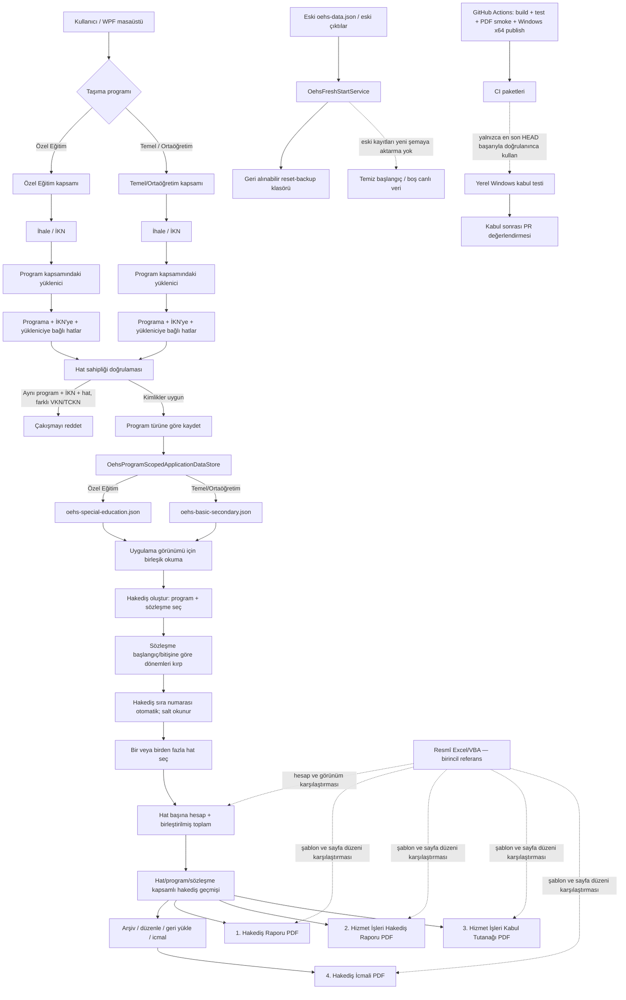

# OEHS devam notu — 16 Ekim 2026 (evde devam için kesin devir)

> **EN ÖNEMLİ UYARI — ev bilgisayarında güncel kod yok.** Evde çalışmaya başlarken ilk iş, GitHub Desktop üzerinden GitHub'daki bu dalı eşitlemektir. Eski yerel dalı güncel sanma, eski yerel kod üzerinden değişiklik yapma ve yeni EXE'yi eski checkout'tan üretme. Önce uzak dalı Fetch/Pull ile güncelle, sonra gerçek yerel HEAD'i doğrula.

## 1. Proje ve uzak kaynakta kesin konum

- Repo: `mcalimlier/OzelEgitimHakedisSistemi`
- Aktif çalışma dalı: `feature/official-payment-document-templates`
- Son kayıtlı uzak HEAD (bu not yazılırken): `eb54309fea56e59c871d21f147db2108e191a1ff`
- PR: [#3 — draft, henüz birleştirilmedi](https://github.com/mcalimlier/OzelEgitimHakedisSistemi/pull/3)
- PR hedef dalı: `feature/wpf-contract-entry-v0.5`
- Son önceki CI başarı referansı: [run 38909396149](https://github.com/mcalimlier/OzelEgitimHakedisSistemi/actions/runs/38909396149) (HEAD `b3436c0`). **Bu başarı, bu nottaki son iki düzeltmeyi içeren yeni HEAD'in CI sonucunun yerine geçmez.** Yeni HEAD için Actions sonucu tekrar kontrol edilecek.
- Evdeki yerel PC'nin güncel kodu olmadığı biliniyor. Daha önce kaydedilen eski yerel konum/commit: `feature/wpf-contract-entry-v0.5` @ `05ff199f05652876c57379340f10ac8028442094`. Bu eski commit güncel uzak dal değildir.

## 2. Bugün uygulanan ana değişiklikler

1. İhale bilgileri formunda taşıma programı seçicisi yukarı alındı.
2. Hakediş numarası seçilen sözleşmenin dönem listesindeki sıra numarasından otomatik üretiliyor; metin kutusu salt okunur. Örnek sözleşme aralığı 14.09.2026–20.11.2026 ise dönemler 14–30 Eylül, 1–31 Ekim, 1–20 Kasım ve sıra numaraları 1, 2, 3.
3. Hat sahibi çakışması program türünü dikkate alıyor. Aynı hat numarası ve firma farklı taşıma programlarında/İKN'lerde birbirine karışmamalı; aynı program + aynı İKN + aynı hat için farklı yüklenici kimliği çakışma olmalı.
4. Sözleşme bulma, hat eşleştirme, hakediş kimlik anahtarları ve geçmiş kayıt eşleştirmeleri program türü kapsamına alındı.
5. Program başına ayrı veri dosyası eklendi:
   - `oehs-special-education.json`
   - `oehs-basic-secondary.json`
   Bu dosyalar arayüzün birleştirilmiş görünümü için birlikte okunuyor; kayıt program türüne göre kendi bölümüne yazılıyor.
6. Temiz başlangıç servisi iki program dosyasını ve yedek/geçici dosyalarını da eski veri yedeğine taşıyacak şekilde güncellendi.
7. **Eski veri politikası korundu:** yeni şema eski `oehs-data.json` dosyasını sessizce canlı kayıtlara içe aktarmamalı. En son düzeltmede program depolama servisi, program dosyaları yoksa boş veri döndürüyor; legacy içe aktarma yolu kaldırıldı. Eski dosyaları yedekleme/taşıma işi `OehsFreshStartService` sorumluluğunda. Bu kural için regresyon testi eklendi.
8. Program bölümlü kaydetme/yükleme ve eski verinin yeni şemaya sızmaması için testler eklendi.
9. Sonraki aşamada çoklu hat seçimi/hakediş ayrıntılarının gerçekten uçtan uca çalıştığı ayrıca kullanıcı arayüzünde doğrulanmalı; yalnızca birleşik toplam gösterip hat detayını kaybeden davranış kabul edilmeyecek.

## 3. Kesin iş kuralları — değiştirme

- Dört PDF ayrı ve zorunlu kalacak:
  1. Hakediş Raporu
  2. Hizmet İşleri Hakediş Raporu
  3. Hizmet İşleri Kabul Tutanağı
  4. Hakediş İcmali
- Kabul Tutanağı ekran sekmesinin kaldırılması, Kabul Tutanağı PDF'sini kaldırma izni değildir.
- Resmî Excel/VBA dosyası hesap ve belge görünümü için birincil karşılaştırma kaynağıdır.
- Kullanıcıya gösterilen ihale numarası İKN'dir. Kullanıcıya “Sözleşme No” alanı eklenmemeli; iç sözleşme kimliği gerekiyorsa dahili kalmalı.
- Aynı firma ve aynı hat numarası iki programda bulunabilir. Program türü ve İKN, kimliğin ayrılmaz kapsam anahtarlarıdır.
- Hakediş oluştur ekranı iki programın sözleşme/hakediş kaynaklarını seçilebilir biçimde sunmalıdır; İhale Bilgileri, Yüklenici Firmalar ve Hatlar panelleri seçili programa göre kapsamlanmalıdır.
- Çoklu hat seçimi örneğin Q1, Q2 ve Q4'ü birlikte seçip birleşik tutar hesaplamalı, fakat her hattın ayrıntısını ve izini kaybetmemeli.
- Resmî kaynaklardan elle girilmiş endeks/katsayı değerleri kullanıcı tarafından sağlanıyorsa yetkili kaynak kabul edilir; otomatik internetten değer çekme veya gereksiz uyarı ekleme.
- Otomatik yeni başlangıçta eski veriler canlı şemaya karıştırılmamalı; eski dosyalar varsa geri alınabilir yedekte kalmalı.
- CI, tüm testler, dört PDF smoke üretimi ve gerçek PDF görsel kontrolü tamamlanmadan “üretime hazır” denmemeli. PR #3 bu kontrol ve kullanıcı kabulü öncesinde merge edilmemeli.

## 4. Evde ilk yapılacaklar — kesin sıra

1. GitHub Desktop'ı aç, doğru repo `OzelEgitimHakedisSistemi` olduğuna bak.
2. **Önce yerel değişiklik var mı kontrol et.** Yerel değişiklik varsa silme/Discard yapma; önce güvenli şekilde ayır ve durumunu incele.
3. `Fetch origin` yap.
4. Dal listesinde `feature/official-payment-document-templates` dalına geç. Yerelde yoksa uzak dalı izleyen yerel dal oluştur.
5. `Pull origin` yap. Son commit'in GitHub'daki son HEAD ile aynı olduğunu doğrula; o sırada HEAD `eb54309` idi ama yeni CI/commit varsa GitHub'daki daha yeni HEAD esas alınır.
6. GitHub Actions'ta güncel HEAD'in en yeni run'ını aç; son legacy-import düzeltmelerinden sonraki run başarıyla bitmeden test sonuçlarını eski başarılı run'dan varsayma.
7. Visual Studio'da solution'ı aç, Restore → Build → tüm testler. Derleme/test hatalarını çöz; yalnızca testleri geçici olarak atlama veya gevşetme.
8. Uygulamayı temiz test veri diziniyle aç; eski gerçek kullanıcı verisini test verisiyle karıştırma.
9. Manuel kabul senaryolarını sırayla test et (aşağıdaki kontrol listesi).
10. Dört PDF'yi oluştur, resmî Excel şablonlarıyla başlıklar, dönem tarihleri, toplamlar, sayfa yerleşimi, sıfır satırlar, para birimi ve imza alanlarını karşılaştır.
11. Ancak tüm doğrulamalar başarılıysa güncel EXE/deneme paketini yeniden üret. Önceki CI paketleri son düzeltmelerin kodunu içermeyebilir; eski paketi güncel kabul etme.
12. PR #3'ü kullanıcı kabulü olmadan birleştirme.

## 5. Manuel kabul listesi

- [ ] Özel Eğitim seçildiğinde yalnızca o programın ihale/yüklenici/hat kapsamı görünüyor.
- [ ] Temel/Ortaöğretim seçildiğinde yalnızca o programın kapsamı görünüyor.
- [ ] Aynı yüklenici kimliği ve aynı hat numarası iki programda ayrı kaydedilip ayrı görünür kalıyor.
- [ ] Aynı program + aynı İKN + aynı hat numarası farklı yüklenici kimliğiyle ikinci kez kaydedilemiyor.
- [ ] Hakediş oluşturma ekranında iki programın sözleşmeleri seçilebilir.
- [ ] Sözleşme 14.09.2026–20.11.2026 için dönemler 14–30 Eylül, 1–31 Ekim, 1–20 Kasım; numaralar sırasıyla 1, 2, 3.
- [ ] Q1 tek başına seçilip doğru hesaplanıyor.
- [ ] Q1 + Q2 + Q4 seçilince birleşik toplam doğru; her hat için ayrıntılar/ara hesaplar korunuyor.
- [ ] Hakediş düzenleme ve yeniden hesaplama başka program/hat geçmişini değiştirmiyor.
- [ ] Arşiv, geri yükleme ve icmal kimlikleri program kapsamını koruyor.
- [ ] Dört ayrı PDF üretiliyor; Kabul Tutanağı PDF'si eksik değil.
- [ ] PDF çıktıları resmî Excel/örnek çıktıyla görsel ve hesap açısından karşılaştırılıyor.
- [ ] Temiz başlangıç sonrası eski veri canlı listede görünmüyor; eski dosyalar yedekte bulunabiliyor.

## 6. Mimari ve veri akışı diyagramı

## 7. Bilinen riskler / henüz kapatılmamış kabul kontrolleri

- Yeni program dosyalarının depolama ve testleri eklendi; son iki düzeltmeden sonraki Actions sonucu yeniden kontrol edilmeli.
- Program kapsamlı depolama, legacy içe aktarmayı bilinçli olarak engelliyor. İlk açılışta `OehsFreshStartService.EnsureFreshStart()` önce çalışmalı ve eski dosyaları yedeklemeli. Marker sürümü `2026-10-16-program-partitioned-storage-v3`.
- Çoklu hat akışının UI → hesap → geçmiş/arşiv → dört PDF uçtan uca davranışı gerçek Windows testinde doğrulanmalı.
- PDF smoke testi dosyanın üretildiğini ve temel formatı doğrular; resmî Excel ile görsel/hesap eşdeğerliğinin tam kabulü değildir.
- GitHub CI'da önceki başarı, daha yeni commit'in doğrulandığı anlamına gelmez. Her zaman HEAD SHA ile run SHA eşleştir.

## 8. Sonraki eylem

**Evde ilk eylem: yerel bilgisayarı GitHub'daki en güncel `feature/official-payment-document-templates` HEAD'i ile güvenli şekilde eşitlemek.** Bundan önce kod yazmaya, eski EXE üretmeye veya PR'ı merge etmeye başlama.
