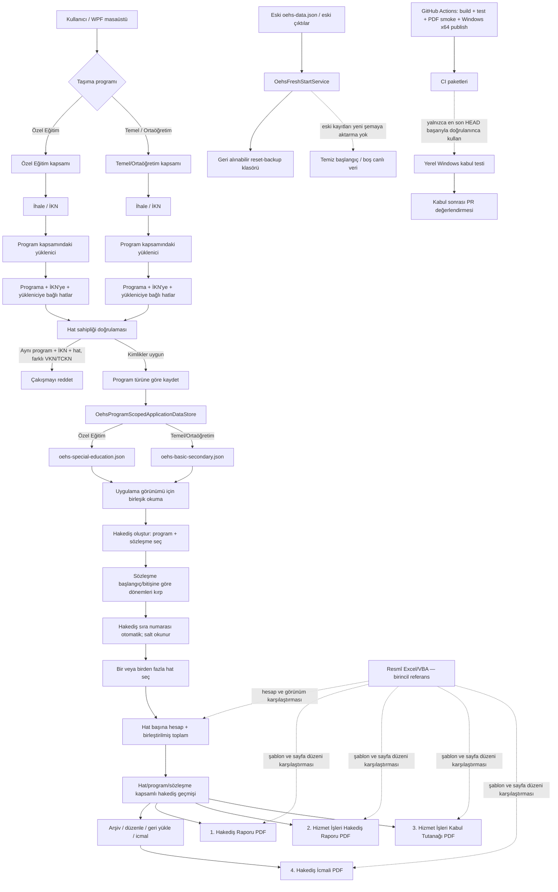

# OEHS devam notu — 16 Ekim 2026 (evde devam için kesin devir)

> **EN ÖNEMLİ UYARI — ev bilgisayarında güncel kod yok.** Evde çalışmaya başlarken ilk iş, GitHub Desktop üzerinden GitHub'daki bu dalı eşitlemektir. Eski yerel dalı güncel sanma, eski yerel kod üzerinden değişiklik yapma ve yeni EXE'yi eski checkout'tan üretme. Önce uzak dalı Fetch/Pull ile güncelle, sonra gerçek yerel HEAD'i doğrula.

## 1. Proje ve uzak kaynakta kesin konum

- Repo: `mcalimlier/OzelEgitimHakedisSistemi`
- Aktif çalışma dalı: `feature/official-payment-document-templates`
- Kod düzeltmelerinin HEAD'i: `eb54309fea56e59c871d21f147db2108e191a1ff`.
- Devam notu eklendikten sonraki HEAD: `aa76195ef0f4364ff9bffe77f3c44c22ae9a2e54` (bu notta veya sonraki dokümantasyon commit'lerinde yeni HEAD oluşursa GitHub'daki en son commit esas alınmalı).
- PR: [#3 — draft, henüz birleştirilmedi](https://github.com/mcalimlier/OzelEgitimHakedisSistemi/pull/3)
- PR hedef dalı: `feature/wpf-contract-entry-v0.5`
- Son tamamlanmış CI başarı referansı: [run 38909396149](https://github.com/mcalimlier/OzelEgitimHakedisSistemi/actions/runs/38909396149) (HEAD `b3436c0`). **Bu başarı, son legacy-import düzeltmelerini içeren yeni HEAD'in CI sonucunun yerine geçmez.** Son kontrol anında `b123e8f0`, `eb54309f` ve `aa76195e` için Actions çalışmaları devam ediyordu; evde ilk olarak en son HEAD'e ait sonucu kontrol et.
- Evdeki yerel PC'nin güncel kodu olmadığı biliniyor. Daha önce kaydedilen eski yerel konum/commit: `feature/wpf-contract-entry-v0.5` @ `05ff199f05652876c57379340f10ac8028442094`. Bu eski commit güncel uzak dal değildir.

## 2. Bugün uygulanan ana değişiklikler

1. İhale bilgileri formunda taşıma programı seçicisi yukarı alındı.
2. Hakediş numarası seçilen sözleşmenin dönem listesindeki sıra numarasından otomatik üretiliyor; metin kutusu salt okunur. Örnek sözleşme aralığı 14.09.2026–20.11.2026 ise dönemler 14–30 Eylül, 1–31 Ekim, 1–20 Kasım ve sıra numaraları 1, 2, 3.
3. Hat sahibi çakışması program türünü dikkate alıyor. Aynı hat numarası ve firma farklı taşıma programlarında/İKN'lerde birbirine karışmamalı; aynı program + aynı İKN + aynı hat için farklı yüklenici kimliği çakışma olmalı.
4. Sözleşme bulma, hat eşleştirme, hakediş kimlik anahtarları ve geçmiş kayıt eşleştirmeleri program türü kapsamına alındı.
5. Program başına ayrı veri dosyası eklendi:
   - `oehs-special-education.json`
   - `oehs-basic-secondary.json`
   Bu dosyalar arayüzün birleştirilmiş görünümü için birlikte okunuyor; kayıt program türüne göre kendi bölümüne yazılıyor.
6. Temiz başlangıç servisi iki program dosyasını ve yedek/geçici dosyalarını da eski veri yedeğine taşıyacak şekilde güncellendi.
7. **Eski veri politikası korundu:** yeni şema eski `oehs-data.json` dosyasını sessizce canlı kayıtlara içe aktarmamalı. En son düzeltmede program depolama servisi, program dosyaları yoksa boş veri döndürüyor; legacy içe aktarma yolu kaldırıldı. Eski dosyaları yedekleme/taşıma işi `OehsFreshStartService` sorumluluğunda. Bu kural için regresyon testi eklendi.
8. Program bölümlü kaydetme/yükleme ve eski verinin yeni şemaya sızmaması için testler eklendi.
9. Sonraki aşamada çoklu hat seçimi/hakediş ayrıntılarının gerçekten uçtan uca çalıştığı ayrıca kullanıcı arayüzünde doğrulanmalı; yalnızca birleşik toplam gösterip hat detayını kaybeden davranış kabul edilmeyecek.

## 3. Kesin iş kuralları — değiştirme

- Dört PDF ayrı ve zorunlu kalacak:
  1. Hakediş Raporu
  2. Hizmet İşleri Hakediş Raporu
  3. Hizmet İşleri Kabul Tutanağı
  4. Hakediş İcmali
- Kabul Tutanağı ekran sekmesinin kaldırılması, Kabul Tutanağı PDF'sini kaldırma izni değildir.
- Resmî Excel/VBA dosyası hesap ve belge görünümü için birincil karşılaştırma kaynağıdır.
- Kullanıcıya gösterilen ihale numarası İKN'dir. Kullanıcıya “Sözleşme No” alanı eklenmemeli; iç sözleşme kimliği gerekiyorsa dahili kalmalı.
- Aynı firma ve aynı hat numarası iki programda bulunabilir. Program türü ve İKN, kimliğin ayrılmaz kapsam anahtarlarıdır.
- Hakediş oluştur ekranı iki programın sözleşme/hakediş kaynaklarını seçilebilir biçimde sunmalıdır; İhale Bilgileri, Yüklenici Firmalar ve Hatlar panelleri seçili programa göre kapsamlanmalıdır.
- Çoklu hat seçimi örneğin Q1, Q2 ve Q4'ü birlikte seçip birleşik tutar hesaplamalı, fakat her hattın ayrıntısını ve izini kaybetmemeli.
- Resmî kaynaklardan elle girilmiş endeks/katsayı değerleri kullanıcı tarafından sağlanıyorsa yetkili kaynak kabul edilir; otomatik internetten değer çekme veya gereksiz uyarı ekleme.
- Otomatik yeni başlangıçta eski veriler canlı şemaya karıştırılmamalı; eski dosyalar varsa geri alınabilir yedekte kalmalı.
- CI, tüm testler, dört PDF smoke üretimi ve gerçek PDF görsel kontrolü tamamlanmadan “üretime hazır” denmemeli. PR #3 bu kontrol ve kullanıcı kabulü öncesinde merge edilmemeli.

## 4. Evde ilk yapılacaklar — kesin sıra

1. GitHub Desktop'ı aç, doğru repo `OzelEgitimHakedisSistemi` olduğuna bak.
2. **Önce yerel değişiklik var mı kontrol et.** Yerel değişiklik varsa silme/Discard yapma; önce güvenli şekilde ayır ve durumunu incele.
3. `Fetch origin` yap.
4. Dal listesinde `feature/official-payment-document-templates` dalına geç. Yerelde yoksa uzak dalı izleyen yerel dal oluştur.
5. `Pull origin` yap. Son commit'in GitHub'daki son HEAD ile aynı olduğunu doğrula; o sırada HEAD `eb54309` idi ama yeni CI/commit varsa GitHub'daki daha yeni HEAD esas alınır.
6. GitHub Actions'ta güncel HEAD'in en yeni run'ını aç; son legacy-import düzeltmelerinden sonraki run başarıyla bitmeden test sonuçlarını eski başarılı run'dan varsayma.
7. Visual Studio'da solution'ı aç, Restore → Build → tüm testler. Derleme/test hatalarını çöz; yalnızca testleri geçici olarak atlama veya gevşetme.
8. Uygulamayı temiz test veri diziniyle aç; eski gerçek kullanıcı verisini test verisiyle karıştırma.
9. Manuel kabul senaryolarını sırayla test et (aşağıdaki kontrol listesi).
10. Dört PDF'yi oluştur, resmî Excel şablonlarıyla başlıklar, dönem tarihleri, toplamlar, sayfa yerleşimi, sıfır satırlar, para birimi ve imza alanlarını karşılaştır.
11. Ancak tüm doğrulamalar başarılıysa güncel EXE/deneme paketini yeniden üret. Önceki CI paketleri son düzeltmelerin kodunu içermeyebilir; eski paketi güncel kabul etme.
12. PR #3'ü kullanıcı kabulü olmadan birleştirme.

## 5. Manuel kabul listesi

- [ ] Özel Eğitim seçildiğinde yalnızca o programın ihale/yüklenici/hat kapsamı görünüyor.
- [ ] Temel/Ortaöğretim seçildiğinde yalnızca o programın kapsamı görünüyor.
- [ ] Aynı yüklenici kimliği ve aynı hat numarası iki programda ayrı kaydedilip ayrı görünür kalıyor.
- [ ] Aynı program + aynı İKN + aynı hat numarası farklı yüklenici kimliğiyle ikinci kez kaydedilemiyor.
- [ ] Hakediş oluşturma ekranında iki programın sözleşmeleri seçilebilir.
- [ ] Sözleşme 14.09.2026–20.11.2026 için dönemler 14–30 Eylül, 1–31 Ekim, 1–20 Kasım; numaralar sırasıyla 1, 2, 3.
- [ ] Q1 tek başına seçilip doğru hesaplanıyor.
- [ ] Q1 + Q2 + Q4 seçilince birleşik toplam doğru; her hat için ayrıntılar/ara hesaplar korunuyor.
- [ ] Hakediş düzenleme ve yeniden hesaplama başka program/hat geçmişini değiştirmiyor.
- [ ] Arşiv, geri yükleme ve icmal kimlikleri program kapsamını koruyor.
- [ ] Dört ayrı PDF üretiliyor; Kabul Tutanağı PDF'si eksik değil.
- [ ] PDF çıktıları resmî Excel/örnek çıktıyla görsel ve hesap açısından karşılaştırılıyor.
- [ ] Temiz başlangıç sonrası eski veri canlı listede görünmüyor; eski dosyalar yedekte bulunabiliyor.

## 6. Mimari ve veri akışı diyagramı

## 7. Bilinen riskler / henüz kapatılmamış kabul kontrolleri

- Yeni program dosyalarının depolama ve testleri eklendi; son iki düzeltmeden sonraki Actions sonucu yeniden kontrol edilmeli.
- Program kapsamlı depolama, legacy içe aktarmayı bilinçli olarak engelliyor. İlk açılışta `OehsFreshStartService.EnsureFreshStart()` önce çalışmalı ve eski dosyaları yedeklemeli. Marker sürümü `2026-10-16-program-partitioned-storage-v3`.
- Çoklu hat akışının UI → hesap → geçmiş/arşiv → dört PDF uçtan uca davranışı gerçek Windows testinde doğrulanmalı.
- PDF smoke testi dosyanın üretildiğini ve temel formatı doğrular; resmî Excel ile görsel/hesap eşdeğerliğinin tam kabulü değildir.
- GitHub CI'da önceki başarı, daha yeni commit'in doğrulandığı anlamına gelmez. Her zaman HEAD SHA ile run SHA eşleştir.

## 8. Sonraki eylem

**Evde ilk eylem: yerel bilgisayarı GitHub'daki en güncel `feature/official-payment-document-templates` HEAD'i ile güvenli şekilde eşitlemek.** Bundan önce kod yazmaya, eski EXE üretmeye veya PR'ı merge etmeye başlama.

## 2026-10-16 ek devam kaydı — güncel CI ve çoklu hat güvenliği

- Yerel eşitleme kullanıcı tarafından tamamlandı; bundan sonraki yerel çalışma bu dalın güncel HEAD'i üzerinden sürdürülmelidir.
- Önceki başarısız CI çalışmasının ardından `OehsApplicationData.Empty` içindeki boş koleksiyonlar tutarlı biçimde başlatıldı.
- `5be27e750627b6ece818659631ff7595e51875a8` commit'inde CI başarıyla tamamlandı. Build, test çözümü, PDF smoke üretimi ve Windows x64 yayın adımları başarılıydı.
- PDF smoke arşivinde dört ayrı A4 PDF bulundu. Bunlar örnek/test verileriyle üretilmiştir; test imzacı adları gerçek üretim kabulü değildir. Gerçek kayıtla üretim ve resmî XLSM görsel karşılaştırması hâlâ gereklidir.
- Kod incelemesinde çoklu hat kaydında tek formdaki manuel parasal alanların her seçilen hat kaydına aynen kopyalandığı görüldü. İskonto, fiyat farkı, vergi borcu, SGK borcu, asgari ücret desteği ve denetim cezası gibi tutarlar bu şekilde yanlışlıkla çoğalabilir.
- Geçici mali güvenlik önlemi eklendi: çoklu hat seçiliyken bu ortak parasal alanlardan biri sıfır değilse kayıt durdurulur ve hat bazlı ayrı giriş istenir. İlgili servis: `MultiRouteProgressPaymentValidationService`; testler: `MultiRouteProgressPaymentValidationServiceTests`.
- **Açık iş / öncelikli:** geçici engelin yerine, seçilen her hat için ayrı iskonto, fiyat farkı ve kesinti girdileri sağlayan hat bazlı çoklu giriş ekranı eklenmeli. Her satırın hesabı ayrı saklanmalı; toplam yalnızca satır sonuçlarının toplamı olmalı. Bu iş bitene kadar çoklu seçimde ortak parasal değerler sıfır değilken işlem bilerek engellenir.
- Bu yeni güvenlik değişiklikleri `5be27e75` sonrasındaki commit'lerdir; bu nedenle önceki başarılı CI bunları kapsamaz. En yeni HEAD için Actions sonucu ayrıca doğrulanmalıdır.

## 2026-10-16 ek devam kaydı — Excel formülleri ve aylık çoklu-hat akışı

### Kaynak analiz belgesi
- Ayrıntılı iki-Excel formül/VBA analizi: `docs/EXCEL_KAYNAK_ANALIZI_VE_AYLIK_HAKEDIS_KURALLARI_2026-10-16.md`.
- Kaynak Excel formüllerine göre Temel/Ortaöğretim Asgari Ücret Desteği kesintilerde korunmalı; yalnızca rehber personel kalemleri bu programda sıfırlanır.
- Ek kesin teminat kaynak formülü: Temel/Ortaöğretim için `I × %6`; Özel Eğitim için `I × %6 + R × %6`. İskontolar bu tabana dahil değildir. Negatif fiyat farkını sıfırlayan `MAX(0, ...)` kaynakta bulunmadığından hesap motorundan kaldırıldı; hukuki uygulama yorumu uzman kontrolüne açık tutuldu.
- Hakediş Raporu D6/D7/D8/D10/D11 zinciri kaynak Excel formülüne göre düzenlendi. D7 yalnızca seçili ayın ham I+R fiyat farkını; D6 ise önceki + mevcut aylık K+T toplamından seçili ayın I+R tutarı çıkarılmış değeri gösterir.

### Aylık hakediş / batch davranışı
- Bir sözleşme 6 ay sürüyorsa tek bir altı aylık hakediş yerine her ay ayrı kayıt oluşturulur.
- Çoklu hat ekranı her hat için ayrı iş günü, iskonto, fiyat farkı ve kesinti alır; ortak toplam satır sonuçlarının toplamıdır.
- Her kayıtta ortak `BatchId`, `BatchDisplayName`, `BatchRouteNumbers` bulunur. Görünen ad: program + İKN + sözleşme + firma + seçili hat kümesi + ay/yıl.
- Her hattın hakediş numarası kendi program/sözleşme/yüklenici/hat geçmişinden türetilir; aynı batch içindeki hatların numaraları farklı olabilir.
- Aynı hat/program/sözleşme için aynı ayda ikinci kayıt, Excel'in hat başına aylık hücre modelini bozacağı için reddedilir. Örneğin Q1/Eylül ve Q1+Q3/Ekim geçerlidir; aynı Q1/Ekim ikinci kez oluşturulamaz.
- Dört resmi PDF adı/üretimi ve arşiv yolu program, seçili hat kümesi ve dönemle ilişkilendirilir; çoklu hat arşivlemesinde hatların hesap ayrıntıları ayrı kayıtlarda korunur.

### Bu oturumda bulunan ve düzeltilen ek hatalar
- **Kritik kapsam hatası:** Hakediş Raporu kümülatif geçmişi farklı hat/program/sözleşme/yüklenici kayıtlarını da toplayabiliyordu. Artık önceki tutarlar tam program + İKN + sözleşme + yüklenici kimliği + hat anahtarıyla filtreleniyor. Farklı kapsamların karışmaması için regresyon testleri eklendi.
- **Kritik giriş alanı hatası:** Asgari Ücret Desteği alanı, rehber personel alanlarıyla birlikte Temel/Ortaöğretim ekranında gizleniyor ve sıfırlanıyordu. Alan artık her iki programda görünür; rehber alanları Özel Eğitim'e özgü kalır.
- Son ilgili commit'ler: `fa5ab7bd` (rapor kapsamı), `656d0208` (rapor kapsam testi), `ec5a138a` (asgari ücret desteği alanı), `c38cd0a7` (tam kimlik kapsamı testi), sonrasında belge güncellemesi.
- Önceki kodda `0fff9556` HEAD'i için CI başarılıydı. Yeni rapor-kapsamı, alan görünürlüğü ve ek regresyon testi commit'lerinin CI çalışmaları başlatıldı; **en yeni HEAD için başarı henüz doğrulanmış kabul edilmemeli**. Güncel kontrol bağlantısı: https://github.com/mcalimlier/OzelEgitimHakedisSistemi/actions

### Bir sonraki çalışma sırası
1. En son HEAD'in GitHub Actions sonucunu kontrol et; başarısız test varsa kodu düzelt, testleri gevşetme.
2. Testler geçince aylık kayıt kimliğinin tek-hat ve çoklu-hat akışında tutarlı kaldığını gözden geçir; özellikle düzenleme, arşivleme, geri yükleme ve dört PDF üretimini doğrula.
3. Resmî XLSM ile gerçek örnek aylar üzerinden ara hücreler ve tutarları karşılaştır; yalnızca PDF'nin oluşması yeterli değildir.
4. Yerel Windows'ta son HEAD'i pull ettikten sonra WPF derlemesi, testler ve gerçek kabul senaryolarını çalıştır.
5. Son başarılı HEAD'den yeni Windows x64/deneme paketi üret; önceki paketleri güncel diye kullanma.
