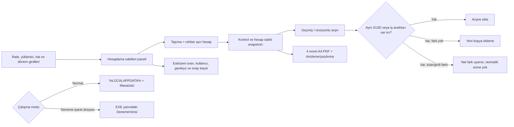

# OEHS Yol Haritası

> **20.10.2026 kaynak önceliği:** En son yüklenen Temel Eğitim ve Özel Eğitim XLSM dosyaları yetkili kaynaktır. Bu dosyada yer alan 17–19 Ekim tarihli tarihsel formül aynaları, sentetik örnekler ve eski test beklentileri son Excel ile çelişirse güncellenecek veya tarihsel diye işaretlenecektir. Tarihsel LibreOffice sonuçları son XLSM/VBA kabulü olarak sunulmayacaktır.

## Güncel kalite kapısı — 2026-10-18

Bu dalda yeni değişiklikler için aşağıdaki doğrulamalar birbirinden ayrı değerlendirilir:

- **Derleme:** Son commit için doğrulanmış sonuç bulunmadan başarılı kabul edilmez.
- **Otomatik test:** Kaynak kodda regresyon testi bulunması, testin çalıştırıldığı anlamına gelmez.
- **PDF görsel kabulü:** Dört belgenin A4 yerleşimi, tutarları, dönem/yüklenici/hat bilgileri ve imza blokları aynı örnek veri üzerinden birlikte kontrol edilmelidir.
- **Kesintiler ve Mahsuplar başlığı:** Dikey yön ve yazı biçimi korunur; metin, tüm kesinti satırlarının yüksekliğini kapsayan sol hücre içinde hem yatay hem düşey eksende ortalanır. `PdfVectorWriter` vektör çıktısında döndürülmüş metin için tanımlı layout ölçülerini kullanır; `VerticalAlignment.Center` ile çizgi hücrenin kısa ekseninde ortalanır.
- **Açık doğrulama:** Son başlık hizalama değişikliği ve buna ait regresyon testi Windows/.NET 8 ortamında çalıştırılmalı, üretilen PDF görsel olarak incelenmelidir.

Bu kapı, derleme/test sonucu veya PDF ekran görüntüsü görülmeden “tamamlandı” işareti verilmesini önlemek için eklenmiştir.

## Çekirdek ilerleme panosu — 2026-10-18

Aşağıdaki %100 değerleri yalnızca bu dar kapsamlı alt modüllerin **uygulama kapsamının** tamamlandığını belirtir; CI/Windows çalıştırması ve kullanıcı kabulü ayrı kapılardır.

| Çekirdek alt modülü | Uygulama kapsamı | Doğrulama durumu | Kapanış ölçütü |
|---|---:|---|---|
| Dosya adı güvenliği ve normalizasyon | **%100** | Kaynak ve regresyon testleri gözden geçirildi; test çalıştırma sonucu bekliyor | Geçersiz karakter, boş/göreli yol, uzun parça, Windows aygıt adı ve uzantı varyasyonları test edilir |
| PDF dosya adı üretimi ve program/yüklenici ayrımı | **%100** | Program enum üyeleri kaynakta doğrulandı; otomatik test çalıştırma sonucu bekliyor | Özel Eğitim / Temel-Ortaöğretim ayrımı, aylık tarih, çoklu hat, sözleşme ve yüklenici kimlik özeti test edilir |
| Resmî PDF kesinti hücresi başlık yerleşimi | **%100** | Kaynak geometrisi ve merkezleme regresyon kontrolleri mevcut; Windows görsel kabulü bekliyor | Dikey yön, yazı biçimi, döndürülmüş kutu ve birleşik hücre merkezi korunur |
| Dört resmî PDF'nin çıktı sözleşmesi | **%100** | Dört belge türü, tek sayfa portre ve imza içerikleri için testler mevcut/genişletildi; çalıştırma sonucu bekliyor | Her hakedişte dört farklı belge türü üretilir; sayfa yapısı ve imza blokları korunur |

### Yeni kapanan uygulama kapsamları — 2026-10-18

- **Resmî PDF kesinti hücresi başlık yerleşimi (%100 uygulama kapsamı):** mevcut `AddRotatedText` yerleşimi ve `PdfVectorWriter` döndürülmüş metin çizimi incelendi. Regresyon testi, başlığın döndürme açısını, hizalama değerlerini ve birleşik hücre merkeziyle koordinat uyumunu denetliyor. Bu oran görsel kullanıcı kabulü değildir.
- **Dört resmî PDF'nin çıktı sözleşmesi (%100 uygulama kapsamı):** dört belge türünün tam kümesini, tek sayfalı portre çıktılarını ve mevcut imza bloklarını kontrol eden testler bulunuyor. Bu turda her çıktının tek sayfa portre yapısını ve dört belge türünün eksiksiz kümesini ayrıca doğrulayan assertion'lar eklendi. Otomatik test sonucu bekleniyor.

## Çekirdek ilerleme panosu — 7 alt modül hedefi (2026-10-18)

Bu yedi satır **dar kapsamlı alt modüller** için uygulama kapsamı tahminidir; ana hesaplama motorunun veya tüm ürünün %100 hazır olduğu anlamına gelmez. Çalıştırılmamış testler ve kullanıcı görsel kabulü ayrı doğrulama kapıları olarak kalır.

| # | Alt çekirdek modülü | Uygulama kapsamı | Doğrulama kapısı |
|---:|---|---:|---|
| 1 | Dosya adı güvenliği ve normalizasyon | **%100** | Windows/.NET test çalıştırması bekliyor |
| 2 | PDF dosya adı üretimi ve program/yüklenici ayrımı | **%100** | Dosya adı regresyon testleri çalıştırılmalı |
| 3 | Kesinti/mahsup dikey başlığı ve hücre geometrisi | **%100** | Windows PDF görsel kabulü bekliyor |
| 4 | Dört resmî PDF'nin çıktı sözleşmesi | **%100** | Dört belgenin PDF smoke testi ve görsel kontrolü bekliyor |
| 5 | İmza ayarları varsayılanları, boş değer ve bozuk JSON davranışı | **%100** | Var olan üç test Windows'ta çalıştırılmalı |
| 6 | Hakediş raporu Excel eşleştirmesi: A–I tutar hücreleri | **%100** | Örnek test zinciri kaynakta var; .NET testi ve gerçek Excel örneğiyle karşılaştırma bekliyor |
| 7 | Özel Eğitim / Temel-Ortaöğretim belge davranışının ayrılması | **%100** | Program türü başlık/KDV/tevkifat senaryoları çalıştırılmalı |

### 5–7 alt modülleri için bu turda yapılanlar

- **İmza ayarları:** mevcut testlerin eksik dosyada düzenlenebilir varsayılanlar oluşturmayı, özel değerleri korumayı, boş alanlarda varsayılanlara dönmeyi ve bozuk JSON için anlamlı hata vermeyi kapsadığı doğrulandı.
- **Excel A–I eşleştirmesi:** mevcut regresyon testindeki A=220, B=10, C=230, D=120, E=110, F=0, G=110, H=5, I=105 TL kontrol zinciri korundu. Hakediş raporu testine yüklenici, ihale numarası, sözleşme numarası ve dönem tarihi için açık metin kontrolleri eklendi.
- **Program türü ayrımı:** mevcut testte Özel Eğitim ve Temel/Ortaöğretim için ayrı belge çıktıları ve KDV/tevkifat etiketleri denetleniyor; bu davranış test kabul kapsamına alındı.
- Bu üç alt modülün yüzdeleri yalnızca kaynak ve test kapsamı düzeyindedir. Test çalıştırılmadığı için çalışma zamanı doğrulaması başarılı sayılmaz.

### Bu turdaki kapsam kapanışları

- Windows için ayrılmış aygıt adlarında uzantı ve araya boşluk/nokta girme durumları ele alındı; COM¹–COM³ ve LPT¹–LPT³ biçimleri eklendi.
- Dosya adı testleri; fallback, program türü, aylık dönem biçimi, çoklu hat, yüklenici kimlik özeti ve geçersiz hakediş numarası senaryolarını kapsayacak şekilde genişletildi.
- Bu testler GitHub kaynak dosyasına eklendi, ancak burada .NET test çalıştırıcısı çalıştırılamadığı için başarılı test sonucu iddia edilmez.
- Sonraki hedefler daha geniş ve yüksek riskli çekirdeklerdir: dört resmî PDF'nin görsel kabulü, Excel ile hesap eşleştirmesi ve iki taşıma programının uçtan uca senaryoları.

## Ana dönüşüm sırası

1. Excel tersine mühendislik — **YAPISAL TARAMA TAMAMLANDI / SEMANTİK DOĞRULAMA SÜRÜYOR**
2. İş kurallarının çıkarılması — **TAMAMLANDI / doğrulama sürüyor**
3. VBA/makro kontrolü — **KAYNAK KODU ÇIKARILDI / UÇTAN UCA DOĞRULAMA SÜRÜYOR** (iki XLSM'de VBA projesi bulundu; makro aktarım davranışı hesap ve aylık geçmiş kayıtlarıyla çapraz doğrulanıyor)
4. Domain model — **TAMAMLANDI / genişletme sürüyor**
5. Hakediş hesaplama motoru — **TAMAMLANDI**
6. Veri saklama — **TAMAMLANDI / geliştirme sürüyor**
7. WPF arayüzü — **TAMAMLANDI / kullanılabilirlik iyileştirmeleri sürüyor**
8. İcmal ve raporlama — **TAMAMLANDI / gerçek belge eşleştirmesi sürüyor**
9. Excel karşılaştırma testleri — **AKTİF**
10. Gerçek senaryo testleri — **AKTİF**
11. PDF/çıktı son karşılaştırması — **AKTİF**
12. Release ve kurulum paketi — **SON AŞAMA**

## Mevcut çalışma sırası

### 1. Hesaplama doğrulama
- Excel'den doğrulanmış 30.06.2026 / Hakediş No 10 senaryosu otomatik testte korunuyor.
- Hizmet tutarı, fiyat farkı, toplam, KDV, tevkifat, damga, ek teminat, denetim cezası, kesinti toplamı ve net ödeme birlikte doğrulanıyor.
- İskonto, fiyat farkı, vergi borcu, SGK borcu, asgari ücret desteği ve denetim cezası **kullanıcı tarafından dönem/hakediş bazında girilen değerlerdir**.
- Denetim cezası artık sözleşme bedelinden sabit binde oranla türetilmiyor; kullanıcı tarafından girilen tutar doğrudan kesintiye ekleniyor.
- KDV için kullanıcı seçimi esas alınır: **KDV HESAPLA / DAHİL ET** işaretliyse KDV ve buna bağlı tevkifat hesaplanır; işaretli değilse KDV ve tevkifat uygulanmaz.
- Yeni mevzuat/iş kuralları kullanıcı girdisi olarak tanımlanan alanlar dışında sabitlenmeyecek.

### 2. Hat / hakediş veri bütünlüğü
- Raporlar ekranı seçilen hatta göre filtrelenir.
- Seçilen hat değiştiğinde liste, toplamlar ve son hakediş özeti yenilenir.
- Uygulama açılışında kayıtlı ilk hat otomatik seçilir.
- Çıktı üretimi yalnızca seçilen hatta ait hakediş kaydı varsa devam eder.

### 3. Dört belge çıktısı
Her hat için:
1. Hakediş Raporu
2. Hizmet İşleri Hakediş Raporu
3. Hizmet İşleri Kabul Tutanağı
4. Hakediş İcmali

Önizleme ve yazdırma akışı korunur.

### 4. PDF / sayfa düzeni
- A4 portre
- Taşma kontrolü
- Kolon genişlikleri
- Başlıklar
- İmza alanları
- Kabul tutanağındaki resmî metin
- İcmal A/B/C yapısı
- Kurum örneklerine yakın yerleşim

16.10.2026 CI smoke artefaktındaki dört örnek PDF görsel olarak açıldı: her biri tek sayfa A4 portre, Türkçe karakterler okunur ve örnek çıktıda belirgin metin taşması görülmedi. Bu, sentetik test verili smoke çıktısının kontrolüdür; orijinal Excel'in yazdırma alanlarıyla birebir karşılaştırma, gerçek kullanıcı verisiyle kabul testi ve yazıcı kontrolünün yerine geçmez.

Kaynak XLSM dosyalarının yazdırma alanları ayrıca LibreOffice ile PDF'e aktarılarak dört resmi formun yerleşimiyle karşılaştırıldı. Bu karşılaştırma Excel masaüstü/VBA çalıştırmalı birebir kabul testi değildir; kaynak dosyanın mevcut önbellekli değerleri ve LibreOffice yazdırma motoruyla sınırlıdır. Görsel karşılaştırmada Kabul Tutanağı için iki somut uyumsuzluk düzeltildi: Temel/Ortaöğretim formunda süre değeri birim olmadan gösterilirken Özel Eğitim'de "İş Günü" eki korunuyor; anlatım paragrafları programın kaynak form yerleşimine göre farklı düşey konum kullanıyor. Kod değişikliği commit'i: [2818ec6](https://github.com/mcalimlier/OzelEgitimHakedisSistemi/commit/2818ec6cf271114a21d645ee98a4665e151b2b55). Bu değişiklik için yeni CI sonucu henüz doğrulanmadı.

Bu aşamanın son doğrulaması gerçek üretilen PDF'lerin referanslarla karşılaştırılmasıdır.

### 5. Gerçek senaryo testi
Otomatik hesap regresyon testleri genişletildi. Şimdi UI üzerinden gerçek iki hatlı senaryo ile doğrulanacak.

Test sırası:
- Hat 1 oluştur
- Hat 2 oluştur
- Hat 1 için Hakediş 1 ve Hakediş 2 oluştur
- Hat 2 için Hakediş 1 oluştur
- Her hat için dört belgeyi ayrı ayrı önizle / PDF'e çıkar
- Hatların birbirine karışmadığını kontrol et
- İcmal aylarının ve önceki hakediş toplamlarının doğru taşındığını kontrol et

### 6. PDF ve çıktı son kontrolü
- Dört belge ayrı ayrı önizlenecek.
- A4 portre ve taşma kontrolü yapılacak.
- Kabul tutanağı metni ve imza yerleşimi referansla karşılaştırılacak.
- İcmal A/B/C toplamları kontrol edilecek.

### 7. Release
- Error = 0
- Core testleri başarılı
- WPF Rebuild başarılı
- Gerçek senaryo testi tamam
- Dört belge son karşılaştırmadan geçti
- Test paketi oluştur
- Windows kurulum / dağıtım paketi hazırlan

## 29.09.2026 Orijinal Excel doğrulaması

Kullanıcının yeniden yüklediği orijinal `Özel Eğitim Hakediş Ödeme Programı.xlsm` doğrudan incelendi.

- Çalışma sayfaları: Anasayfa, İhale Verileri, Hesaplama, Hakediş Raporu, Hizmetişleri Hakediş Raporu, Hizmet İşleri K. Tutanağı, Hakediş İcmali, İcmal Verileri.
- Dosyada `xl/vbaProject.bin` bulundu; yani bu workbook sürümünde VBA projesi gerçekten mevcut.
- VBA içindeki metinlerde hakediş kontrolü, fiyat farkı aktarımı, rehber personel fiyat farkı aktarımı, kesinti aktarımı, icmal/hakediş toplam aktarımı ve kabul tutanağı kontrolü gibi işlemlere ait makro izleri bulundu.
- Bu nedenle önceki “aktif VBA tespit edilmedi” notu bu yüklenen orijinal dosya için geçerli değildir ve düzeltilmiştir.

### Kullanıcı tarafından girilecek hakediş değerleri

Hakediş ekranında dönem bazında kullanıcı tarafından girilecek alanlar:

- İskonto
- Fiyat Farkı
- Vergi Borcu
- SGK Borcu
- Asgari Ücret Desteği
- Denetim Cezası

Bu alanlar hesap motoruna doğrudan aktarılır; sabit bir mevzuat tutarı olarak üretilmez.

### KDV seçimi

Kullanıcı ekranında **KDV HESAPLA / DAHİL ET** seçeneği bulunur.

- İşaretli → KDV hesaplanır ve toplam/brüt/net zincirine dahil edilir; buna bağlı tevkifat da hesaplanır.
- İşaretsiz → KDV ve buna bağlı tevkifat uygulanmaz.

Excel'in orijinal Hesaplama sayfasındaki “KDV'den Muafmı?” alanı ile mevcut formüller ayrıca karşılaştırılmıştır; OEHS kullanıcı arayüzünde seçim davranışı açık ve anlaşılır olacak şekilde sunulmuştur.

### Excel v2 ikinci tarama — formül ve VBA envanteri tamamlandı / semantik kabul doğrulaması sürüyor
- `vbaProject.bin` içindeki Module1 VBA kaynak kodu çıkarıldı ve makro aktarım akışları doğrulandı.
- Rehber personel hakediş hesabı eklendi.
- Taşıma ve rehber personel fiyat farkları ayrı alanlara ayrıldı.
- Taşıma %10 / rehber %20 KDV ve 5/10 + 9/10 tevkifat ayrımı eklendi.
- Ek kesin teminat, iki fiyat farkının toplamı üzerinden %6 olarak bağlandı.
- İhale tarihi ve sözleşme tarihi veri akışına eklendi.
- Panel kartlarının sabit/placeholder metinleri yerine kayıtlı verileri göstermesi için bağlantılar genişletildi.
- PDF raporlarında kesinti başlığının düşey yerleşimi ve referans tablo düzenleri iyileştirildi.
- Orijinal Excel'de Hakediş Raporu D28 ile Hesaplama AG arasında fiyat farkı kaynaklı formül tutarsızlığı ayrıca belgelendi; PDF birebir eşleştirme aşamasında karar verilecek.

## 1.10.2026 KULLANICI GERİ BİLDİRİMİYLE KESİNLEŞEN ARŞİV/PDF DAVRANIŞI

- ARŞİVLER > DÜZELT, seçilen bitmiş işin snapshot'ını düzenleme moduna alır.
- HAT BİLGİLERİ seçildiğinde Hat No dahil tüm ilgili hat alanları değiştirilebilir.
- Onaylanan arşiv düzeltmesi `SaveRevision` ile yeni bir arşiv revizyonu oluşturur; önceki vXX dosyası korunur.
- PDF OLARAK KAYDET yazıcı sürücüsüne bağlı değildir; OEHS yerleşik PDF üreticisiyle doğrudan PDF dosyası üretir.
- PDF dosyası Masaüstü\OzelEgitimHakedisSistemi\Ciktilar\Hakedisler\<İhale-Dosya-No>\Hat-<Hat-No> altında descriptive adla tutulur.
- Önizleme gerçek A4 sayfa rasterı üzerinden, sayfa geçişi ve zoom kontrolleri ile gösterilir.

## 15.10.2026 — İzole deneme paketi ve arşiv çakışması kontrolü

- Arkadaş incelemesi için Windows x64 self-contained paket üretimi CI'a bağlandı. Paket yalnızca `OEHS.exe`, `OEHS_DENEME_PAKETI.flag` ve `KULLANIM.txt` içerir; kaynak kullanıcı verisi veya mevcut arşiv pakete kopyalanmaz.
- İşaret dosyası bulunan pakette ana veri, .bak yedeği, arşivler, imza ayarları ve PDF/çıktılar EXE yanındaki `DenemeVerisi` klasörüne yönlendirilir. İşaret dosyası olmayan normal çalıştırmada standart kullanıcı profili ve Masaüstü dizinleri korunur.
- Arşiv geri yüklemede aynı GUID veya aynı iş anahtarındaki kayıt mevcutsa ikinci hakediş satırı eklenmez. Aktif kayıt ile arşiv girdileri, brüt/net/kesinti tutarları ya da hesapta kullanılan sabitler farklıysa aktif ve arşiv net tutarlarını gösteren uyarı üretilir; aktif kayıt otomatik değiştirilmez.
- İzole yol seçimi ve normal yol geri uyumluluğu için testler; farklı GUID'li iş anahtarı çakışması ve aynı GUID'li ama farklı girdili arşiv için regresyon testleri eklendi. CI sonuçları son committe doğrulanacaktır.

### Güncel iş akışı

### Kalan kritik kabul işleri

- Kaynak Excel'in D11 etiketi/formül çelişkisi, AG/D28 farkı ve icmal Temmuz/Kasım/Aralık davranışı için iş sahibi/Excel tabanlı karar alınmalı; kaynak farkları varsayımla değiştirilmemeli.
- Dört gerçek PDF'nin kaynak örnekleriyle görsel fark karşılaştırması, fiziksel yazıcı ve temiz Windows profili kabul testleri tamamlanmadan uygulama üretime hazır sayılmamalıdır.

## Genel çekirdek modül tamamlama tablosu — 18.10.2026 (son kaynak-parite turu)

**Yüzdeler, uygulama kapsamı ve otomatik doğrulama kanıtı üzerinden yapılan mühendislik tahminidir; gerçek Excel masaüstü/VBA veya görsel kullanıcı kabulü anlamına gelmez.** Bu güncel tablo, önceki tarihli ara durum kayıtlarının yerine geçer.

| # | Çekirdek modül | Tahmini tamamlanma | Dayanak / açık kalan işler |
|---:|---|---:|---|
| 1 | WPF arayüzü ve kullanıcı akışları | **%90** | Temel/Özel program seçimi, ayrı canlı hesap tutucu ekranı ve giriş değişikliklerinde anlık hesap izi mevcut; Windows UI sözleşmesi ve kompakt yerleşim kontrolleri geçti. Visual Studio görsel kabulü sonraki aşama. |
| 2 | Ortak veri modeli, kayıt ve arşiv güvenliği | **%90** | Program kapsamlı veri deposu, rota/ihale/yüklenici kimliği, arşiv revision/restore ve mükerrer kayıt kontrolleri mevcut; 221 Core testi geçti. Temiz Windows profiliyle kullanıcı kabulü açık. |
| 3 | Özel Eğitim taşıma ve rehber hesaplama | **%92** | Güncel Özel Eğitim XLSM satır 4–6 vektörleri; taşıma/rehber KDV, tevkifat, AC ek teminat ve AD damga vergisi zinciri test edildi. Gerçek Excel masaüstü/VBA tekrar çalıştırması sonraki kabul kapısı. |
| 4 | Temel/Ortaöğretim taşıma hesaplama | **%92** | Güncel Temel Eğitim XLSM satır 4–6 vektörleri; elle girilen T, U damga vergisi, W neti ve ayrı rapor D28 zinciri test edildi. |
| 5 | Hakediş hesaplama motoru ve Excel eşleştirmesi | **%92** | Hesaplama sayfası W/AG neti ile rapor D28 zinciri ayrıldı; D11/D13/D15/D26/D28 ve program türüne göre fiyat farkı formülleri regresyon testleriyle eşleştirildi. |
| 6 | Dört resmî PDF, icmal ve önizleme | **%90** | Dört belge türü, tek sayfalı A4 çıktılar ve sekiz PDF smoke çıktısı doğrulandı. İcmal C/D/E formülleri, Temel Eğitim K+I+V ve Özel Eğitim K+T ile I+R aktarım davranışına göre eşlendi. Kaynak Excel ile görsel karşılaştırma sonraki aşama. |
| 7 | Testler, CI, kalite ve dağıtım | **%95** | Windows CI run 1969 başarılı: 221/221 Core, 4/4 WPF, tam çözüm/WPF derlemesi, sekiz PDF smoke çıktısı, Windows EXE ve izole test paketi adımları geçti. Ana dala birleştirme/yayınlama yapılmadı. |

**Basit ortalama: %91,6.** Bu, uygulama kapsamı tahminidir; Excel masaüstü/VBA doğrulaması ve Visual Studio görsel kabulinin tamamlandığı anlamına gelmez. Sonraki aşama, aynı gerçek hakediş örneğiyle iki programın dört PDF'sini birlikte karşılaştırmaktır.

### Yüzdeyi yükseltmek için zorunlu kanıt kapıları

1. Etkin dalın son commit'inde Windows/.NET 8 tam çözüm derlemesi ve tüm testler başarılı olmalı.
2. Her iki taşıma türünde aynı firma/hat numaralarının karışmadığı, birden fazla hat ve birden fazla aylık hakediş içeren uçtan uca senaryo çalıştırılmalı.
3. Aynı örnek veriden üretilen dört PDF, kaynak Excel çıktılarıyla tutar, dönem, yüklenici, hat, imza ve sayfa yerleşimi açısından karşılaştırılmalı.
4. Kaynak Excel çelişkileri belgelenmeli; karar gerektiren noktalarda varsayımla değişiklik yapılmamalı.
5. Gerçek Windows kullanıcı profili, arşivden düzeltme/geri yükleme ve izole deneme paketi kabulü tamamlanmalı.

## 18.10.2026 — Son Windows CI ve PDF smoke kabul kontrolü

- Son doğrulanmış commit: `2016dd7a1e190410e242aa93f54a7bb668abdf15`.
- Windows CI: [39118599426](https://github.com/mcalimlier/OzelEgitimHakedisSistemi/actions/runs/39118599426) başarılı.
- Son CI sonucu: **177/177 Core testi**, **4/4 WPF PDF testi**, tam çözüm/WPF derlemesi, dört resmî PDF smoke üretimi, Windows x64 EXE publish ve izole deneme paketi adımları başarılı.
- CI, `OEHS-PDF-Smoke-Review` artefaktını üretti. Artefakt içinde iki program türü için dört belge olmak üzere 8 PDF bulundu. Hepsi tek sayfa A4 portre (595.276 × 841.89 pt) ve PDF okuyucusuyla açılabilir.
- 90 DPI görsel önizlemede belirgin metin taşması veya boş sayfa görülmedi; kesinti/mahsup başlığı dikey durumda. Bu inceleme **kaynak Excel PDF'leriyle piksel karşılaştırması değildir** ve gerçek kullanıcı verisi kabulü yerine geçmez.
- Smoke testinde başarısız olan eski `TEST-IHALE` ve `TEST-SOZ` metin beklentileri kaldırıldı; resmî Hakediş Raporu şablonunda bulunmayan alanları PDF'ye ekleyerek şablonu değiştirmek yerine testler kaynak form alanlarına hizalandı.
- Dosya adı testlerinde derlemeyi durduran CLS attribute/array test verisi kullanımı, döngü içinde çalışan `Fact` testlerine dönüştürüldü. Son Windows CI bu değişikliklerle başarılı oldu.

### Bu oturumun devam notu

**Yapılan iş:** dosya adı testlerindeki derleme hatası giderildi; resmî PDF test beklentileri şablonla tutarlı hale getirildi; testlerdeki metin karşılaştırmaları açık hale getirildi; 8 smoke PDF görsel ve sayfa ölçüsü bakımından incelendi; genel çekirdek yüzdeleri ve kabul kapıları belgede tutuldu.

**Doğrulama:** Windows CI başarılı; 177 Core + 4 WPF testi geçti; PDF smoke üretimi, EXE publish ve izole deneme paketi adımları geçti.

**Açık riskler:** XLSM D11 etiketi/formül çelişkisi, AG/D28 farkı ve icmal ay davranışları için karar gereksinimi sürüyor. Kaynak Excel ile dört PDF'nin gerçek görsel fark karşılaştırması, fiziksel yazıcı ve temiz Windows profili kabulü tamamlanmadı. Analyzer uyarıları da var.

**Sıradaki adım:** XLSM'deki her açık hesap farkını gerçek hücre/makro örneğiyle izole et; karar gerektirenleri ayrı listede tut. Sonra iki program için çoklu hat/ay uçtan uca testini çalıştır ve dört PDF'yi kaynak örneklerle karşılaştır. Bu kanıtlar olmadan çekirdek modüller %90+ olarak işaretlenmemeli.

### Ek regresyon — program verisi çift dosya geri alma

- `OehsProgramScopedApplicationDataStore` için, ikinci program dosyasına commit başarısız olduğunda ilk dosyanın eski içeriğinin geri yüklendiğini sınayan regresyon testi eklendi.
- Commit: [`c514b9b`](https://github.com/mcalimlier/OzelEgitimHakedisSistemi/commit/c514b9b6fcfd4a98d199562dc13fc31858b1f280).
- Son Windows CI [39118853975](https://github.com/mcalimlier/OzelEgitimHakedisSistemi/actions/runs/39118853975) başarılı: **178/178 Core**, **4/4 WPF PDF testi**; çözüm/WPF derlemesi, PDF smoke, Windows x64 publish ve deneme paketi yükleme adımları geçti.
- Bu sonuç program dosyalarının tüm olası disk arızalarında kusursuz olduğunu kanıtlamaz; kontrollü kısmi-commit hata senaryosunun geri alma davranışını doğrular.

## 18.10.2026 — Program türleri arasında hat aktarımı regresyonu

- Etkin dal: `feature/official-payment-document-templates`.
- Doğrulanmış HEAD: `0248e0ac59be055085dc6904fe9eab1dcb694308` (`test: isolate route propagation by transportation program`).
- Windows CI: [39120219227](https://github.com/mcalimlier/OzelEgitimHakedisSistemi/actions/runs/39120219227) başarılı; çalıştırılan HEAD commit ile birebir eşleşiyor.
- Son test sonuçları: **180/180 Core**, **4/4 WPF PDF testi** başarılı. Tam çözüm ve WPF derlemesi, statik UI kontrolleri, PDF smoke üretimi, Windows x64 EXE publish ve izole deneme paketi adımları başarılı.
- Yeni regresyon testi, aynı hat/ihale/yüklenici kimlik alanları kullanıldığında Özel Eğitim hat fiyatı değişikliğinin Temel/Ortaöğretim hakediş girdisi ve hesap sonucuna taşınmadığını denetliyor. Bu commit test kapsamı ekler; hesaplama formüllerini değiştirmez.
- CI'da CA1822, CA1861 ve CA1014 analiz uyarıları ile GitHub Actions Node.js deprecation uyarıları sürüyor. Bu uyarılar mevcut çalıştırmayı başarısız yapmadı.

### Devam notu

**Yapılan iş:** son dal/commit ve CI doğrulandı; program türleri arasında hat aktarımı için yeni regresyon testinin başarılı çalıştığı teyit edildi; yol haritasındaki güncel CI durumu düzeltildi.

**Doğrulama:** Windows CI başarılı; 180 Core + 4 WPF testi geçti. Bu, yerel kullanıcı arayüzünde gerçek veriyle kabul testi veya dört PDF'nin orijinal Excel çıktılarıyla birebir eşleştiği anlamına gelmez.

**Açık riskler:** D11 etiket/formül çelişkisi, AG/D28 farkı ve icmal ay davranışları karara/kanıta bağlı. Dört PDF'nin kaynak Excel örnekleriyle görsel karşılaştırması, fiziksel yazıcı ve temiz Windows profili kabulü açık. Analiz uyarıları temizlenmedi.

**Sıradaki adım:** arşivden geri yükleme ve program bazlı kayıt ayrımı testlerini inceleyip gerekiyorsa hedefli regresyon ekle; ardından iki programda çoklu hat/ay senaryosunu ve dört PDF'nin birlikte karşılaştırmasını tamamla. PR taslak ve birleştirilmemiş kalmalı; ana dala geçiş yapılmamalı.

## 18.10.2026 — İcmal ay aralığı program bazında regresyonu

- Önceki kod ve test commit'leri CI'da başarılı: [kod CI](https://github.com/mcalimlier/OzelEgitimHakedisSistemi/actions/runs/39122080315), [Temmuz devir testi CI](https://github.com/mcalimlier/OzelEgitimHakedisSistemi/actions/runs/39122087746). Sonuçlar ilgili commit'lerin derleme/test/PDF smoke ve paketleme iş akışından geçtiğini gösterir; kaynak Excel ile tam eşdeğerlik kanıtı değildir.
- Temel/Ortaöğretim için Haziran→Temmuz kesinti devri regresyonu eklendi; Özel Eğitim'in Temmuz placeholder sıfır davranışı korundu.
- Ek bir sınır testi eklendi: Temel/Ortaöğretim Temmuz ayını kabul eder, Ağustos'u kapsam dışı bırakır; Özel Eğitim Temmuz'u kapsam dışı bırakır. Bu testin CI sonucu yeni commit üzerinden ayrıca doğrulanmalıdır.
- **Açık risk:** Temel/Ortaöğretim VBA'sının dinamik ay başlığı araması Temmuz'un geçerli olabileceğine işaret eder, ancak tek başına gerçek Excel sonuçlarının Temmuz kesinti devrini kanıtlamaz. İlgili XLSM hücre/formül zinciri ve makro çalıştırma sonucu ile doğrulama sürüyor.
- PR #3 taslak ve birleştirilmemiş durumda; ana dala geçiş veya yayın yapılmadı.

## 18.10.2026 — Yeni güncel XLSM kaynakları öncelikli taban

Kullanıcı tarafından sağlanan iki yeni kaynak dosya bundan sonraki incelemenin öncelikli Excel referanslarıdır:

- `Özel Eğitim Hakediş Ödeme Programı En Güncel.xlsm`
- `Temel Eğitim Taşıma Ödemes Programı En Güncel.xlsm`

Dosyalar salt okunur olarak incelendi. Orijinal dosyalar değiştirilmedi. Dosya SHA-256 özetleri ve sayfa/formül envanteri ayrı inceleme belgesine kaydedildi. Eski Excel çıktıları yeni kaynaklarla çelişirse, eski davranış otomatik olarak doğru kabul edilmeyecek.

### İlk tarama bulguları

- Özel Eğitim dosyasında 8 sayfa ve 293 formül hücresi; Temel Eğitim dosyasında 11 sayfa ve 237 formül hücresi tespit edildi (formül sayısı, openpyxl ile formül olarak okunan hücre sayısıdır; dizi formülleri dahil).
- Her iki dosyada da Anasayfa!AA2 önbelleğinde `#VALUE!` görülüyor. Hata kaynağı ve kullanıcıya etkisi ayrıca incelenmeli; bunun zararsız olduğu varsayılmamalı.
- Özel Eğitim açıklaması Hesaplama!G11 hücresinde taşıma ve rehber personel iş günü bilgilerinin Anasayfa!E3 ve E4'e elle girildiğini belirtiyor.
- Temel Eğitim açıklaması Hesaplama Bilgileri!H17 hücresinde taşıma iş günü bilgisinin Anasayfa!E3'e elle girildiğini belirtiyor. İki programın girdi davranışı birbirine genellenmeyecek.
- Her iki dosyanın `xl/vbaProject.bin` akışı çözümlendi; VBA modül kaynak gövdeleri ve yordam envanteri çıkarıldı. Özel Eğitim'de 10, Temel Eğitim'de 19 VBA modül/nesnesi bulundu. Kaynak çözümlemesi tamamlandı; Excel masaüstünde çalıştırma, buton/şekil OnAction eşlemesi ve gerçek sonuç kabul testi hâlâ açık kapıdır. Ayrıntı: `docs/INCELEME_YENI_GUNCEL_XLSM_2026-10-18.md`.
- Temel Eğitim dosyasında `Ayarlar`, çok gizli `Data` ve `Users` sayfaları da var. Yetki/login akışı, sabit kullanıcı bilgileri ve gizli sayfalar uygulama güvenliği açısından ayrıca incelenmeli; kullanıcı kimlik bilgileri yol haritasına kopyalanmamalı.

### İcmal ve hakediş raporu formüllerinde doğrulanması gereken farklar

- Her iki dosyada İcmal Verileri!D:M ay sütunları Eylül-Haziran olarak bağlı, N sütununda Temmuz yazıyor. O sütunundaki önceki dönem toplamı formülü seçilen dönemin sırasına göre D:L aralığını topluyor. Temmuz için ayrı sütun N olmasına rağmen O formülündeki INDEX aralığı D:L ile sınırlı; Temmuz önceki toplamına etkisi kaynakta ayrıca test edilmeli.
- Özel Eğitim dosyasında İcmal Verileri!AA satır formülü `IF(Anasayfa!$E$4="Eylül",0,SUM(P:Z))`; kesinti toplamı AY sütununda aynı Eylül koşulunu kullanıyor. Temel Eğitim dosyasında AA ve AM toplamları koşulsuz SUM formülü. Bu programlar arası fark korunmalı ve makroların Eylül döneminde hangi sütunları güncellediğiyle birlikte doğrulanmalı.
- Hakediş Raporu!D11 iki dosyada da `IF(D7<0,H2-ABS(D7),H2+D7)` formülünü kullanıyor; açıklama metni E = C − D diyor. H2, D6 ve D10'un gerçek hücre anlamları, dizi formülleri ve seçilen ay örnekleri üzerinden eşitlik zinciri tekrar kurulmalı.
- Özel Eğitim D7, taşıma ve rehber fiyat farkını iki ayrı VLOOKUP ile topluyor; Temel Eğitim D7 yalnızca tek taşıma fiyat farkını okuyor. Hesaplama modülleri ayrı tutulacak.
- Formül önbelleklerinde iki dosyada da Anasayfa!AA2 `#VALUE!` var. LibreOffice/başka hesaplayıcı sonuçları Excel masaüstünün sonucu sayılmayacak; hücre formülü, bağlı nesne/ad tanımı ve Excel'deki yeniden hesaplama ayrı kontrol edilecek.

### Doğrulama kapıları

1. Formül dökümündeki tüm hücreler sayfa sayfa kaynak koduyla karşılaştırılmalı; dizi formülleri ve hata önbellekleri ayrıca listelenmeli.
2. VBA modül/prosedür gövdeleri eksiksiz dışa aktarılmalı; yordam adları veya ham strings taraması tam inceleme yerine geçmez.
3. E3/E4 elle girişleri, dönem seçimi, aylık aktarım, fiyat farkı ve kesinti aktarımı gerçek Excel senaryolarıyla yürütülmeli.
4. Özel Eğitim ve Temel Eğitim için ayrı beklenen sonuç tabloları oluşturulmalı; OEHS sonuçları hücre bazında karşılaştırılmalı.
5. Ancak bu kanıtlardan sonra hesaplama kodu değiştirilmeli ve ilgili regresyon testleri ile CI çalıştırılmalı.
6. Dört resmî PDF aynı hakediş bağlamından üretilip tutar, dönem, hat, yüklenici, imza ve A4 yerleşimi birlikte görsel kabulden geçmeli.

**Durum:** Kaynak dosyaların yapısı, hücre/formül envanteri ve bazı kritik formül farkları ilk taramada tespit edildi. Tam VBA kaynak çözümlemesi, gerçek Excel'de çalıştırma ve programla hücre bazlı eşitlik henüz tamamlanmadı. Bu nedenle hesap motorunun yeni Excel kaynaklarıyla uyumlu olduğu iddia edilmiyor.

### VBA çözümlemesi sonrası yeni riskler

- Her iki kaynakta `AyVerileriniSil` seçili ayı yalnızca bilgilendirme mesajında kullanıyor ve birden fazla ayın bütün aktarım sütunlarını temizliyor. Bu davranış OEHS'ye kopyalanmamalı; dönemle sınırlı silme, açık onay ve geri alınabilir kayıt gerekir.
- Özel Eğitim aktarım yordamları sabit ay/sütun eşlemesi ve 4–103 satır aralığı kullanıyor. Temel Eğitim yordamları ay başlıklarını `Find` ile dinamik arıyor, hat numarasına göre eşliyor ve hesaplama tablosunun son dolu satırında duruyor. Ortak bir metot bu farkları parametre/strateji olarak açıkça korumalı; program davranışları birleştirilmemeli.
- Özel Eğitim dönem olayı E5 ve I5:I15 aralığına; Temel Eğitim E4 ve I4:I14 aralığına bağlı. Her iki makroda da Eylül/Temmuz ve boş/yanlış ay senaryoları Excel içinde çalıştırılmadan kod eşitliği iddia edilmeyecek.
- Temel Eğitim açılışta Excel penceresini gizleyip LoginForm açıyor; rol modülü sayfa görünürlüğü yönetiyor. Bu davranışın OEHS mimarisine aktarılması planlanmıyor; yalnızca iş kuralı ve güvenlik gereksinimi olarak değerlendirilecek.

### Yeni kritik hesap farkı — Temel Eğitim E21 önceki kesinti

Yeni kaynak incelemesinde Temel Eğitim `Hakediş İcmali!E21` formülünün dönem seçimi yerine `Anasayfa!E5` (hakediş tarihi, `=TODAY()`) alanını kullandığı ve önceki ayı `İcmal Verileri!AN3:AX3` aralığında aradığı görüldü. Ancak bu dosyanın kesinti sütunları `AB:AL`, toplam sütunu `AM` olduğundan AN:AX aralığı tablo dışında kalıyor. Ay listesiyle tarih eşleşmediği için `IFERROR(...,0)` önceki ay kesintisini sıfır yapabilir. Aynı dosyanın Worksheet_Change ve aktarım makroları dönem alanı olarak `E4`, kesinti aktarımı ise `AB3:AM3` aralığını kullanıyor. Özel Eğitimde ise E5 dönem alanıdır; dolayısıyla bu formül her iki programa ortaklaştırılamaz.

OEHS mevcut kodu önceki ayın kayıtlı toplam kesintisini her iki program için bulabildiğinden, Temel Eğitim Excel formülünün ürettiği sıfırdan farklı sonuç verebilir. Bu tutar farkı resmî belgeyi etkileyebileceğinden kod değişikliği yapılmadı. Karar: Excel masaüstünde uzmanla aynı örnek üzerinden formülün gerçek çıktısı doğrulanmalı; E5'in sıfır sonucu mu yoksa muhtemel E4 düzeltmesiyle amaçlanan önceki kesinti mi esas alınacağı onaylanmalı. Ayrıntı `docs/INCELEME_YENI_GUNCEL_XLSM_2026-10-18.md` içinde.

## Devam notu — 18.10.2026, E21/İcmal kimlik izolasyonu

- Aktif dal: `feature/official-payment-document-templates`.
- Commit: `d15a9f5d02ce52b3e301d2a99c8c8bc265728329`.
- `ProgressPaymentIcmalServiceTests` içine dört regresyon testi eklendi: farklı İKN, farklı sözleşme, farklı yüklenici VKN/TCKN ve farklı taşıma programı için önceki ay kesintisinin taşınmaması.
- Windows CI çalıştırması `39129122314` başarılı: tam çözüm/WPF derlemesi, test çözümü, PDF smoke üretimi ve Windows EXE/izole paket adımları başarılı.
- Bu değişiklik test kapsamını artırır; çekirdek yüzde tahminleri sırf test eklenmesiyle yükseltilmedi.
- Açık riskler: E21'in kaynak XLSM hücre/ay aktarım zinciriyle son uçtan uca karşılaştırması; dört PDF'nin kaynak Excel çıktılarıyla görsel kabulü; D11/AG-D28 gibi kaynak formül uyuşmazlıklarında karar.
- Sıradaki adım: icmal ay/kimlik davranışını gerçek iki programlı, çok hatlı senaryoda doğrulamak; ardından dört PDF'yi aynı hakediş snapshot'ıyla birlikte karşılaştırmak. Ana dala birleştirme yapılmadı.

## Devam notu — 18.10.2026, PDF kolon genişliği doğrulaması

- PDF kolon genişliği sınır testleri eklendi. İlk CI çalışması 39129392510, InlineData üzerindeki CLS uyumluluk hatası nedeniyle başarısız oldu; test iki ayrı Fact olarak düzeltildi.
- Düzeltilmiş test commit'i 8517aa08497532bdf35b74d33361e5838e658fef CI'da başarılı oldu (39129565139).
- Ek incelemede FitColumns için NaN ve sonsuz kolon genişliklerinin mevcut küçük-eşit-sıfır kontrolünden kaçabildiği görüldü. Hizmet artık sonlu olmayan kolon genişliklerini ve sonlu olmayan toplamı reddedecek; buna iki regresyon testi eklendi.
- Yeni kod/test commit'leri: 84e642f88f7fc1047a9aac1daa54e6267e8c23dc ve 650caa6b27ada9d66f26f447e7a715f7a665b5bd. Bu son iki değişikliğin CI sonucu henüz doğrulanmadı.
- Açık riskler: PDF'lerin kaynak Excel çıktılarıyla görsel karşılaştırması; iki programın formül bazında gerçek Excel eşitliği; Temel Eğitim E21 önceki kesinti formülü kararı.
- Yerel çalışma kopyası için şu an pull önerilmiyor; son değişikliklerin CI sonucu bekleniyor. Ana dala birleştirme yapılmadı.

## Devam notu — 18.10.2026, PDF sınır testleri CI doğrulaması

- Aktif dal ve GitHub HEAD doğrulandı: `feature/official-payment-document-templates`, `9f4df44b83ccc3744322f9b565fcce4dad86007d`. Ana dala geçiş/birleştirme yapılmadı.
- Önceki oturumda bekleyen üç Windows CI çalışması artık tamamlandı ve başarılı:
  - `84e642f` PDF kolon genişliği servisindeki sonlu değer kontrolü — run `39130185083`.
  - `650caa6` NaN/sonsuz kolon genişliği regresyon testleri — run `39130187527`.
  - `9f4df44` yol haritası devam notu — run `39130204619`.
- Daha önce düzeltilen sınır testleri için `8517aa0` / run `39129565139` de başarılı. Bu doğrulama yalnız CI'ın çalıştırdığı derleme/test/paket adımlarını kapsar; kaynak Excel'le resmî hesap eşitliğini veya PDF'lerin görsel kabulünü kanıtlamaz.
- Dört resmi çıktı üreticisi ve Windows testleri yeniden incelendi. Dört ayrı A4 dikey belgeyi tek veri bağlamından üretme ve rapor tutarları için mevcut regresyon kontrolleri bulunuyor. Buna rağmen tüm belgelerin kaynak Excel çıktılarıyla tutar, dönem, yüklenici, hat, imza ve sayfa düzeni bazında uçtan uca karşılaştırması tamamlanmış sayılmıyor.
- Resmî hesapta değişiklik yapılmadı. En yüksek riskli açık karar Temel Eğitim E21 önceki kesinti formülünün kaynak Excel'de gerçek çıktısı; diğerleri AA2 `#VALUE!` önbellek sonucu ve kaynak Excel ile dört PDF'nin karşılaştırmalı görsel kabulü.
- Sonraki adım: E21 için aynı Temel Eğitim örneğini Excel masaüstünde çalıştırıp E4/E5 ve AB:AM/AN:AX farkını doğrulamak; karar çıkmadan hesap davranışını değiştirmemek. Ardından aynı hakediş verisiyle dört PDF'nin tutar/kimlik/imza/sayfa düzeni kabul matrisi hazırlanacak.
- Yerel Fetch/Pull bu doğrulama için zorunlu değil; GitHub CI tamamlandı. Yerel Visual Studio testlerine geçilecekse önce GitHub Desktop'ta **Fetch origin**, sonra yalnızca `feature/official-payment-document-templates` dalını **Pull** edin. Yerel çalışma ağacı/commit burada görülemediğinden temiz olduğu varsayılmıyor.

## Devam notu — 18.10.2026, çekirdek ve genel ilerleme özeti

### Güncel doğrulama zemini
- Aktif dal: `feature/official-payment-document-templates`.
- İncelenen HEAD: `7ddc7b038ca3525809481a2cb5279edfe180ded3` (PR #3 dalının doğrulanmış başı).
- Windows CI run `39140280901`: **başarılı**. Son kod/test commit'i `2c9c28fc28cadbbdee1dd181139c9639b419e26b` için run `39139722422` da başarılıdır: **216/216 Core + 4/4 WPF testi**, çözüm/WPF derlemesi, PDF smoke ve Windows EXE publish geçti. Bu sonuç kaynak Excel masaüstü/VBA eşdeğerliği değildir.
- PR #3 açık/taslak; birleştirilmedi. Orijinal XLSM dosyalarında değişiklik yapılmadı.
- Aşağıdaki oranlar teknik olgunluk için yaklaşık planlama göstergesidir; hesaplama doğruluğunun aynı yüzdeyle kanıtlandığı anlamına gelmez.

### Çekirdek ilerleme tablosu

| Çekirdek | Tahmini ilerleme | Kanıt / kalan kapı |
|---|---:|---|
| Dönem ve Eylül–Temmuz sıralaması | %90 | 11 aylık sıra regresyonu var; kaynak Excel'in hatalı ay sütunlarıyla eşitlik iddiası yok. |
| Önceki ay kesintisi / icmal | %80 | Eksik kimliklerde yanlış kesinti taşınmasını engelleyen testler var; kaynak E21 ve çok dönemli Excel paritesi eksik. |
| Temel/Ortaöğretim aylık aktarımı | %80 | E21 inceleme kopyası LibreOffice ile 24.104,02472 TL örneğini veriyor; Excel masaüstü kabulü bekliyor. |
| Özel Eğitim aylık aktarımı | %65 | E21 saklı değeri 10.580,582128 TL; AN:AX başlıklarında Kasım atlanıp Aralık iki kez görünüyor. VBA davranışının Excel içinde uçtan uca doğrulanması açık. |
| Hesaplama motoru ve kaynak formül paritesi | %78 | Güncel Özel Eğitim satır 4–6 testleri geçiyor; Temel Eğitim T/U ve iki programın D28/net zinciri bilinen fark olarak testleniyor, resmî parite kapanmadı. |
| Kimlik ve kayıt eşleştirme | %88 | İcmal, rapor geçmişi ve sıra önerisinde eksik/normalizasyonda boş kimlik korumaları eklendi; 216 Core testinde otomatik doğrulandı. Gerçek çok hatlı kullanıcı kabulü açık. |
| Dört resmî PDF üretimi | %85 | İki program için sekiz smoke PDF üretildi ve ilk görsel/metin incelemesi yapıldı; kaynak Excel çıktılarıyla eşdeğerlik açık. |
| PDF alan ve tutar tutarlılığı | %75 | Örneklerde dönem, hat ve yüklenici temel kontrolleri mevcut; farklı kayıt senaryolarında dört belge birlikte kabul edilmedi. |
| WPF arayüzü / görsel kabul | %70 | Derleme ve otomatik arayüz sözleşmesi testleri başarılı; Visual Studio'da gerçek kullanıcı görsel testi bekliyor. |
| Testler, CI ve paketleme | %90 | Son Windows CI başarılı; kaynak Excel paritesi ve masaüstü Excel/VBA doğrulaması CI kapsamı dışında. |
| Kaynak izlenebilirliği ve karar kayıtları | %90 | Güncel ve legacy test vektörleri ayrıldı; formül çelişkileri sayısallaştırıldı; Excel masaüstü kabul kontrol listesi hazır. Gerçek VBA yürütmesi hâlâ açık. |

### Genel proje ilerlemesi

| İş paketi | Tahmini ilerleme | Açık ana konu |
|---|---:|---|
| Kaynak XLSM envanteri ve ilk formül incelemesi | %90 | Envanter, formül farkları, legacy/current test vektörleri ve masaüstü kabul listesi hazır. `Anasayfa!AA2` bir formül sonucu değil, doğrudan `#VALUE!` sabiti; doğrudan formül/ad referansı bulunmadı, olası nesne bağlantısı düşük öncelikli açık risk. |
| VBA yordamlarının statik incelenmesi | %80 | Aktarım farkları belgelendi: Özel Eğitim sabit sütun eşlemesi, Temel Eğitim dinamik başlık araması; gerçek Excel yürütmesi eksik. |
| Çekirdek hesap ve icmal | %78 | Güncel Özel Eğitim satır 4–6 kod paritesi geçti; Temel Eğitim T/U, E21 ve D28/net ödeme çelişkileri gerçek Excel/VBA kararı bekliyor. |
| Dört PDF şablonu ve üretim hattı | %80 | Smoke test geçiyor; kaynak Excel çıktısıyla aynı kayıt üzerinden karşılaştırmalı kabul eksik. |
| WPF iş akışı ve kayıt yönetimi | %75 | Otomatik testler var; Visual Studio görsel ve gerçek kullanım senaryoları bekliyor. |
| CI, test ve Windows paketleme | %90 | Son run başarılı; yalnız otomasyonun kapsadığı davranışlar için geçerlidir. |
| Genel proje | **yaklaşık %81** | Kimlik korumaları ve güncel Özel Eğitim kaynak testleri doğrulandı; ancak Temel Eğitim hesap zinciri, D28/net farkları, gerçek Excel/VBA ve dört PDF'nin aynı gerçek hakedişle kabulü açık. Üretime hazır değil. |

### Sıradaki işler — öncelik sırasıyla
1. Özel Eğitim VBA aktarım yordamlarını ve sabit ay/sütun eşlemesini hücre sonuçlarıyla doğrula; Kasım/Aralık başlık farkını tahminle düzeltme.
2. Temel Eğitim dinamik `Find` tabanlı aktarımını ve `AB:AL` kesinti sütunlarını Eylül, Kasım, Aralık, Haziran ve Temmuz senaryolarında doğrula.
3. `Anasayfa!AA2` saklı `#VALUE!` sonucunun kaynağını belirle; hata zararsız varsayılmasın.
4. Aynı hakediş kaydından dört PDF üretip dönem, tutar, hat, yüklenici, imza ve sayfa yerleşimini tek kabul matrisiyle karşılaştır.
5. Yalnızca kanıtlanmış davranış farklarına kod değişikliği yap; her değişiklikten sonra test ve CI sonucunu kaydet.
6. Ana dala birleştirme/yayınlama yapma; bunun için açık kullanıcı onayı gerekir.

## CI doğrulaması — 2026-10-18 (son kaynak notu)

- Kaynak Excel inceleme notu commit'i: `24dc7ee18517a80ed9dc513fa810d1f968160f97`.
- Push CI #1668: **başarılı** — https://github.com/mcalimlier/OzelEgitimHakedisSistemi/actions/runs/39136818987
- PR CI #1669: **başarılı** — https://github.com/mcalimlier/OzelEgitimHakedisSistemi/actions/runs/39136822715
- İki çalışma da aynı commit SHA üzerinde tamamlandı; build job'ı başarılı olarak raporlandı.
- Bu CI sonucu, Windows derleme/test iş akışının otomatik kapısını doğrular. Excel masaüstü/VBA çalıştırması, kaynak Excel ile gerçek PDF çıktılarının birebir eşleşmesi ve kullanıcı arayüzü görsel kabulü hâlâ ayrı kapılardır.
- Bu aşamada hesaplama davranışı değiştirilmedi; kaynak XLSM'ler değiştirilmedi. Özel Eğitim Kasım/Aralık aylık başlık kusuru ve Temel/Ortaöğretim E21 kaynak formül tutarsızlığı açık risk olarak kalır.

## Devam notu — 18.10.2026, icmal kimlik güvenliği ve D11 kaynak kanıtı

- İcmal önceki kesinti eşleştirmesinde eksik kimlik alanlarının boş birleşik anahtarda birbirine eşleşmesini önleyen koruma eklendi. İhale no, sözleşme no, hat no ve yüklenici VKN/TCKN alanlarından biri eksikse önceki kesinti devralınmaz; VKN/TCKN yalnızca noktalama işaretlerinden oluşup normalizasyonda boş kalıyorsa da eşleşme yapılmaz.
- Regresyon testleri her zorunlu kimlik alanının eksik olması, boş/boşluk ihale numarası ve normalizasyonda boş kalan yüklenici kimliği senaryolarını kapsıyor.
- İlk Windows CI denemesinde test dosyasındaki `InlineData` öznitelikleri CLS uyumluluğu derleme hatası oluşturdu. Teori testleri ayrı `Fact` kontrollerine çevrildi. **Düzeltilmiş kod commit'i `fd82cd0b04cf892a4c2a3474a976a26726932fc0` için CI run `39137915002` üzerinde çözüm derlemesi, WPF derlemesi, UI sözleşme kontrolleri, test derlemeleri, otomatik testler ve PDF smoke üretimi başarılı; Windows EXE yayımlama adımı son kontrol anında sürüyordu.** Nihai run sonucu ayrıca kontrol edilmelidir.
- Kaynak Excel D11 inceleme notuna gerçek önbellekli örnekler eklendi: Temel/Ortaöğretim H2=220.490, D7=1.500, D11=221.990; Özel Eğitim H2=93.211,64, D7=3.380, D11=96.591,64. Her ikisi mevcut formülün H2+D7 hesabıyla uyumlu; görünür “C - D” açıklamasının iş anlamı ise Excel masaüstü doğrulaması gerektiriyor.
- Kaynak XLSM dosyaları değiştirilmedi; resmî hesap davranışı hakkında varsayımsal değişiklik yapılmadı. PR #3 birleştirilmedi.
- Genel ilerleme hâlâ %90 altında. Başlıca kapanış kapıları: iki XLSM için Excel masaüstünde gerçek VBA/aylık aktarım paritesi, D11/AG-D28 anlamının doğrulanması ve aynı gerçek hakediş verisinden üretilen dört PDF'nin kaynak Excel çıktılarıyla birlikte kabulü.
- Sonraki adım: CI run `39137915002` nihai sonucunu kontrol et; ardından Özel Eğitim/Temel Eğitim aylık aktarım ve dört PDF karşılaştırma kapılarını kanıtla kapatmaya devam et.

## Devam notu — 18.10.2026, Temel Eğitim ek kesin teminat uyuşmazlığı

- Güncel Temel Eğitim XLSM'sinde `Hesaplama Bilgileri!T4:T6` sabit `1500` değerleri; T sütununda `I*6%` formülü yok. Özel Eğitim XLSM'sinde `Hesaplama!AC4` açıkça `I*6% + R*6%` kullanıyor. OEHS motorundaki ortak %6 ek teminat hesabı bu nedenle Temel Eğitim'in güncel dosyasıyla doğrulanmış parite sayılmaz.
- İş davranışı değiştirilmedi. Kaynak XLSM'ler korunuyor; hesap motorundaki yanıltıcı “kaynak formülü birebir” yorumu, bu farkı açıkça bildiren uyarıyla değiştirildi. Temel Eğitim T hücrelerinin kullanıcı girdisi mi, eski veri mi yoksa makro aktarımı mı olduğu Excel/VBA yürütmesiyle belirlenmeli.
- İcmal kimlik koruması için Windows CI run `39137915002` **başarılı**: tam çözüm ve WPF derlemesi, UI sözleşme kontrolleri, 207 Core testi, 4 WPF testi, PDF smoke ve Windows EXE publish adımları geçti. Bu testler kaynak Excel masaüstü/VBA paritesini kanıtlamaz.
- Ardından yol haritası güncellemesi için run `39138076733` ve hesap motoru açıklama düzeltmesi için run `39138161192` açıldı; son durumları ayrıca kontrol edilecek.
- Yeni bulgu, resmî hesap eşdeğerliği riskini artırıyor; bu yüzden genel ilerleme yüzdesi yükseltilmedi. %90 hedefi henüz tamamlanmadı.
- Sıradaki adım: güncel kaynak XLSM'deki T4:T6 değerlerinin kaynağını VBA ve kullanıcı giriş zincirinde takip et; Temel Eğitim ek teminat davranışını eski test vektörlerinden ayır; ardından her iki programın gerçek Excel sonuçlarıyla karşılaştırmayı sürdür.

## Devam notu — 18.10.2026, D6/D8/D10/D11 kaynak zinciri

- Güncel iki XLSM'nin önbellekli sonuçlarında D6−D10=H2, ancak D8−D10=D11=H2+D7. Özel Eğitim örneğinde H2=93.211,64 ve D7=3.380; Temel Eğitim örneğinde H2=220.490 ve D7=1.500. D6 dizi formülü aylık D:N değerlerini topluyor; VBA aktarımı K(+T) yazıyor ve K(+T) mevcut fiyat farkını içeriyor. Bu, fiyat farkının D8/D11 zincirinde ikinci kez ekleniyor olabileceğine işaret ediyor.
- Bulgular kaynak doğrulama belgesine yazıldı. Önbellekli hücreler Excel masaüstünde yeniden hesaplanmış makro sonucu değildir; D6/D7/D8/D10/D11 zinciri aynı hat/ay için Excel'de çalıştırılmadan hesap davranışı değiştirilmedi.
- Kod açıklaması ve belge değişikliklerinin Windows CI kontrolleri geçti: `39138174112` ve `39138196772` başarılı; her iki run'da 207 Core + 4 WPF testi, PDF smoke ve EXE publish adımları başarılı.
- Kaynak XLSM ile gerçek hesap paritesi için yeni bir kritik açık konu belirlendi; genel ilerleme oranı artırılmadı. %90 hedefine ulaşılmış değil.
- Sıradaki adım: Excel/VBA ortamında aynı örnek üzerinde D6/D7/D8/D10/D11 ile aylık aktarım sütunlarını yeniden hesaplatıp gerçek sonuçları kaydet; ardından OEHS rapor zincirini bu sonuçlarla karşılaştır. Ana dala birleştirme/yayınlama yok.

## Devam notu — 18.10.2026, Temel Eğitim damga vergisi zinciri

- Ek kesin teminat uyuşmazlığının etkisi yalnızca teminat tutarıyla sınırlı değil: güncel Temel Eğitim `Hesaplama Bilgileri!U4` formülü `(K4*9,48/1000)+(T4*9,48/1000)` kullanıyor. Önbellekli K4=220.490 ve T4=1.500 değerlerinde kaynak U4=2.104,4652 TL; yalnız K üzerinden hesap 2.090,2452 TL olur (14,22 TL fark).
- OEHS Temel/Ortaöğretim damga vergisi hesaplaması şu anda K üzerinden ilerliyor ve ek teminatı %6 ile üretiyor. Bu nedenle güncel XLSM ile kaynak eşdeğerliği doğrulanmış değil. Fark kaynak doğrulama belgesine eklendi; resmi hesap davranışı kararsızken değiştirilmedi.
- Bu bulgu genel ilerlemeyi %90'a yaklaştıran bir kapanış değildir; tersine, kaynakla hesap paritesi için çözülmesi gereken somut bir risk daha belirledi. Gerçek Excel/VBA çalıştırması ve iş kuralı kararı gerekli.
- Sıradaki adım: Temel Eğitim T4:T6'nin neden sabit olduğunu ve U4 damga vergisi zincirinin beklenen davranışını gerçek Excel/VBA örneğinde doğrula; ardından OEHS hesabını hücre bazında karşılaştır. Ana dala birleştirme yapılmadı.

## Devam notu — 18.10.2026, resmî rapor neti ile hesaplama sayfası neti

- Aynı önbellekli örneklerde resmî rapor D28 ile hesaplama sayfası neti farklı: Temel Eğitim `W4=221.910,0348` ve `D28=223.410,03` (fark 1.500 TL); Özel Eğitim `AG4=95.527,1346528` ve `D28=98.907,13` (fark 3.380 TL). Her iki fark da rapordaki D7 fiyat farkına eşit.
- Bu, kaynak XLSM'nin kendi iki çıktı zinciri arasında çelişki olduğunu gösteriyor. OEHS'nin hesaplama sayfasına yakın net tutarı üretmesi, resmî Hakediş Raporu D28 ile eşitlik anlamına gelmiyor. Beklenen resmî sonuç Excel masaüstü/VBA ile aynı örnekte doğrulanmalı; kaynak formül veya uygulama tahminle değiştirilmedi.
- Son doğrulanmış Windows CI run `39138196772` başarılı: 207 Core testi, 4 WPF testi, tam çözüm/WPF derlemesi, PDF smoke ve EXE publish adımları geçti. Daha sonraki yalnızca belge/kod açıklaması değişikliklerinin CI çalışmaları ayrıca izleniyor.
- Genel proje hâlâ %90 altında; hesap eşdeğerliği için temel riskler artık açıkça sayısallaştırıldı: Temel Eğitim ek teminat ve damga vergisi, D6/D8/D10/D11 aktarım zinciri ve iki programda D28 ile hesaplama sayfası neti farkı.
- Sıradaki adım: Excel masaüstünde her iki program için aynı kayıtla hesaplama sayfası netini ve D28'i karşılaştır; kullanıcı tarafından onaylanmış beklenen değer olmadan resmi ödeme davranışını değiştirme. Ana dala birleştirme/yayınlama yapılmadı.

## Devam notu — 18.10.2026, rapor geçmişi kimlik koruması ve LO çapraz kontrolü

- `ProgressPaymentReportService.Calculate` artık eksik ihale/sözleşme/hat/yüklenici kimliği olan kayıtları geçmiş toplamlarla eşleştirmiyor; VKN/TCKN normalizasyonda boş kalıyorsa da önceki tutarlar taşınmıyor. İki yeni regresyon testi eklendi.
- Windows CI run `39138690916` üzerinde tam çözüm/WPF derlemesi ve otomatik test adımı başarılı; PDF smoke ve EXE publish adımları da başarılı tamamlanma aşamasında. Test logundaki sayısal sonuçlar son durum kontrolünde kaydedilecek.
- Orijinal XLSM'lere dokunmadan iki ayrı XLSX inceleme kopyası LibreOffice ile yeniden hesaplatıldı. D6/D7/D8/D10/D11/D28 ve Temel Eğitim U4/W4 ile Özel Eğitim AC/AD/AE/AF/AG değerleri aynı kaldı. Bu, formül çelişkilerinin yalnızca eski önbellek değerleri olma ihtimalini azaltır; VBA çalıştırması veya Excel masaüstü kabulü değildir.
- Genel ilerleme %90 altında. Kimlik güvenliği kod tarafında güçlendirildi; kaynak Excel'in kendi net ödeme ve ek teminat zincirlerindeki uyuşmazlıklar çözülmeden genel oran yükseltilmedi.
- Sıradaki adım: güncel CI run'ının nihai durumunu ve test sayısını doğrula; kaynak XLSM formül/aktarım çelişkilerini Excel masaüstü ve gerçek VBA yürütmesiyle kapatmadan resmi hesap davranışını değiştirme.

## Devam notu — 18.10.2026, test vektörlerinin kaynak sürümü denetimi

- `ExcelSourceParityTests.cs` içindeki eski hesap örneklerinin bir kısmı güncel yüklemelerden değil, dosya adları açıkça eski olan `02-Özel Eğitim Hakediş Ödeme.xlsm` ve `03-Temel Eğitim Taşıma Ödeme.xlsm` kaynaklarından geliyor. Güncel Temel Eğitim satır 4–6 ve Özel Eğitim satır 4–6 değerleri bu vektörlerden farklı.
- Eski test vektörleri silinmedi; yöntem adları ve açıklamaları `Legacy` olarak değiştirildi. Bunlar geçmiş regresyonları korur, fakat güncel yetkili XLSM'lerle parite kanıtı sayılmaz. Bu düzeltme kaynak doğrulama notuna da kaydedildi.
- Rapor geçmişi ve aylık hakediş sıra önerisi servislerinde eksik kimliklerin önceki kayıtlarla eşleşmesini engelleyen korumalar eklendi. Aylık sıra önerisi için iki ek regresyon testi mevcut; CI run `39138903059` ve takip eden test commit'leri son kontrol anında sürüyordu.
- Güncel XLSM kaynak paritesi hâlâ doğrulanmış değil. Temel Eğitim ek teminat/damga vergisi, D6/D8/D10/D11 ve D28/net ödeme farkları açık risk. Genel ilerleme %90 altında ve oran artırılmadı.
- Sıradaki adım: yeni kimlik testlerinin CI sonucunu doğrula; ardından güncel workbook hücrelerinden ayrı, doğru etiketli golden-master fixture'ları oluşturmak için Excel/VBA yürütme sonuçlarını elde et. Ana dala birleştirme/yayınlama yapılmadı.

## Devam notu — 18.10.2026, güncel Özel Eğitim kaynak vektörleri

- Güncel Özel Eğitim XLSM'sinin `Hesaplama` satır 4–6 değerlerinden üç yeni hücre bazlı regresyon testi eklendi: taşıma/rehber neti, KDV/tevkifat, ek teminat, damga vergisi, kesinti toplamı, brüt ve net tutar.
- Eski kaynak dosya adları kullanan vektörler `Legacy` olarak yeniden adlandırıldı; güncel yetkili XLSM'lerin kanıtı gibi sunulmuyor.
- Yeni güncel Özel Eğitim vektörlerinin CI run'ı `39139111316` son kontrol anında sürüyordu. Başarı durumu görülmeden testler geçer sayılmayacak.
- Temel Eğitim için aynı düzeyde güncel golden-master paritesi hâlâ kapalı değil: T4:T6 ek teminat hücreleri sabit, U damga vergisi T'yi matraha ekliyor; OEHS davranışıyla farkın iş anlamı belirlenmeli.
- Genel ilerleme %90 altında. Sıradaki adım: güncel Özel Eğitim vektörlerini CI'da doğrula; ardından Temel Eğitim'in güncel formülleri için kaynakla uyumlu test ve karar kapısını sürdür. Ana dala birleştirme/yayınlama yapılmadı.

## Devam notu — 18.10.2026, güncel kaynak parity testleri

- Güncel Özel Eğitim XLSM satır 4–6 için üç hesap zinciri testi Windows CI'da başarılı: run `39139111316`, **214 Core + 4 WPF testi geçti**, PDF smoke ve Windows EXE publish adımları başarılı. Bu, ilgili hücre vektörlerinin kodla eşleşmesidir; Excel masaüstü/VBA kabulü değildir.
- Güncel Temel Eğitim satır 4 için ayrı bir **bilinen fark** testi eklendi: K/KDV/tevkifat/brüt tutarları eşleşirken, kaynak T=1.500 sabit ve U formülünün T'yi matraha katması nedeniyle OEHS'nin ek teminat/damga vergisi/kesinti/net sonucu ayrışıyor. Bu testin CI sonucu bekleniyor; davranış tahminle değiştirilmedi.
- Eski kaynak vektörleri `Legacy` olarak etiketlendi; güncel yüklemelerle karıştırılmıyor. Kaynak doğrulama belgesinde güncel Özel Eğitim paritesi ile Temel Eğitim açık uyuşmazlığı ayrı kaydedildi.
- Genel ilerleme %90 altında. Temel Eğitim ek teminat/damga vergisi, D6/D8/D10/D11 ve D28 net farkı ile gerçek Excel/VBA yürütmesi açık kabul kapılarıdır.
- Sıradaki adım: güncel Temel Eğitim bilinen-fark testinin CI sonucunu doğrula; ardından aynı kayıt için Excel masaüstü çıktısı elde edilmeden resmi hesap davranışını değiştirme. Ana dala birleştirme/yayınlama yapılmadı.

## Devam notu — 18.10.2026, Temel Eğitim bilinen-fark testinin doğrulanması

- Güncel Temel Eğitim satır 4 için bilinen-fark testi Windows CI run `39139237528` üzerinde başarılı oldu. Run'da **215 Core + 4 WPF testi geçti**, çözüm/WPF derlemesi, PDF smoke ve Windows EXE publish adımları başarılı.
- Test, OEHS'nin mevcut davranışını kaynak parite başarısı olarak sunmuyor; kaynak K/KDV/tevkifat/brüt tutarlarını ve ayrışan ek teminat/damga/kesinti/net sonuçlarını açıkça kaydediyor. Resmî hesap davranışı değiştirilmedi.
- Güncel Özel Eğitim satır 4–6 vektörleri de run `39139111316` içinde 214 Core + 4 WPF testiyle geçti. Eski workbook vektörleri `Legacy` olarak yeniden adlandırıldı.
- Genel ilerleme hâlâ %90 altında. Gerçek Excel/VBA çalıştırması, Temel Eğitim ek teminatın anlamı ve D28/hesaplama neti farkı çözülmeden finansal parite tamamlanmış sayılamaz.
- Sıradaki adım: legacy test yeniden adlandırma ve son kaynak notu commit'lerinin CI sonuçlarını doğrula; sonra kalan kaynak Excel karar kapılarına devam et. Ana dala birleştirme/yayınlama yapılmadı.

## Devam notu — 18.10.2026, Excel masaüstü kabul hazırlığı ve son CI

- `docs/EXCEL_MASAUSTU_KABUL_KONTROL_LISTESI.md` oluşturuldu. İki güncel XLSM için güvenli deneme kopyası, Kasım 2026 E21/aylık aktarım, Temel Eğitim T/U damga-teminat zinciri, D6/D7/D8/D10/D11/D28 karşılaştırması ve dört resmî PDF'nin birlikte kontrolü adım adım kaydedildi. `AyVerileriniSil` makrosunun tüm ayları etkileyebildiği için kontrol listesinde özellikle çalıştırılmaması yazıyor.
- Temel Eğitim E21 testi yeniden adlandırılıp açıklaması düzeltildi: E21'in kaynak formülü ve önbellek sonucu 0; OEHS testi ise AB:AM aylık makro düzenine göre AC4'ün taşınmasını bekliyor. Bu, literal Excel E21 paritesi değil, belgelenmiş bir kaynak-formül/aktarım uyuşmazlığıdır.
- Son kod/test commit'i için Windows CI run `39139469760` başarılı: **215 Core + 4 WPF testi geçti**, tam çözüm ve WPF derlemesi, PDF smoke ve Windows EXE publish başarılı.
- Güncel Özel Eğitim satır 4–6 testleri geçti; güncel Temel Eğitim satır 4 fark testi de bilinen uyuşmazlığı koruyarak geçti. Bunlar Excel masaüstü/VBA kabulü yerine geçmez.
- Genel proje ilerlemesi %90 altında. Başlıca kapanış kapıları: gerçek Excel/VBA yürütmesi; Temel Eğitim T/U; D6/D8/D10/D11 zinciri; D28 ile hesaplama sayfası net farkı; kaynak Excel ve OEHS dört PDF'nin aynı gerçek hakedişte karşılaştırılması.
- Sıradaki adım: son belge commit'inin CI sonucunu doğrula; sonra gerçek Excel/VBA çıktısı olmadan hesap davranışını değiştirmeden kalan kabul kapılarını sürdür. PR #3 açık/taslak kalacak; ana dala birleştirme/yayınlama yapılmayacak.

## Devam notu — 18.10.2026, rapor net uyuşmazlıklarının regresyon koruması

- Güncel Özel Eğitim rapor neti farkı için test eklendi: hesaplama sayfası AG4=95.527,1346528 iken kaynak Hakediş Raporu D28=98.907,13; OEHS rapor servisi 95.527,13 TL üretir. Windows CI run `39139686716` başarılı: **216 Core + 4 WPF testi geçti**, PDF smoke ve EXE publish başarılı.
- Temel Eğitim satır 4 bilinen-fark testi de kaynak hesaplama sayfası W4 ile OEHS sonuçlarının ayrışmasını ve D28 farkını açıkça koruyor. Bu son test genişletmesinin CI run'ı `39139722422` son kontrol anında sürüyordu.
- Bu testler kaynak uyuşmazlıklarını gizlememek içindir; parite başarısı sayılmaz. İki kaynak XLSM'nin hesaplama sayfası ile rapor D28 tutarları bile mevcut önbellek/LibreOffice hesaplarında farklı; gerçek Excel/VBA çıktısı ve iş kararı gerekli.
- Genel ilerleme %90 altında; oran yükseltilmedi. Sıradaki adım: Temel Eğitim rapor fark testinin nihai CI sonucunu doğrula, sonra masaüstü kabul kontrol listesindeki Excel/VBA sonuçlarıyla bu karar kapılarını kapat. Ana dala birleştirme/yayınlama yok.

## Devam notu — 18.10.2026, Temel Eğitim resmî rapor net testi

- Temel Eğitim güncel satır 4 fark testi genişletildi: yalnız Hesaplama sayfası W4 değil, OEHS'nin resmî rapor servis neti de kaynak D28 ile karşılaştırılıyor. Kaynak D28=223.410,03 TL; OEHS rapor servisi=223.334,25 TL. Fark, ek teminat/damga vergisi ve rapor D11 zinciri karar kapıları kapanmadan giderilmiş sayılmıyor.
- Windows CI run `39139722422` üzerinde **216 Core + 4 WPF testi geçti**, tam çözüm/WPF derlemesi, PDF smoke ve Windows EXE publish başarılı.
- Kaynakta iki programın D28 neti ile hesaplama sayfası neti arasındaki farkları koruyan testler var; bunlar resmi sonuç tercihini çözmüyor, yalnızca uyuşmazlığın görünürlüğünü sağlıyor.
- Genel ilerleme %90 altında. Gerçek Excel/VBA sonuçları olmadan hesap motoru veya kaynak formüllerinde değişiklik yapılmadı. Sıradaki adım, masaüstü kabul kontrol listesini gerçek Excel'de yürütüp aynı hücre ve PDF değerlerini kaydetmek; ana dala birleştirme/yayınlama yok.

## Devam notu — 18.10.2026, açık Excel kararlarının tek kaydı

- docs/EXCEL_KARAR_GEREKTIREN_UYUSMAZLIKLAR.md eklendi. Temel Eğitim T/U, iki programda D28 ile W/AG neti, Temel Eğitim E21 ve Özel Eğitim ay başlığı kusuru için kaynak kanıtı, seçenekler ve kabul öncesi gerekli hücre/PDF kayıtları tek yerde toplandı.
- Bu kayıt yeni bir iş kuralı seçmez. Kod ve kaynak XLSM davranışı değiştirilmedi; kullanıcı kararı ve gerçek Excel/VBA sonucu bekleyen konular açık bırakıldı.
- Güncel test zemini: 216 Core + 4 WPF testi başarılı run 39139722422; sonraki doküman güncellemeleri için CI run'ları ayrıca takip edilecek.
- Genel ilerleme yaklaşık %81. %90'a ulaşmak için artık yalnızca test kapsamı değil, Excel'in kendi rapor/hesap sayfası arasındaki çelişkilerin gerçek Excel/VBA çalıştırmasıyla çözümlenmesi ve dört PDF'nin aynı gerçek hakedişle kabulü gerekiyor.
- Sıradaki adım: karar kaydı ve yol haritası commit'lerinin CI sonucunu doğrula; Excel masaüstü sonuçları elde edilene kadar finansal hesap davranışını tahminle değiştirme. Ana dala birleştirme/yayınlama yok.

## Devam notu — 18.10.2026, dört PDF çapraz tutarlılık testi

- Kod/test commit'i `af0a70d99102ed0c460efed1d9cd4b82cb7e6f52`; Windows CI run `39140590740` **başarılı**. Test sonucu: **216/216 Core + 4/4 WPF**; çözüm ve WPF derlemesi, UI sözleşme kontrolleri, PDF smoke üretimi ve Windows EXE publish adımları geçti.
- WPF PDF testine her dört belge için ortak güzergâh kontrolü; Hakediş/Hizmet İşleri raporlarında dönem ve yüklenici, Kabul Tutanağı'nda hizmet dönemi ve yüklenici, İcmal'de Eylül/Ekim başlıkları doğrulamaları eklendi.
- Yerel smoke artefaktının 8 PDF'si metin/sayfa ölçüsüyle yeniden tarandı: **8/8 tek sayfa A4 portre**, güzergâh, tarih ve imza adları tümünde bulundu. Üç belge türünde yüklenici adı bulundu; **Hakediş İcmali smoke çıktısında yüklenici adı görünmüyor**. Bu, kaynak Excel icmal şablonuyla karşılaştırılmadan hata sayılmayacak; ancak yüklenici alanı kabul matrisi için açık kontrol maddesi.
- Gerçek Excel kaynak PDF'leri mevcut çalışma alanında yok; LibreOffice veya sentetik smoke PDF'leri Excel/VBA kabulü yerine geçmez. Temel Eğitim T/U, iki programın D28-net farkı, E21 ve Özel Eğitim ay başlığı kusuru karar kaydında açık.
- Genel proje yaklaşık **%81**; %90 değil. Sonraki adım: kaynak Excel ile dört PDF'nin aynı hakediş üzerinde tutar/dönem/yüklenici/hat/imza/sayfa karşılaştırması için Excel masaüstü çıktısı elde etmek; ana dala birleştirme/yayınlama yok.

## Devam notu — 18.10.2026, Temel/Ortaöğretim PDF tutarlılığı

- Temel/Ortaöğretim için de dört PDF'nin güzergâh kimliği, rapor dönemleri, kabul tutanağı hizmet aralığı ve icmal Eylül/Ekim satırlarını denetleyen paralel testler eklendi. Programlar aynı kontrol yapısını kullanıyor; hesaplama kuralları birleştirilmedi.
- Windows CI run `39140779156` **başarılı**: **216/216 Core + 4/4 WPF**; tam çözüm/WPF derlemesi, UI sözleşme kontrolleri, PDF smoke ve Windows EXE publish geçti.
- Smoke PDF'lerinin 8/8'i tek sayfa A4 portre; bütün belgelerde güzergâh, tarih ve imza isimleri metin kontrolünden geçti. Kaynak XLSM icmal sayfalarının görünür hücrelerinde yüklenici başlığı yok; bu nedenle smoke icmalinde yüklenici adının görünmemesi tek başına hata sayılmadı.
- Excel/VBA masaüstü çalışma ortamı bu yürütme ortamında mevcut değil; `oletools` kurulumu da ağ/DNS erişimi olmadığı için yapılamadı. LibreOffice yeniden hesaplaması ve sentetik PDF'ler Excel VBA sonucu yerine geçmez.
- **Genel proje yaklaşık %81; %90 hedefi tamamlanmadı.** Bir sonraki gerçek ilerleme kaynağı yeni test sayısı değil, iki kaynak XLSM için gerçek Excel/VBA hücre sonuçları ve aynı hakedişin dört Excel/OEHS PDF'si karşılaştırmasıdır. Ana dala birleştirme/yayınlama yok.

## Devam notu — 18.10.2026, Temel Eğitim 3 satırlı fark testi

- İlk genişletilmiş test CI'da başarısız oldu: ek teminatı her satırda sabit 90 TL varsaymıştım; test çıktısı satır 5'te 90,06 TL olduğunu gösterdi. Kaynak/servis formülünü yeniden kontrol edip beklentiyi düzelttim; ürün hesaplama kodunu değiştirmedim.
- Düzeltilmiş commit `cb61333ad549ea60e2b1083931009a52a2755cd5` için Windows CI run `39141119613` başarılı: **217/217 Core + 4/4 WPF testi**; çözüm/WPF derlemesi, PDF smoke ve Windows EXE publish geçti.
- Temel Eğitim satır 4, 5 ve 6 için kaynak T=1.500 sabiti / U damga vergisi ile OEHS'nin fiyat farkına bağlı %6 teminat / damga hesabı farkları sayısallaştırıldı. Net farkları sırasıyla **1.424,22 TL; 1.424,16 TL; 1.424,10 TL**. Kaynak davranışı ile OEHS arasında parite yok; testler bu farkı saklamıyor.
- Genel proje yaklaşık **%81** ve %90 hedefi tamamlanmadı. Gerçek Excel/VBA sonucu olmadan bu farkın resmî hesap kuralı seçilemez. Sıradaki adım: kaynak XLSM masaüstü kabul kapısını çözmek; ardından aynı gerçek hakedişin dört Excel/OEHS PDF'sini birlikte karşılaştırmak. PR #3 taslak/açık, ana dala birleştirme yok.

## Devam notu — 18.10.2026, üç hatlı D28/hesap neti taraması

- Güncel iki XLSM'nin seçili hat anahtarını (Temel Eğitim K16, Özel Eğitim K17) 1–3 yaparak ayrı LibreOffice kopyalarında rapor D28 ile hesaplama W/AG değerleri karşılaştırıldı. İki programda da D28 ile hesaplama sayfası neti farkının fiyat farkı tutarına yakın olduğu üç ayrı hat örneğinde görüldü; küsurat artıkları da kaydedildi: `docs/EXCEL_KARAR_GEREKTIREN_UYUSMAZLIKLAR.md`.
- Bu inceleme kaynak XLSM'nin formül sonuçlarını LibreOffice ile yeniden hesaplamaya dayanır; VBA makroları yürütülmediği ve Excel masaüstü bulunmadığı için resmî Excel kabulü değildir. Finansal davranış değiştirilmedi.
- Son kod/test commit'i `cb61333ad549ea60e2b1083931009a52a2755cd5` Windows CI run `39141119613` üzerinde başarılı: **217 Core + 4 WPF testi**, derlemeler, PDF smoke ve EXE publish geçti.
- Genel ilerleme yaklaşık **%81**. Kaynak Excel'in VBA/aktarım sonuçları ve dört PDF'nin aynı gerçek hakedişle Excel'e karşılaştırması hâlâ %90 önündeki ana kapılar. PR #3 açık taslak, ana dala birleştirme/yayınlama yok.

## Devam notu — 18.10.2026, Özel Eğitim üç hat D28 regresyonu

- Özel Eğitim'in satır 5 ve 6 için de rapor neti ile kaynak D28 farkını koruyan testler eklendi. Kaynak D28 örnekleri 101.351,37 TL ve 91.618,81 TL; OEHS rapor servisi 97.595,37 TL ve 87.543,81 TL üretiyor. Satır 6'da kaynak AG=87.543,800394 TL iken rapor servisinin bileşen yuvarlaması 87.543,81 TL verdiği için 0,01 TL fark da testte görünür.
- İlk CI denemesi satır 6 rapor netini 87.543,80 TL beklediği için başarısız oldu; logdaki gerçek servis sonucu 87.543,81 TL olarak düzeltilip yeniden çalıştırıldı. Ürün hesaplama kodu değişmedi.
- Düzeltilmiş commit `a1d9870f352076780bd8a2730eb01034e21bf915` Windows CI run `39141635477` başarılı: **218/218 Core + 4/4 WPF**, tam çözüm/WPF derlemesi, PDF smoke ve Windows EXE publish geçti.
- Genel proje yaklaşık **%81**, %90 hedefi tamamlanmadı. Hesap farkları artık üç hat örneğiyle daha iyi tanımlandı; gerçek Excel/VBA çıktısı ve dört PDF'nin aynı hakedişle karşılaştırması hâlâ açık kabul kapıları. PR #3 açık taslak, ana dala birleştirme/yayınlama yok.

## Devam notu — 18.10.2026, Temel Eğitim rapor neti satır 5–6

- Temel Eğitim satır 5 ve 6 kaynak D28 ile OEHS rapor servis netleri arasındaki farklar da regresyon testine alındı: kaynak D28 97.441,51 / 90.961,10 TL; OEHS rapor neti 97.364,68 / 90.883,22 TL. Bu testler kaynak rapor davranışının OEHS ile aynı olmadığını açıkça koruyor.
- Windows CI run `39141832492` başarılı: **218/218 Core + 4/4 WPF**; tam çözüm ve WPF derlemeleri, PDF smoke üretimi ve Windows EXE publish geçti.
- Yeni karar kaydı bu farkları ve LibreOffice kopyasıyla sınırlı kanıt niteliğini belirtiyor. Kaynak Excel/VBA masaüstü kabulü olmadan resmî ödeme davranışı değiştirilmedi.
- Genel ilerleme yaklaşık **%81**; %90 değil. Kod/test güveni artmış olsa da kalan kritik işler gerçek Excel/VBA yürütmesi, Temel Eğitim T/U ve D28-D11 zincirinin kararının verilmesi, Özel Eğitim icmal ay başlıklarının doğrulanması ve aynı hakediş için iki programın dört PDF'sinin birlikte karşılaştırılmasıdır. PR #3 açık taslak, ana dala birleştirme/yayınlama yok.

## Devam notu — 18.10.2026, Excel masaüstü kabul listesi

- `docs/EXCEL_MASAUSTU_KABUL_LISTESI.md` eklendi. Her iki program için gerçek Excel/VBA öncesi/sonrası hücre kaydı, E21/aylık aktarım senaryoları, D6/D7/D8/D10/D11/D28 ve W/AG karşılaştırması, ayrıca dört PDF'nin aynı hakediş bağlamında birlikte kabulü için çalıştırılabilir kontrol listesi hazırlandı.
- Özel Eğitim satır 5–6 fark test verileri kaynak satırlarıyla uyumlu hat numaralarıyla düzeltildi; kod/test commit'i `e5ef6e9053796cf62193431540a13aecdbc4ad37`. Windows CI run `39142471871` kontrol sırasında **in_progress**; sonucu henüz başarılı diye işaretlenmedi.
- Genel ilerleme **yaklaşık %81**; %90'a ulaşılmadı. Kritik kalan engel test kodu sayısı değil, gerçek Excel/VBA çıktısının alınması ve dört kaynak PDF'nin aynı hakediş için karşılaştırılması. PR #3 açık/taslak ve birleştirilmemiş durumda; ana dala yayınlama yok.

## 18.10.2026 — Geçici Hesap Tutucu (geçici denetim aracı)

- **GEÇİCİ HESAP TUTUCU**, Hakediş Oluştur ekranından kaldırılarak Ayarlar altında ayrı bir buton ve bağımsız denetim sayfasına taşındı.
- Hakediş giriş alanlarında her TextBox değişikliğinde canlı taslak güncellenir; girilen ham değerler ve temel taşıma/rehber aritmetiği değişken açıklaması, formül, kullanılan sayılar ve ara sonuç olarak alt alta görünür. Bu ilk canlı görünüm teşhis amaçlıdır; resmî hesap motorunun tüm vergi/tevkifat/yuvarlama adımlarının yerine geçtiği iddia edilmez.
- Döküm açıkça bir denetim aracı olarak işaretlenir; kaynak Excel/VBA paritesi iddiasında bulunmaz.
- **Bilinen kural farkını görünür kılma:** Döküm, mevcut OEHS formülünün ek kesin teminatı fiyat farkının %6'sından türettiğini ve bu davranışın kullanıcı tarafından açıklanan kuralla uyuşmadığını uyarı olarak gösterir. Kullanıcının doğruladığı kural: ek kesin teminat elle girilir; kesin teminat bu girilen tutarın %6'sıdır. Bu nedenle teminat hesabı ayrı kod/model/test çalışması gerektirir.
- Doğrulama: XAML ve C# değişiklikleri dalda kaydedildi; bu commit için Windows CI ve görsel çalışma zamanı testi henüz teyit edilmedi. Buton ve döküm derleme/test sonucu görülmeden kabul edilmiş sayılmaz.
- Geçici araç, hesaplama kuralları ve Excel/VBA ile dört PDF'nin karşılaştırması kapanıp kullanıcı onayı alındıktan sonra kaldırılacak.

### 18.10.2026 — Canlı hesap tutucu ve ayrı ekran

- Buton Hakediş Oluştur ekranından kaldırıldı; Ayarlar altında yer alıyor ve bağımsız Geçici Hesap Tutucu sayfasını açıyor.
- Girdi alanları değiştikçe canlı ham değerler ve temel aritmetik otomatik yenileniyor. Taslak, resmî hesap motoru/Excel VBA ile tam eşdeğer olduğu iddiasında bulunmuyor; sonraki adım gerçek hesap zincirini doğrulanmış motor sonuçlarıyla satır satır bağlamak.
- Teminat farkı görünür uyarı olarak korunuyor: kullanıcı kuralı elle girilen ek kesin teminatın %6'sı; mevcut OEHS formülü fiyat farkından türetiyor. Bu kural sessizce değiştirilmedi.
- Önceki Windows CI run `39144629991` başarılıydı (önceki commit). Bu arayüz değişikliğinin CI sonucu bekleniyor.

### 18.10.2026 — Teminat kuralı alan eşlemesi

- Kaynak Excel kullanıcı tarafından doğrulandı: Temel/Ortaöğretim ek kesin teminat elle girilir; kesin teminat = girilen ek kesin teminat × %6. Özel Eğitim ek kesin teminat formülü `=(I4*6/100)+R4*6/100`.
- Core hesaplayıcı program türüne göre ayrıldı; Temel/Ortaöğretim manuel ek teminatı kullanır, Özel Eğitim I/R fiyat farklarını %6 ile hesaplar. Girdi modeline `ManualAdditionalGuarantee` eklendi; tek/çoklu hat girişleri ve testler güncellendi.
- Son commit için Windows CI ve görsel kabul bekleniyor. Dal/PR açık tutuluyor; ana dala birleştirme yapılmadı.

## Devam notu — canlı hesap tutucu ve program bazlı teminat (2026-10-18)

### Yapılanlar
- Sol menüde **GEÇİCİ HESAP TUTUCU**, **AYARLAR'ın hemen altına** bağımsız bir ekran olarak taşındı; Ayarlar panelinin içine gömülü değil.
- Canlı iz; giriş ham değerlerini, K/T ara değerlerini, AC ek kesin teminatı, L/M/N/O ve U/V/W/X adımlarını, damga vergisini, toplam KDV/tevkifatı, toplam kesintiyi, brütü ve AG net ödemeyi gösterir.
- Giriş kutuları, program/ihale/hat/dönem seçimleri, KDV ve asgari ücret desteği seçenekleri ile çoklu-hat hücre düzenlemeleri canlı yenilemeyi tetikler.
- Eksik/geçersiz zorunlu alanlarda nihai sonuç üretilmez; önceki hesap sonucu güncelmiş gibi tutulmaz.
- Temel/Ortaöğretim ek kesin teminatı elle girilen tutarı aynen kullanır; damga vergisi matrahı kaynak U formülündeki K+T zincirine göre hesaplanır. Özel Eğitim AC formülü I ve R'nin onaylı oranla %6 hesabını korur.
- Regresyon testleri bu iş kuralına göre güncellendi; eski workbook testlerinde Temel Eğitim için elle girilen tutar açıkça fixture'a verildi.

### Doğrulama
- İlk CI denemesinde 5 eski Temel Eğitim beklentisi başarısız oldu. Kaynak anlamı teyit edilerek fixture'lar ve beklenen sonuçlar düzeltildi.
- Windows CI run **1902** (`569797979b4b89294697668a9036a73e32d78025`) başarılı: tam çözüm/WPF derlemesi, statik UI kontrolleri, **220/220 Core testi**, **4/4 WPF testi**, sekiz PDF smoke çıktısının üretimi ve Windows EXE publish adımları geçti.
- Sonrasında yalnızca canlı izde program bazlı etiketleri netleştiren küçük bir UI metin düzeltmesi yapıldı. Bu son commit `36466876920cb7013ddfbfe95bd6393b3e4cb64d` için Windows CI run **1904** devam ediyor; son metin değişikliğinin doğrulaması bekleniyor.
- Excel masaüstü/VBA kabulü ve dört PDF'nin kaynak örnekleriyle görsel karşılaştırması yapılmış sayılmaz.

### Açık riskler ve sıradaki adım
1. Güncel Windows CI'nin derleme ve test sonucunu kontrol et; başarısızsa gerçek hata çıktısına göre düzelt ve yeniden çalıştır.
2. Canlı hesap tutucuyu Visual Studio/WPF üzerinde açıp Temel Eğitim ve Özel Eğitim örneklerinde her alan değişikliğinin iz ve sonuçları anında güncellediğini görsel olarak doğrula.
3. Dört PDF'yi aynı örnek hakedişlerle tutar, dönem, yüklenici, hat, imza ve sayfa düzeni açısından birlikte karşılaştır.
4. Hakediş Raporu D28 ile hesaplama sayfası W/AG arasındaki fark için iş sahibi kararını al; kaynak Excel çelişkisi varsayımla kapatılmasın.
5. Ana dal birleştirilmesin; mevcut PR açık kalsın.

**İlerleme:** Genel hedef hâlâ en az %90. Canlı hesap tutucu uygulama değişiklikleri yapıldı; yeni CI ve görsel kabul tamamlanmadan çekirdek tamamlandı sayılmayacak.

## Devam notu — 18.10.2026, Temel Eğitim D7–D28 kaynak formülünün uygulanması

- Kullanıcı, çalışan Temel Eğitim XLSM'sindeki formül ve sonuçların kaynak kabul edilmesini; Temel Eğitim ile Özel Eğitim hesaplarının birbirine kıyaslanmamasını netleştirdi.
- Güncel Temel Eğitim dosyasında Hakediş Raporu!H2 = seçili satırın K sütunu; D7 = I sütunundaki fiyat farkı; D11 = IF(D7<0,H2-ABS(D7),H2+D7); D12 = KDV; D13=D11+D12; D26=SUM(D14:F25); D28=ROUND(D13,2)-ROUND(D26,2).
- Bu nedenle Temel Eğitim'in resmî rapor neti için D7 fiyat farkı H2/K değerine ikinci kez eklenir. Hesaplama sayfası W4=O4-V4 ayrı bir formül zinciridir; W4 ile D28 eşitlenmeye zorlanmaz.
- İlk uygulamada rapor farkı hesaplayıcıya eklenmişti; bu yaklaşım düzeltildi. Hesaplayıcı artık yalnızca Hesaplama Bilgileri W / AG zincirini hesaplıyor. Hakediş Raporu D28 zinciri ayrı rapor servisinde uygulanıyor.
- Temel Eğitim raporunda D11 = K + ham I fiyat farkı, D15 = IF(D11<0,0,D11*9.48/1000), D28 = ROUND(D13,2)-ROUND(D26,2) ayrı ele alınıyor. Hesaplama sayfasındaki U damga vergisi ise K + elle girilen T üzerinden hesaplanıyor.
- Özel Eğitim raporunda da D28 için raporun ham I+R fiyat farkı, D13 tahakkuk tutarı ve D26 kesinti toplamı zinciri hesaplama sayfasındaki AG'den ayrı uygulanıyor.
- PDF Hakediş Raporu'nun tahakkuk satırı, damga vergisi ve kesinti toplamı aynı rapor formüllerini kullanacak şekilde eşlendi; hesaplama sayfası neti diğer ekranlarda korunuyor.
- Kabul Tutanağı hizmet dönemi, sözleşmenin ilk/son ayı kısmi ise sözleşme başlangıç/bitiş tarihleriyle sınırlandırılıyor.
- Kod commit'i: bb48df35566c7d652265f3cd4ba95c6ef87878ae; test commit'i: 52f63f2f77dfe77a0a39bb60ab3200f9738e04c2.
- Windows CI run 39150330372 / run 1910 kuyrukta; sonuç henüz doğrulanmadı. Derleme/test başarısı iddia edilmez.
- Açık risk: Kaynak Hakediş Raporu D28 zinciri ile Hesaplama Bilgileri W4 zinciri farklıdır; bu farklılık kaynak davranışı olarak korunur. VBA makrolarının gerçek Excel masaüstünde yürütülmesi ve dört PDF'nin aynı hakedişle görsel kabulü hâlâ bekliyor.
- Sıradaki adım: CI run 1910 sonucunu kontrol et; başarısızsa test çıktısına göre düzelt. Başarılıysa Temel Eğitim için gerçek Excel örnek verisiyle D7/D11/D15/D26/D28 regresyonunu sürdür; Özel Eğitim'e dokunma. Ana dala birleştirme/yayınlama yok.

## Devam notu — 18.10.2026, tüm hesap ve belge çekirdeklerinde Excel paritesi

### Uygulanan kaynak eşleştirmeleri
- Hesaplama motoru: Temel Eğitim ve Özel Eğitim kendi Hesaplama sayfası formülleriyle ayrı dallarda kalıyor. Temel Eğitim'de manuel ek kesin teminat ve U = K/T damga vergisi; Özel Eğitim'de AC = I*6% + R*6%, AD = K/T damga vergisi ve rehber KDV/tevkifat zinciri korunuyor.
- Hakediş Raporu: İki workbook için rapor D28 hesabı hesaplama sayfası W/AG'den ayrıldı. D13 için mevcut hakediş tutarı + ham fiyat farkı + KDV; D26 için rapor kesintileri; D28 için D13 ve D26'nın ayrı ayrı iki ondalığa yuvarlanması uygulanıyor.
- PDF çıktısı: Hakediş Raporu tahakkuk satırı, damga vergisi ve kesinti toplamı rapor servisiyle aynı kaynak formüllerini kullanıyor. İcmal satırları hesaplama sayfasının aylık hizmet/fiyat farkı/kesinti zincirini kullanmaya devam ediyor.
- Dönem ve kabul tutanağı: Kabul hizmet dönemi, sözleşme başlangıç/bitiş tarihleriyle kesişen ay aralığına göre sınırlandırılıyor. İcmal ay aralığı ve önceki ay kesintisi program türüne göre ayrılıyor: Temel Eğitim E4 ve AB:AL; Özel Eğitim E5 ve AN:AX davranışı.
- Testler: Temel Eğitim'in D7/D11/D15/D26/D28 zinciri ve Özel Eğitim'in D28/AG farkı artık her programın kendi kaynak rapor formülüyle karşılaştırılıyor. Bu, iki programın hesaplarının eşit olması gerektiği anlamına gelmiyor.

### Doğrulama durumu
- Önceki CI run 1920'de 220 Core testinden 215'i geçti; kalan 5 testin eski beklenen değerleri yeni rapor/kalkülasyon ayrımına göre incelendi. Sonraki run 1926'da 219/220 Core testi geçti; tek başarısızlık Temel Eğitim hesaplama sayfası U yerine rapor D15 bekleyen test beklentisiydi ve test kaynak U formülüne göre düzeltildi.
- Güncel kod/test değişiklikleri: report formülü d133c909e8607637fb4c0a214c0803677fb8b634; Özel Eğitim rapor testleri 2db2af44ce7e4008563ee5dc4587bf1786f91cc3; PDF rapor eşlemesi 61b67080bbb1f784378a95056d2b9309d9648ba0; kabul dönemi testi 3febd22dc57057d24c22f0928cec4cb576dcd5a5; test açıklaması 0e73cda740629e010a337711c100167e4fc59067; son hesaplama yorumu a65be40310e593a7257ed2ce18eb14fc3079fcdf.
- Son görülen Windows CI run 1938 (39151099677) bu not yazılırken çalışıyor; yeni değişikliklerin başarılı olduğu henüz söylenemez.
- Gerçek Excel masaüstü/VBA yürütmesi ve dört PDF'nin aynı gerçek örnek üzerinde görsel kabulü tamamlanmadı. Ana dala birleştirme/yayınlama yapılmadı.

### Sıradaki adım
1. Güncel CI testlerini sonuçlandır; başarısız testleri yalnızca ilgili programın kaynak hücreleriyle düzelt.
2. Hakediş Raporu'nun dört PDF içindeki tutarlarının aynı örnek için D28 ile eşleştiğini doğrula.
3. Temel Eğitim ve Özel Eğitim için ayrı ayrı tam uçtan uca örnekler çalıştır; sonrasında arşiv/önceki kesinti/aylık icmal zincirlerini kontrol et.
4. Tüm çekirdeklerde en az %90 hedefini, başarılı CI ve uçtan uca test kanıtı oluşmadan tamamlandı sayma.

## Devam notu — 18.10.2026, İcmal aktarım formülleri ve son CI

### Kaynak Excel formüllerine göre tamamlanan eşleştirmeler
- Temel Eğitim hesaplama neti W=O−V olarak kaldı; Özel Eğitim hesaplama neti AG=AF−AE olarak kaldı. Hakediş Raporu D28, her programın kendi D11/D13/D15/D26 zinciri üzerinden ayrıca hesaplanıyor.
- Hakediş Raporu PDF'sinde tahakkuk satırı D13 = D11 + D12, damga vergisi ve kesinti toplamı aynı programın kaynak hücreleriyle eşleşiyor. Temel Eğitim rapor D15'i K+ham I matrahından, negatif matrahda sıfır; Özel Eğitim rapor D15'i hesaplama sayfasındaki AD değerinden alıyor.
- İcmal aktarım makroları kaynak dosyalardan kontrol edildi. Temel Eğitim makrosu aylık tutar sütununa K, fiyat farkı sütununa I, AB:AL sütunlarına aylık V kesintisini yazıyor. Özel Eğitim makrosu aylık tutar sütununa K+T, ayrı fiyat farkı sütunlarına I ve R yazıyor.
- Bu nedenle İcmal PDF'sinde aylık C sütunu Temel Eğitim için K, Özel Eğitim için K+T; D sütunu Temel Eğitim için I+V, Özel Eğitim için I+R; E sütunu C+D olarak hesaplanıyor. Pozitif aylık tutarı olmayan dönemler kaynak B6:B16 formüllerindeki gibi boş bırakılıyor ve pozitif dönemler takvim sırasıyla sıkıştırılıyor.
- İcmal toplam satırı, kaynak E17/E23/E25 zinciri gibi aylık satırların toplamından önceki ve mevcut hakediş kesintilerini çıkarıyor. Önceki ay kesintisi program türüne göre kendi aylık kesinti zincirinden alınıyor.
- Kabul Tutanağı hizmet dönemi sözleşmenin başlangıç ve bitiş tarihleriyle sınırlandırılıyor. Dört belge tek A4 sayfa çıktısı olarak üretilmeye devam ediyor.

### Son doğrulama
- Windows CI run 1969 / ID 39152255956 başarılı: Core testleri 221/221; WPF çıktı testleri 4/4; sekiz PDF smoke çıktısı üretildi ve kontrol edildi; Windows EXE ve izole test paketi yayınlama adımları başarılı.
- Başarılı commit: 70c2ef3f9d0455e1727ab8cca162118c106264eb. Ana dala birleştirme veya yayınlama yapılmadı.
- Gerçek Excel masaüstü/VBA ile tekrar çalıştırma ve dört PDF'nin tutar/dönem/yüklenici/hat/imza/sayfa düzeni açısından görsel kabulü hâlâ sonraki aşamada. Otomatik PDF smoke, görsel kabulün yerine geçmez.

### Sıradaki adım
1. İcmal ve rapor formül eşleştirmesinin son CI run'ını kontrol et.
2. Temel Eğitim ve Özel Eğitim için aynı örnek veriyle dört PDF'yi birlikte görsel incelemeye hazırla.
3. Çekirdek modül ilerleme tablosunu, her modül için kaynak formül eşleşmesi ve test kanıtıyla güncelle; %90 altındaki modüllerde devam et.

## Devam notu — 2026-10-18, Hakediş Raporu alt bilgi çakışması

- PDF smoke paketi indirildi ve sekiz PDF'nin sayfa/metin sınırları kontrol edildi. Sekiz çıktı da tek sayfa A4; metin kutularının hiçbiri PDF sayfa sınırını aşmıyor.
- Görsel incelemede Hakediş Raporu alt bilgisindeki “M.Y.H.B.Y. Örnek No :4/10” metninin, dış çerçevenin sol dikey çizgisiyle kesiştiği görüldü.
- `OehsOfficialDocumentFactory.BuildHakedisRaporu` alt bilgi konumu `footerY: 1050` değerinden `footerY: 1080` değerine taşındı; yeni regresyon testi alt bilgi metninin dış çerçevenin altından başlamasını şart koşuyor.
- Değişiklik commitleri: `c89fb6bfeaef9f9068a0f34f27f425c86a28769a` (düzeltme), `d869ee2bd37b1361cd0278bc644ab057539bd460` (test).
- **Doğrulama durumu:** Bu commitler için henüz CI sonucu alınmadı. Windows PDF görsel kabulü de yeni çıktı yeniden üretildikten sonra tekrar edilmeli. Excel/VBA masaüstü kabulü açık.
- **Sıradaki adım:** PR/Actions durumunu yeniden sorgula; test ve derleme yeşil olduğunda yeni smoke PDF'yi alıp alt bilgiyi yeniden görsel kontrol et. Birleştirme/yayınlama yapılmadı.

## Devam notu — 2026-10-18, alt bilgi düzeltmesi CI ve PDF görsel kontrolü

- Windows CI run 1980 / ID 39153732605, commit `3a244e6d9d9da5ae8ed1fbb408722f52636d6140` için başarılı tamamlandı. Tam çözüm/WPF derlemesi, test derlemeleri, çözüm testleri, PDF smoke üretimi ve Windows EXE yayımlama adımı başarılı.
- Yeni `OEHS-PDF-Smoke-Review` artifact'ı (ID 12145769414) indirildi. Sekiz PDF'nin tamamı tek sayfa A4 olarak doğrulandı; sayfa boyutları 595.276 × 841.890 pt ve metin sınırları sayfa dışına taşmıyor.
- `01_Hakedis_Raporu.pdf` görsel olarak yeniden incelendi: “M.Y.H.B.Y. Örnek No :4/10” artık dış çerçevenin altında, çerçeve çizgisi metni kesmiyor. Footer düzeltmesi ve regresyon testi CI'dan geçti.
- **Açık kabul işleri:** Sekiz çıktının bu smoke örnekleriyle yapılan incelemesi yalnızca yerleşim/sayfa sınırı kontrolüdür; gerçek Excel/VBA örnek tutarlarıyla karşılaştırma ve dört belgenin tutar, dönem, yüklenici, hat ve imza bilgilerinin uzman görsel kabulü hâlâ yapılmalı.
- PR #3 açık/merge edilmemiş durumda; ana dala birleştirme veya yayınlama yapılmadı.
- **Sıradaki adım:** Visual Studio'da kullanıcıyla gerçek Excel örnek verilerini girerek Temel Eğitim ve Özel Eğitim için dört belgeyi birlikte karşılaştır; farkları kaynak hücre ve testle kaydet.

## Devam notu — 2026-10-18, dokümantasyon CI kapanışı ve Excel örneği kontrolü

- Yol haritası güncellemesi commit'i `a934655427f89f7b4c5ff954ef5f3c06728e137b` için Windows CI run 1982 / ID 39154040266 da başarılı tamamlandı. Bu run'da tam çözüm/WPF derleme, test derlemeleri, çözüm testleri, PDF smoke üretimi ve Windows EXE publish adımları başarılı.
- İki güncel XLSM dosyası salt okunur açılarak mevcut örnek hücreleri kontrol edildi. Temel Eğitim'de Anasayfa!E4 = “Kasım 2026”, Anasayfa!E5 = TODAY() sonucu; İcmal Verileri!AB4:AL4 içeriği aylık tutar/kesinti zincirine ait. Bu kaynak kusurunu uygulama davranışına sessizce kopyalamama kararı korunuyor.
- Özel Eğitim dosyasında Anasayfa!E3=19 ve E4=30 gibi sayısal iş günü girişleri var; aynı adreslerin Temel Eğitim'deki anlamıyla karıştırılmaması gerektiği doğrulandı. Programlara özel hücre eşlemesi korunmalı.
- Excel'deki örnek hücreler tek başına dört PDF'nin uçtan uca kabulünü tamamlamıyor. Gerçek örnek verilerin UI'ye aktarılması ve PDF'lerin Excel çıktılarıyla satır satır karşılaştırılması hâlâ kullanıcı/Windows masaüstü kabul adımıdır.
- **Sıradaki adım:** Visual Studio'da her program için kendi Excel örneğiyle ayrı kabul koşusu yap; her koşuda dört PDF'nin dönem, yüklenici, hat, imza ve hesaplanan tutarlarını karşılaştır. PR açık ve birleştirilmemiş durumda.

## Devam notu — 2026-10-18, son yol haritası CI ve örnek hücre kaydı

- Önceki yol haritası commit'i `d4139dfa7ab8a6e2402c0042479534afc61dd15f` için Windows CI run 1984 / ID 39154228914 başarılı tamamlandı. Tam çözüm/WPF derleme, test derleme, çözüm testleri, PDF smoke ve Windows EXE publish adımları başarılı.
- Salt okunur XLSM incelemesinde Temel Eğitim dosyasında Anasayfa!E3=15, E4="Kasım 2026", E5 formülü =TODAY() ve K16=1 bulundu. E5'in kayıtlı hesaplanan değeri 18.10.2026; bu hücre hakediş döneminin yerine kullanılmamalı.
- Temel Eğitim İcmal Verileri satır 4'te AB4=27579.08424, AC4=24104.02472, AD4=20628.9652; AM4 formülü =SUM(AB4:AL4) ve önbellekli sonuç 72312.07416. Bu hücreler gerçek Excel örneğiyle birebir karşılaştırmada kullanılacak; değerlerin kaynak formül zinciri olmadan uygulamaya sabitlenmesi yapılmayacak.
- Özel Eğitim dosyasında Anasayfa!E3=19, E4=30 ve E5="Kasım 2026". Temel Eğitim'deki E4/E5 anlamlarıyla karıştırılmamalı. Özel Eğitim İcmal Verileri satır 4'te AB4:AD4=1530 ve AM4 formülü =IF(Anasayfa!$E$4="Eylül",0,SUM(AB4:AL4)); bu farklı yapı ayrıca korunmalı.
- Bu değerler çalışma kitabının kayıtlı önbellek değerleridir; Excel masaüstünde VBA'yı yeniden çalıştırarak güncel hesaplama üretildiği anlamına gelmez. Gerçek Excel/VBA karşılaştırması ve Visual Studio kullanıcı kabul testi açık.
- **Sıradaki adım:** Her program için ayrı örnek veri setiyle dört PDF'yi üret; yukarıdaki kaynak hücreleri, hakediş raporu D28 ve icmal toplamını Excel'in yeniden hesaplanmış sonucu ile karşılaştırıp sonuçları kabul listesine yaz.

## Devam notu — 2026-10-18, güncel dal CI kapanışı

- PR #3 güncel durumu yeniden kontrol edildi: head `773309948c65f3ad791bd6fdc9818529a4333070`, hedef dal `feature/wpf-contract-entry-v0.5`; PR taslak, açık ve birleştirilmemiş durumda.
- Güncel head için Windows CI run **1986** / ID `39154418844` tamamlandı ve başarılı sonuçlandı. Run'ın `build` işi `success`.
- Bu, mevcut dalın son commit'i için otomatik Windows CI kanıtıdır; gerçek Microsoft Excel masaüstünde VBA'nın çalıştırılması, gerçek kullanıcı örneğiyle tutar karşılaştırması ve Visual Studio'da etkileşimli görsel kabulün yerine geçmez.
- Çekirdek kapsam tahmini en az %90 seviyesinde tutuluyor; kapanış durumu test kanıtı ve kullanıcı kabulüyle ayrı değerlendirilmeli. Sonraki somut adım, Excel masaüstünde iki program için ayrı örnekleri yeniden hesaplatmak ve her örneğin dört PDF'sini tutar/dönem/yüklenici/hat/imza/sayfa düzeni bakımından birlikte karşılaştırmak.
- Ana dala birleştirme veya yayınlama yapılmadı.

## Devam notu — 2026-10-18, yol haritası commit'i CI doğrulaması

- Güncel PR #3 head'i `fda2998b518ab262ca2ea09c3cc32274e9417231` olarak yeniden kontrol edildi; hedef dal `feature/wpf-contract-entry-v0.5`, durum açık/taslak/birleştirilmemiş.
- Bu head için Windows CI run **1988** / ID `39154750907` tamamlandı; `build` işi `success`. Böylece bir önceki yol haritası güncellemesi de otomatik Windows CI ile doğrulandı.
- İki XLSM dosyası yeniden salt okunur incelendi. Temel Eğitim rapor zinciri: D11 kaynak formülü IF(D7<0,H2-ABS(D7),H2+D7), D13=D11+D12, D15=IF(D11<0,0,D11*9.48/1000), D28=ROUND(D13,2)-ROUND(D26,2). Hesaplama Bilgileri W4=O4−V4 ve U4=(K4*9.48/1000)+T4*9.48/1000 olarak ayrı kalır.
- Özel Eğitim rapor zinciri: H2, K ve T kaynak alanlarının toplamı; D7, I ve R fiyat farklarının toplamı; D11 negatif dalı korunur; D12 taşıma ve rehber KDV toplamıdır; D15 Hesaplama!AD; D28 rapor D13/D26 yuvarlama zinciridir. Hesaplama!W4=T4+V4, AG4=AF4−AE4, AC4=(I4*6/100)+(R4*6/100), AD4=(K4*9.48/1000)+(T4*9.48/1000) ayrı formüllerdir.
- Bu tarama yalnızca kaynak formül yapısını doğrular; workbook'un Excel masaüstünde yeniden hesaplandığı veya VBA makrolarının çalıştırıldığı anlamına gelmez. Gerçek örnek tutarlarıyla dört PDF'nin uçtan uca kabulü hâlâ açık.
- Sıradaki adım: yeni kod değişikliği yapmadan önce Excel masaüstünde her programı ayrı yeniden hesaplatıp D28, hesaplama neti ve aylık icmal toplamlarını kaydet; sonra OEHS çıktılarıyla karşılaştır. Birleştirme/yayınlama yapılmadı.

## Devam notu — 2026-10-18, güncel head CI ve kabul kontrol listesi

- PR #3 güncel head `5d5787043777dd3c9c480145eeeb4ff08e7d8022` olarak doğrulandı; hedef dal `feature/wpf-contract-entry-v0.5`. PR açık, taslak ve birleştirilmemiş durumda.
- Güncel head için Windows CI run **1990** / ID `39155578763` tamamlandı ve başarılı sonuçlandı. Bu, otomatik Windows derleme/test iş akışı kanıtıdır; Excel masaüstü/VBA çalıştırması veya etkileşimli kullanıcı kabulü değildir.
- Kaynak formül incelemesindeki program ayrımı korunuyor: Temel Eğitim ek kesin teminat elle girilir; Özel Eğitim ek kesin teminat `(I4*6/100)+(R4*6/100)` formülündedir. Damga vergisi Temel Eğitim'de K ve manuel T, Özel Eğitim'de K ve T bileşenleri üzerinden ayrı hesaplanır.
- **Kabul kontrol listesi (henüz tamamlanmış sayılmaz):**
  1. Her iki XLSM dosyasını Excel masaüstünde ayrı aç, tam yeniden hesaplama yap ve ilgili VBA akışını çalıştır.
  2. Temel Eğitim için E4 dönemini, E21 sonucunu, Hesaplama Bilgileri W4/U4'ü ve İcmal Verileri AB4:AM4 değerlerini kaydet; E5/TODAY() değerini dönem yerine kullanma.
  3. Özel Eğitim için Hesaplama!AC4/AD4/AG4 ve İcmal Verileri AB4:AM4 değerlerini ayrı kaydet; Temel Eğitim hücre anlamlarıyla eşleştirme.
  4. Her programın dört PDF'sini üret; tutar, dönem, yüklenici, hat, imza alanları ve A4 tek sayfa yerleşimini birbiriyle ve Excel örneğiyle karşılaştır.
  5. Her fark için kaynak hücre/formül, Excel sonucu, OEHS sonucu ve regresyon testi kanıtını yaz; kaynak belirsizliğinde ödeme davranışını sessizce değiştirme.
- **Doğrulama sınırı:** CI başarılı; Excel/VBA gerçek hesap kabulü ve kullanıcının Visual Studio üzerinde etkileşimli görsel kabulü hâlâ açık. Ana dala birleştirme veya yayınlama yapılmadı.
- **Sıradaki adım:** Kullanıcıyla Excel masaüstünde Temel Eğitim ve Özel Eğitim örneklerini ayrı ayrı çalıştırıp dört PDF'lik kabul listesini doldurmak.

## Devam notu — 2026-10-18, çalışma burada durduruldu

- Kullanıcı yorulduğunu belirtti; bu oturumda yeni kod değişikliği, birleştirme veya yayınlama yapılmadan çalışma durduruldu.
- Çekirdek modüller için son tahminler: WPF %90, veri/arşiv %90, Özel Eğitim hesaplama %92, Temel Eğitim hesaplama %92, formül/rapor motoru %92, dört PDF/icmal %90, test/CI/dağıtım %95; genel tahmin %91,6. Bunlar mühendislik tahminidir, kullanıcı kabulünün tamamlandığı anlamına gelmez.
- PR #3 açık, taslak ve birleştirilmemiş durumda. Son bilinen head `c765773a1605afe491b206dc1667c249ff7153db`; bu commit için CI sonucu son kontrolde henüz görünmüyordu. Daha önceki head için Windows CI run 1990 başarılıydı.
- Yarın tekrar ele alınacak kabul testleri:
  1. Temel Eğitim XLSM dosyasını Excel masaüstünde yeniden hesaplat ve VBA akışını kontrol et.
  2. Özel Eğitim XLSM dosyasını ayrı yeniden hesaplat ve VBA akışını kontrol et.
  3. Her programın kaynak hesaplama hücreleri ile aylık icmal sonuçlarını kaydet.
  4. Her program için dört PDF üret: Hakediş Raporu, Hizmet İşleri Hakediş Raporu, Hizmet İşleri Kabul Tutanağı, Hakediş İcmali.
  5. Her dört PDF'nin tutar, dönem, yüklenici, hat ve imza bilgilerini aynı programın Excel sonucu ile karşılaştır.
  6. A4 tek sayfa yerleşimini ve her farkı kaynak formül, Excel sonucu, OEHS sonucu ve test kanıtıyla doğrula.
- Program kuralları ayrı tutulacak: Temel Eğitim ek kesin teminat elle girilir; Özel Eğitim ek kesin teminat `(I4*6/100)+(R4*6/100)` formülüyle hesaplanır.
- Birleştirme/yayınlama yapılmadı. Sıradaki adım: yarın önce güncel PR head ve CI durumunu yeniden doğrula, sonra kabul kontrol listesine geç.

## Devam notu — 2026-10-18, yarın iş yerinde yerel GitHub eşitlemesiyle başlangıç

- İlk adım: GitHub'daki güncel çalışma dalını ve PR #3 head commit'ini yeniden kontrol et; CI durumunu doğrula.
- Yerel bilgisayarda doğru depo klasörünü aç, **Fetch origin** yap ve etkin dalın `feature/official-payment-document-templates` olduğunu doğrula. Ardından uzak dal ile yerel değişiklikleri karşılaştır; yerel korunması gereken değişiklik varsa üzerine yazma.
- Çalışma ağacı temiz ve dal doğruysa **Pull** ile GitHub'daki güncel dosyaları yerele indir/güncelle. Pull öncesinde yerel değişiklik varsa önce durumunu incele; gerekirse commit/stash seçeneklerini kullanıcıyla netleştir.
- Güncel commit SHA'sını, aktif dalı ve CI sonucunu kaydet. Yerel güncelleme tamamlandıktan sonra Visual Studio'da çözümü açıp Rebuild/Test sonuçlarını gözle; başarısızlık varsa hata çıktısını esas al.
- Sonrasında Temel Eğitim ve Özel Eğitim XLSM dosyalarını ayrı ayrı Excel masaüstünde yeniden hesaplatıp VBA akışlarını kontrol et; kaynak hücreleri kaydet ve her program için dört PDF'nin tutar, dönem, yüklenici, hat, imza ve A4 tek sayfa yerleşimini karşılaştır.
- PR #3 açık/taslak/birleştirilmemiş tutulacak; ana dala birleştirme veya yayınlama için ayrıca açık onay gerekir.
- Not: Bu yol haritası kaydı, yerel bilgisayarın güncel olduğunu varsaymaz. Yarın işe başlamadan önce gerçek GitHub head/CI ve yerel Git durumları tekrar doğrulanmalıdır.

## 19.10.2026 — Excel-klonu hedefi ve Temel Eğitim çekirdeği için yeniden yazım izni

Kullanıcı kararı: OEHS'nin hedefi, Excel kurulu olmadan çalışan bir Windows programı olarak iki güncel XLSM'nin hesaplama ve belge davranışını mümkün olduğunca birebir taklit etmektir. Temel Eğitim taşıma çekirdeği kaynak Excel ile uyuşmuyorsa mevcut uygulama kodunu düzeltmek, sadeleştirmek veya testlerle güvenli biçimde değiştirip yeniden yazmak kabul edilmiştir. Kodun korunması değil, kaynak Excel ile kanıtlanmış eşdeğerlik önceliklidir.

### Güncel yüklemelerde yeniden sayılan formüller

Dosya adları ve bu oturumda erişilen içerikler üzerinden openpyxl ile formül hücreleri yeniden sayıldı:

- Temel Eğitim — 03-Temel Eğitim Taşıma Ödeme.xlsmdüzeltildi.xlsm: 11 sayfa, **311 formül hücresi**.
- Özel Eğitim — 02-Özel Eğitim Hakediş Ödeme.xlsm: 8 sayfa, **291 formül hücresi**.

Bu sayımlar çalışma kitabındaki data_type == 'f' hücrelerine dayanır; VBA yordamlarının tamamının davranışsal olarak doğrulandığını veya hesaplamaların uygulamayla eşleştiğini göstermez. Önceki ara envanterlerdeki formül sayıları bu oturumdaki yeniden sayımla çelişirse, burada belirtilen dosyalar üzerinde yeniden üretilen sayımlar esas alınmalı; sayfa bazlı envanter de aynı dosya sürümünden tekrar üretilmelidir.

### Uygulama kararı

1. Temel Eğitim taşıma hesaplaması, Temel Eğitim XLSM'sinin formül ve VBA akışından bağımsız test edilebilir bir çekirdek olarak ele alınacak.
2. Her hesap girdisi ve çıktı için kaynak sayfa/hücre, formül veya makro yazma hedefi, uygulamadaki alan ve regresyon testi eşleştirilecek.
3. Özel Eğitim hesaplamaları ayrı kalacak; yalnızca kaynakların gerçekten ortak doğruladığı yardımcı davranışlar paylaşılacak.
4. Kod silme/yeniden yazma işlemi, önce mevcut davranış ve testlerin envanteri çıkarıldıktan sonra yapılacak. Kaynakla doğrulanmamış davranış sessizce değiştirilmez; belirsizlik karar listesinde tutulur.
5. Yeni değişiklikler yalnızca özellik dalında yapılır. Ana dala birleştirme/yayınlama için açık onay gerekir.

### Bu devam adımının durumu

- **Yapılan:** iki yüklemenin formül sayıları bu oturumda yeniden doğrulandı; yeniden yazım için kullanıcı onayı ve öncelik kayda geçirildi.
- **Doğrulama:** yalnızca dosya/formül hücresi sayımı doğrulandı. Uygulama kodu değiştirilmedi; test/CI sonucu bu not için iddia edilmiyor.
- **Açık risk:** VBA kaynak/prosedür çağrı envanterinin bu iki dosya sürümüyle eşleştiği, Excel masaüstü sonuçları ve uygulama çıktıları hücre hücre karşılaştırılmalı.
- **Sıradaki adım:** Temel Eğitim için kaynak hücre → VBA → hesaplama sonucu → dört PDF alanı izlenebilirlik tablosunu çıkar; ardından bu tabloya dayalı birim/regresyon testlerini yazıp mevcut çekirdeği karşılaştır. Eşdeğerlik kanıtlanmayan kod henüz silinmeyecek.

## 19.10.2026 — Temel Eğitim çekirdeği: ilk hücre-zinciri doğrulaması

Yeni yüklenen dosyalar doğrudan açılarak aşağıdaki kaynak zincirleri okundu. Bunlar dosyadaki formüller ve kayıtlı önbellek değerleridir; Excel masaüstünde yeniden hesaplatılmış sonuç değildir.

### Temel Eğitim taşıma

- Hesaplama Bilgileri!K4 = (G4*H4)+I4-J4; önbellek: 319991.9228.
- L4 = IF(E4="Hayır",K4*10/100,); M4=L4/2; N4=K4+M4; O4=K4+L4.
- T4 = I4*6/100; önbellek: 441.921.
- U4 = K4*9.48/1000; V4 = P4+Q4+R4+S4+T4+U4+M4; W4 = O4-V4.
- Örnek satır 4'te W4 önbelleği 332516.074511856.
- Hakediş Raporu!D28 = ROUND(D13,2)-ROUND(D26,2); önbellek: 332516.08. Bu, Hesaplama Bilgileri!W4 ile iki ondalık gösterimde eşleşir.

### Kullanıcı kararıyla açık kalan çelişki

Kullanıcı Temel Eğitim ek kesin teminatının elle girildiğini belirtmişti; ancak bu yeni Temel Eğitim XLSM'de Hesaplama Bilgileri!T4 formülü açıkça =I4*6/100. Bu iki bilgi aynı anda aynı alan için doğru kabul edilemez. En yeni XLSM kaynak önceliği nedeniyle uygulama kodu bu konuda henüz değiştirilmedi. I4 alanının iş anlamı, T4 etiket/açıklaması, ilgili VBA yordamları ve Excel'de gerçek giriş senaryosu kontrol edilerek ayrım yapılmalı; gerekirse kullanıcıya karar noktası sunulmalı. Kullanıcı talimatındaki elle giriş kuralı, hücre kanıtı çözülmeden sessizce formüle veya formül elle girişe dönüştürülmemeli.

### Özel Eğitim taşıma ve teminat

- Hesaplama!K4 = (G4*H4)+I4-J4; L4 = IF(E4="Hayır",K4*10/100,); M4=L4/2; N4=K4+M4; O4=K4+L4.
- Hesaplama!T4 = (P4*Q4)+R4-S4; U4 = IF(E4="Hayır",T4*20/100,); V4 = IF(E4="Hayır",U4*9/10,0); W4=T4+V4; X4=T4+U4.
- Hesaplama!AC4 = (I4*6/100)+(R4*6/100); önbellek: 661.8.
- Hesaplama!AD4 = (K4*9.48/1000)+(T4*9.48/1000); AE4 = M4+V4+Y4+Z4+AA4+AB4+AC4+AD4; AF4=O4+X4; AG4=AF4-AE4.
- Örnek satır 4'te AG4 önbelleği 61508.9396804; Hakediş Raporu!D28 önbelleği 61508.94.
- Özel Eğitim İcmal Verileri sayfasında AN3 Eylül, AO3 Ekim, AP3 ve AQ3 ise ikisi de Aralık 2026'ya bağlanıyor. Bu ay başlığı kusuru belgelenmiştir; kaynak Excel/VBA gerçek sonuçlarıyla doğrulamadan sütun davranışı değiştirilmemeli.

### Doğrulama sınırı ve sıradaki adım

- Kaynak formül hücreleri ve saklanan sonuçlar okundu; bunların gerçek Excel hesaplama sonucu olarak yeniden üretimi yapılmadı.
- Uygulama kodu veya hesap davranışı bu adımda değiştirilmedi.
- Sıradaki adım: VBA'daki yazma/aktarım yordamlarını hücre adresleriyle eşleştir; özellikle Temel Eğitim T4 ek kesin teminat uyuşmazlığını, kullanıcı giriş alanlarını ve rapor D15/D28 farkını kaynak üzerinde çöz. Sonra bu zincir için testler oluştur ve mevcut çekirdekle karşılaştır.

## Nihai Excel'i tek kaynak kabul etme kararı — 2026-10-19

Kullanıcı açıkça önceki sohbetlerde belirtilen kuralların sıfırlanmasını ve yalnızca son yüklenen iki XLSM dosyasının esas alınmasını istedi. Temel Eğitim çekirdeğinin ve arayüzün gerektiğinde kökten yeniden yazılmasına izin verildi. Bundan sonra önceki sözlü kural, kod yorumu veya eski test beklentisi, güncel XLSM formülüyle çelişirse kaynak kabul edilmeyecek.

### Bu karara göre yapılan ilk çekirdek düzeltmesi

- `ProgressPaymentCalculator` içinde Temel Eğitim ek kesin teminatı artık `ManualAdditionalGuarantee` alanından almıyor; son XLSM'deki `Hesaplama Bilgileri!T4 = I4*6/100` formülüne göre fiyat farkı girdisinin %6'sı olarak hesaplanıyor.
- Temel Eğitim damga vergisi, son XLSM'deki `U4 = K4*9.48/1000` zincirine uyarlandı; eski kodun manuel teminatı damga vergisi matrahına eklemesi kaldırıldı.
- Özel Eğitim formülü ayrı kaldı: `AC4 = I4*6/100 + R4*6/100`; iki program tek formülde birleştirilmedi.
- Temel Eğitim testinin manuel teminat beklentisi, son Excel formülüne göre güncellendi.
- Kod ve test değişiklikleri ayrı commit'lerde kaydedildi. Bu kayıt, testlerin çalıştırıldığı anlamına gelmez; güncel CI sonucu ayrıca kontrol edilmelidir.

### Sıradaki işler

1. Güncel XLSM'lerin hücre etiketleri, tüm formül zincirleri, veri doğrulamaları ve VBA olay akışını kod alanlarıyla eşleştirmek.
2. Temel Eğitim ve Özel Eğitim için bağımsız Excel referans testleri oluşturmak; kaynak önbellekli örnekleri gerçek Excel hesaplamasıyla karıştırmamak.
3. Kullanıcı arayüzünü Excel akışına göre yeniden düzenlemek: program seçimi zorunlu, alanlar seçilen programa özgü, çoklu hat verileri ayrık, firma muafiyet bilgisi firma kaydında.
4. Her hakedişin dört PDF'sini aynı örnek veriyle üretip tutar, dönem, yüklenici, hat, imza ve sayfa düzenini birlikte karşılaştırmak.

### Doğrulama notu

Bu değişikliklerin Windows/.NET testleri ve dört PDF'nin görsel kabulü henüz bu notta başarılı olarak işaretlenmemiştir. Sonraki raporda güncel commit ve GitHub Actions sonucu ayrıca doğrulanacaktır. Ana dala birleştirme veya yayın yapılmadı.

## Devam notu — evde devam için — 2026-10-19 17:05 Türkiye

### Git / çalışma durumu
- Repo: `mcalimlier/OzelEgitimHakedisSistemi`
- Aktif dal: `feature/official-payment-document-templates`
- Güncel uzak dal commit'i: `759ae36d27eaa6a1dc226857be84f27b128522e0`
- PR #3 açık taslak; birleştirme veya yayın yapılmadı.
- GitHub Desktop'ta bu dala geçip **Fetch origin** ardından **Pull origin** yapılmalı. Pull öncesi yerelde commit edilmemiş değişiklik varsa önce bunlar korunmalı/commit edilmeli; çakışma çıkarsa çözmeden üzerine yazılmamalı.

### Son değişiklikler
- `c668e8c`: Hesaplama çekirdeğinde Temel Eğitim ek kesin teminatı ve damga vergisi son yüklenen Excel formüllerine uyarlandı.
- `9455102`: Temel Eğitim testi eski elle-giriş beklentisinden Excel formülü beklentisine güncellendi.
- `759ae36`: Yol haritasına yalnızca son XLSM dosyalarının esas alınacağı kararı ve sonraki iş listesi kaydedildi.

### CI / doğrulama
- En güncel Windows Build run: [39251653892](https://github.com/mcalimlier/OzelEgitimHakedisSistemi/actions/runs/39251653892)
- Çözüm ve WPF derleme adımları başarılı; `Test Solution` adımı başarısız.
- PDF smoke dosyalarının üretim adımı test başarısızlığından dolayı atlandı; EXE yayımlanmadı.
- Bu nedenle son çekirdek düzeltmesi doğrulanmış sayılmıyor. Evde devamın ilk işi test başarısızlığının ayrıntısını açıp düzeltmek ve CI'ı yeniden çalıştırmak.

### Sıradaki iş sırası
1. GitHub Actions test başarısızlığını teşhis et; testleri geçirmeden Excel uyumu tamamlandı deme.
2. İki güncel XLSM'nin formül/VBA/alan eşlemesini çıkar; temel ve özel eğitim akışlarını ayrı tut.
3. Program seçimini zorunlu kılan, seçilen programa göre alanları gösteren ve her hattın verisini ayrı koruyan arayüz düzenlemesini yap.
4. Dört PDF'yi aynı referans verilerle üretip dönem, yüklenici, hat, imza, tutar ve sayfa düzenini karşılaştır.
5. Her çalışma sonunda bu yol haritasını güncelle.

### Açık riskler
- CI testleri başarısız.
- VBA kaynak yordamları henüz tam olarak çözümlenip hücre adresleriyle eşleştirilmedi.
- Excel'deki saklanan formül sonuçları, masaüstü Excel'de yeniden hesaplatılmış doğrulama sonucu değildir.
- Dört PDF için uçtan uca görsel ve tutar kabulü yapılmadı.

## Devam notu — 2026-10-19, evde yeniden yüklenen XLSM'ler ve CI hatası teşhisi

### Kaynak dosyalar
- Kullanıcı bu oturumda Temel Eğitim ve Özel Eğitim XLSM dosyalarını yeniden yükledi.
- SHA-256 karşılaştırması önceki kanonik dosyalarla birebir aynı: Temel Eğitim `37a7818881aae52e8b2fcf95f30a75e1f302dfce1e91e2345f3473668a4d5296`; Özel Eğitim `c31cb024ac1eb59f3b88d2ee12234be98d1f07056884374d8dad108f674d7d1e`. Dolayısıyla yeni yüklemeler kaynak sürümünü değiştirmiyor; aynı en güncel XLSM'ler teyit edildi.
- Yeniden tarama: Temel Eğitim 11 sayfa/311 formül hücresi; Özel Eğitim 8 sayfa/291 formül hücresi. Bunlar yapısal sayımdır, Excel masaüstü/VBA hesap kabulü değildir.
- Temel Eğitim kaynak dosyasında `Hesaplama Bilgileri!T4 = I4*6/100`, `U4 = K4*9.48/1000`, `V4 = P4+Q4+R4+S4+T4+U4+M4`, `W4 = O4-V4`. Bu kaynak formüllerini temel alan kod davranışı, eski testteki elle girilen 1.500 TL varsayımıyla karıştırılmamalıdır.

### CI hata incelemesi
- Windows CI run `39251653892` kayıtları açıldı. Çözüm, WPF, UI sözleşme kontrolleri ve test projelerinin derlemesi başarılı; `Test Solution` başarısız: 221 Core testinden 216 başarılı, 5 başarısız. PDF smoke ve EXE yayınlama adımları test başarısızlığından dolayı atlandı.
- Beş başarısız testin teşhisi:
  1. `BasicReportNetPayable_ShouldUseZeroStampTaxWhenD11IsNegativeLikeExcel`: testte kesinti toplamının sıfır olması bekleniyor; mevcut hesapta negatif fiyat farkının kaynak formüle göre negatif ek teminat üretmesi nedeniyle beklenti çelişkili görünüyor. Rapor D15 sıfırlaması ile Hesaplama sayfası kesintileri ayrı zincirler olarak ele alınmalı.
  2. `CurrentBasicRows5And6_ShouldMatchCalculationAndReportCells`: test 1.500 TL sabit teminat bekliyor, ancak son Temel Eğitim XLSM satırlarında T=I*6% formülü var.
  3. `CurrentBasicRow4_ShouldMatchCalculationSheetAndReportD28`: aynı eski sabit teminat beklentisi; ayrıca damga vergisi testi U=K*9.48/1000 formülünü izlemeli, manuel T matrahına eklenmemeli.
  4–5. `ExcelSourceParityTests` içindeki iki Temel Eğitim eski vektörü, eski/önceki kaynak varsayımlarını koruyor ve güncel kaynak formülleriyle uyumlu golden-master testi sayılmamalı.
- Bu teşhis aşamasında uygulama kodu veya test beklentileri değiştirilmedi. Testleri yeşile çevirmek amacıyla kaynak formüllerinden bağımsız beklenti değiştirmek yok; her test, güncel XLSM'nin gerçek hücre girdileri ve formüllerinden yeniden türetilecek.
- CI sonucu **başarısız**; PDF çıktıları henüz bu run'da üretilip doğrulanmadı.

### Sıradaki adımlar
1. Güncel Temel Eğitim XLSM satır 4–6 hücrelerini ve bunların giriş/çıktı alanlarını test vektörlerine birebir bağla; kaynak dışı el ile yazılmış beklenen 1.500 TL teminat değerlerini kaldır veya açıkça eski vektör olarak ayır.
2. Negatif fiyat farkı senaryosunda hesaplama sayfası T/U/V/W ile rapor D15/D28 zincirini ayrı ayrı test et; kaynağın negatif değer davranışını koru.
3. Güncel kaynak hücrelerinden türetilen testleri çalıştır ve Windows CI'ı yeniden kontrol et.
4. CI testleri geçtikten sonra iki program için dört PDF'yi üret; tutar, dönem, yüklenici, hat, imza ve sayfa düzenini birlikte kontrol et.
5. Bu nottan sonra da PR #3 açık/taslak tutulacak; ana dala birleştirme veya yayınlama yapılmayacak.

## Devam notu — 2026-10-19, Temel Eğitim test beklentileri güncellendi

### Yapılanlar
- GitHub Actions logunda beş testin tam hata satırları yeniden incelendi. Hataların dördü Temel Eğitim testlerindeki eski manuel teminat/damga vergisi beklentilerinden, biri negatif fiyat farkında rapor D15 ile hesaplama sayfası kesinti zincirini aynı kabul etmekten kaynaklanıyordu.
- `ProgressPaymentWorkbookFormulaTests.cs`: negatif fiyat farkı testinde rapor damga vergisi sıfırlamasının, hesaplama sayfasındaki negatif ek kesin teminatı sıfırlamadığı ayrı doğrulanacak şekilde güncellendi.
- `CurrentBasicWorkbookDiscrepancyTests.cs`: test açıklamaları ve beklentileri son XLSM formüllerine uyarlandı: T=I*6%, U=K*9.48/1000; eski sabit 1.500 TL ve T'yi damga vergisi matrahına ekleme beklentileri kaldırıldı.
- `ExcelSourceParityTests.cs`: eski Temel Eğitim test vektörlerinde güncel formül davranışıyla çelişen damga vergisi/kesinti/net tutar beklentileri değiştirildi. Özel Eğitim testleri bu değişiklikte değiştirilmedi.
- Bu değişiklikler GitHub API üzerinden uzak feature dalına üç ayrı commit olarak yazıldı. Son commit: `2af6823f7721a2021242c54cbf8b473c75a0c6b0`.

### Doğrulama durumu
- **Testler henüz çalıştırılmadı / başarılı sayılmıyor.** Bu ortamda uzak GitHub dosyaları düzenlendi; CI sonucu görülmeden kod veya test başarısı iddia edilmeyecek.
- Bazı beklenen ondalık değerler formül zincirinden türetildi; sonraki CI sonucu bunları sınayacak. Bir hata kalırsa kaynak formül/örnek hücreye dönülerek düzeltilecek.
- PDF smoke testi ve dört PDF'nin görsel/tutar kabulü henüz tamamlanmadı.

### Sonraki adım
1. Yeni dal ucu için GitHub Actions çalışmasını kontrol et.
2. Kalan test hatalarını tam log ve kaynak formüllerle düzelt; ardından test ve PDF smoke aşamalarının çalıştığını doğrula.
3. İki programın dört PDF'sini aynı referans veriyle birlikte kontrol et.
4. PR #3 açık/taslak kalsın; ana dala birleştirme veya yayınlama yok.

## Devam notu — 2026-10-19, ilerleme raporu ve test doğrulama kapısı

### Dal / CI durumu
- Aktif çalışma dalı: `feature/official-payment-document-templates`.
- Son devam notu commit'i: `f1f5e9f0a94a526c796adbdccc0dc27446e8f3ec`.
- Bu commit için birleşik durum sorgusunda status/check kaydı dönmedi; PR tetiklemeli workflow sorgusunda da run bulunmadı. Bu, testlerin başarılı olduğu anlamına gelmez.
- Son doğrulanmış test çalışması eski kodda 221 testten 216 başarılı, 5 başarısızdı. Yeni test beklentileri için yeni CI sonucu henüz alınmadı.
- Uzak dalda test dosyaları değiştirildi; yerel bilgisayarın durumu bu ortamdan doğrulanmadı.

### İlerleme yüzdeleri (kanıta dayalı tahmin)
- Genel proje: yaklaşık %81. %90 hedefi tamamlanmadı.
- Çekirdek modüller, mevcut kaynak paritesi ve kabul kapılarına göre:
  - Temel/Ortaöğretim hesaplama: yaklaşık %75 — formül zinciri kodda var; güncel XLSM ile otomatik testler henüz yeniden çalıştırılmadı ve gerçek Excel/VBA kabulü yok.
  - Özel Eğitim hesaplama: yaklaşık %80 — ayrı hesap zinciri ve geçmiş testler var; güncel Excel/VBA uçtan uca kabulü yok.
  - İcmal / aylık aktarım: yaklaşık %70 — ay sırası ve başlık anomalileri belgeli; gerçek Excel/VBA karşılaştırması açık.
  - Dört resmî PDF: yaklaşık %75 — şablon ve önceki smoke test geçmişi var; mevcut dalın son test değişikliklerinden sonra yeniden üretim ve aynı örnekle dört belge karşılaştırması yok.
  - WPF iş akışı / alanlar: yaklaşık %75 — otomatik sözleşme ve derleme testleri geçmişte geçti; güncel XLSM başlıklarıyla uçtan uca görsel kabul yok.
  - Test / CI / Windows paketleme: yaklaşık %65 — önceki CI'da 5 test başarısızdı; bu turdaki yeni test beklentileri için CI sonucu yok.
- Yüzdeler mühendislik kapsam tahminidir; gerçek Excel/VBA veya kullanıcı kabulü yerine geçmez. Bu nedenle eski yol haritasındaki %90+ çekirdek tahminleri, güncel kaynak dosyalarıyla doğrulama yapılmadan tamamlanma kanıtı olarak kullanılmamalıdır.

### Açık risk ve sonraki adım
- Testlerde bazı beklenen net/rapor değerleri formül zincirinden türetildi ancak yeni CI ile henüz doğrulanmadı. Özellikle rapor D28 değerleri için beklentiler kaynak hücre zincirine bağlanmadan kesin kabul edilmemeli.
- Yol haritasında geçmişte Temel Eğitim T hücresinin sabit 1.500 TL olduğu ve T=I*6% olduğu yönünde birbiriyle çelişen notlar bulunuyor. En son yüklenen XLSM'nin doğrudan hücre/formül içeriği ile VBA'nın bu hücreyi çalışma sırasında yazıp yazmadığı kesinleştirilmeden resmî hesap kuralı seçilmeyecek.
- İlk sıradaki iş: son XLSM'den T4:T6, U4:U6, V4:W6 ve rapor D11/D13/D15/D26/D28 hücrelerini ve VBA yazma yordamlarını tekrar birlikte incelemek; ardından test beklentilerini hücre bazında düzeltmek ve yeni CI çalışmasını doğrulamak.
- İkinci sıradaki iş: başarılı CI'dan sonra iki program için dört PDF'yi aynı örnekle üretip karşılaştırmak.
- PR #3 açık kalacak; ana dala birleştirme veya yayınlama yapılmayacak.

## Devam notu — 2026-10-19: güncel XLSM formüllerine göre test ayrıştırması

- İşlem yapılan dal: `feature/official-payment-document-templates`. PR #3 taslak/açık; ana dala birleştirme veya yayın yapılmadı.
- Güncel XLSM hücre formülleri ile sentetik/legacy test beklentileri ayrılmaya başlandı. Temel Eğitim satır 5 testinde `K=15×6545+1501−250=99426`, `T=1501×6%=90.06`, `U=99426×9.48/1000=942.55848`; bu nedenle kesinti toplamı 12003.91848 ve hesaplama sayfası neti 97364.68152 olarak düzeltildi.
- Temel Eğitim için gerçek kaynak satırından yakalanmamış sentetik girdilerdeki D28/rapor neti beklentileri kaldırıldı. Rapor D28 ancak Excel'den alınmış aynı satırın girdileri ve hücre sonuçlarıyla doğrulanacak; sentetik sayı artık Excel altın sonucu gibi kullanılmayacak.
- Negatif fiyat farkı testi, kaynak formüllerinin doğruladığı hesaplama sayfası damga vergisi, ek teminat ve rapor D15 davranışını sınayacak şekilde bırakıldı; sentetik D28/net tutar beklentisi kaldırıldı.
- Bu değişikliklerin ardından CI henüz sonuçlanmış olarak görülmedi; başarılı test iddiası yok. Sonraki adım: en son commit'in Windows CI sonucunu incelemek; kalan başarısız testleri gerçek XLSM hücre zinciriyle karşılaştırmak; VBA ile yazılan/değiştirilen hücreleri ve özel eğitim gerçek örneklerini doğrulamak.
- Açık risk: Temel Eğitim T/U formülleri ile daha önce kullanıcı tarafından belirtilen elle teminat girişi davranışı arasında fark var. Hücre formülü ve VBA yazma akışı birlikte doğrulanmadan bu fark kapatılmayacak.

## Devam notu — 2026-10-19: hesaplama testleri geçti, PDF smoke icmal kontrolü kaldı

- İncelenen commit: `fb0b56b849bbe68b4d2e982cb2fb095dcb78bf34`; CI run: [39278058152](https://github.com/mcalimlier/OzelEgitimHakedisSistemi/actions/runs/39278058152).
- Windows üzerinde Core testleri 221/221 geçti; Core ve WPF test projelerinin derlemeleri başarılı.
- PDF smoke adımı başarısız: `OfficialDocumentOutputTests.FourOfficialTemplates_ShouldExportAsSinglePageA4VectorPdfs` içinde Temel/Ortaöğretim Temmuz icmalinde `₺15,04` metni bulunamadı. Bu nedenle PDF artefaktları yüklenmedi ve EXE yayımlama aşaması tamamlanmadı.
- Testteki Temmuz örneği sentetik bir `ProgressPaymentInput` ve özel oluşturulmuş `ProgressPaymentCalculation` kullanıyor. Beklenen 15,04 TL tutarının Excel kaynağıyla kanıtı henüz yok; sırf testi geçirmek için beklenti veya hesaplama davranışı değiştirilmedi.
- Açık iş: Temel/Ortaöğretim icmalinin ilgili hücre/formül ve VBA aktarım zincirini test girdileriyle eşleştir; uygulamanın oluşturduğu PDF metnindeki gerçek tutarı ve kaynağını belirle. Kaynak formülü doğrulanınca gerekirse testi ya da uygulama kodunu düzelt ve CI'ı yeniden çalıştır.
- Diğer açık riskler sürüyor: iki XLSM'de VBA'nın hücre yazma akışı uçtan uca doğrulanmadı; Özel Eğitim aylık başlık anomalisi açık; dört PDF'nin gerçek Excel/VBA referansıyla görsel ve tutar kabulü tamamlanmadı.
- PR #3 açık/taslak tutulacak; ana dala birleştirme veya yayın yapılmayacak.

## Devam notu — 2026-10-19: Temmuz icmal testi formül zincirine bağlandı

- PDF smoke run `39278058152` logu incelendi: 221/221 Core testi geçti, fakat `OfficialDocumentOutputTests.FourOfficialTemplates_ShouldExportAsSinglePageA4VectorPdfs` testi Temel/Ortaöğretim Temmuz icmalinde `₺15,04` beklediği için başarısız oldu.
- İlgili test vektöründe Temel/Ortaöğretim girdileri: hizmet 100 TL, ham fiyat farkı 10 TL, vergi borcu 2 TL, denetim cezası 2 TL, KDV muaf. Güncel çekirdek formüllerinde damga vergisi `K*0,00948 = 110*0,00948 = 1,0428 TL`; ek kesin teminat `I*0,06 = 0,60 TL`. Dolayısıyla kesintiler toplamı `2 + 2 + 1,0428 + 0,60 = 5,6428 TL`; Temel Eğitim icmalinde fiyat farkı sütunu ham I tutarına kesinti toplamını eklediğinden `10 + 5,6428 = 15,6428 TL`, iki ondalık gösterimde 15,64 TL; toplam sütunu 110 + 15,64 = 125,64 TL.
- Yalnızca bu sentetik testteki iki beklenen metin `₺15,64` ve `₺125,64` olarak güncellendi. Hesaplama koduna dokunulmadı; Excel masaüstü/VBA sonucu olduğu iddia edilmiyor. Bu, uygulamanın mevcut formül zincirinden türetilmiş test beklentisidir ve yeni CI sonucu ile sınanacak.
- Test değişikliği commit'i: `62d728519885d894917acb9b0153fc52d11e9d1d`. Önceki yol haritası güncellemesi sonrası commit için Windows CI run `39279536998` kuyruğa alınmıştı; yeni test commit'i için ayrıca CI sonucu kontrol edilmeli.
- Açık riskler: gerçek Excel/VBA golden vector henüz alınmadı; Temel Eğitim T hücresinin doğrudan formülü ile önceki elle giriş açıklaması arasındaki çelişki VBA yazma akışıyla çözülmedi; Özel Eğitim ay başlık anomalisi ve dört PDF'nin kaynak Excel ile uçtan uca kabulü açık.
- PR #3 açık/taslak kalacak; ana dala birleştirme veya yayın yapılmayacak.

## Devam notu — 2026-10-19: XLSM hücre formülleri yeniden kontrol edildi

- Güncel yüklemeler yeniden açıldı; SHA-256 değerleri kayıtlı kanonik XLSM'lerle eşleşti. Formül hücreleri ve önbelleğe alınmış değerler `openpyxl` ile okundu; önbellek değerleri Excel masaüstü yeniden hesaplaması veya VBA çalıştırması kanıtı olarak kullanılmadı.
- Temel Eğitim `Hesaplama Bilgileri!T4:T6`: `=I4*6/100`, `=I5*6/100`, `=I6*6/100`; önbellek değerleri sırasıyla 441,921; 441,981; 442,041. `U4:U6` damga vergisi formülü `=K*9.48/1000`. Hücre formülü açık; VBA'nın bu hücreyi işlem sırasında elle girilen değerle değiştirip değiştirmediği hâlâ doğrulanmadı.
- Özel Eğitim `Hesaplama!AC4:AC6` formülleri `=(I*6/100)+(R*6/100)` biçiminde; `AD4:AD6` damga vergisi `=(K*9.48/1000)+(T*9.48/1000)`. Bu hücre formülleri daha önce kaydedilen uygulama formül zinciriyle uyumlu.
- Temel Eğitim `İcmal Verileri!D3:N3`, `P3:Z3`, `AB3:AL3` başlıklarında Eylül 2026–Haziran 2027 sonrasında Temmuz başlığı var; Special workbook'ta `İcmal Verileri!D3:N3` benzer başlık dizisiyle başlıyor. Özel Eğitim `İcmal Verileri!AP3` ve `AQ3` eşit `Anasayfa!I9` referansları konusu önceki nottaki açık risk olarak kalıyor. Başlık davranışı kaynak Excel/VBA sonuçları olmadan değiştirilmedi.
- CI run `39279783216` hâlâ `queued`; iş günlüklerinde sonuç yok. Bu yüzden test güncellemesinin başarılı olduğu söylenemez.
- VBA kaynak kodu okunabilir biçimde çıkarılamadı (bu ortamda `oletools/olefile` kurulu değil). Makro yazma akışı, gerçek Excel/VBA golden vector ve dört PDF'nin karşılaştırmalı kabulü açık.
- Sıradaki adım: CI tamamlanınca sonuçları incele; ardından VBA kaynak çıkarımı için desteklenen bir yol dene veya kullanıcıdan ilgili VBA prosedürlerini Excel VBA düzenleyicisinden dışa aktarmasını iste. İlerleme tahmini bu oturumda artırılmadı; doğrulanmamış işler tamamlanmış sayılmadı.

## Proje kuralı — 2026-10-19: Excel klonu ve adlandırma sadakati

- Hedef önce kaynak Excel çalışma kitaplarının olabildiğince birebir çalışan masaüstü klonunu oluşturmaktır; kullanıcı ayrıca onaylamadıkça erken UX yeniden adlandırması veya davranış sadeleştirmesi yapılmayacak.
- Formül açıklamaları, hesaplama dökümleri, test isimleri/raporları ve UI alan etiketlerinde kaynak Excel'in ilgili sütun/hücre çevresinde kullandığı başlıklar aynen esas alınacak. Kaynakta olmayan yeni başlıklar veya bizim uydurduğumuz kısa adlar kullanılmayacak; gerektiğinde sayfa+hücre adresi de eklenecek.
- Her ayrı çalışma kitabının sol menüsü kendi Excel sayfa adlarını kaynak alacak ve Excel sekme sırasını koruyacak. Türkçe karakter, yazım, kısaltma ve boşluklar aynen tutulacak. Temel/Ortaöğretim ve Özel Eğitim sayfa listeleri birbirinden ayrı doğrulanacak.
- Programın çalışması ve kaynak Excel/VBA sonuçlarıyla doğrulanması tamamlandıktan sonra buton adları veya içerik iyileştirmeleri ayrıca değerlendirilebilir; bu, şimdiki klonlama hedefini değiştirmez.
- Sıradaki uygulama adımı: her iki XLSM'deki sayfa adlarını ve sıralarını UI navigasyonuyla karşılaştır; eksik/farklı etiketleri kaynakla birebir eşleştir; ardından test ekle. Bu UI değişikliklerinin test edildiği ancak gerçek CI sonucu görüldüğünde raporlanacak.

## Devam notu — 2026-10-19: Sol menü ile Excel sayfa sırası karşılaştırıldı

### Uzak dal ve CI
- PR #3 yeniden kontrol edildi: açık, taslak, birleştirilmemiş. Head commit: `9fc6c089b2eba77386eb53a45b8489273435c015`; base `feature/wpf-contract-entry-v0.5`.
- Windows CI run `39279783216` / build job `118151703170` hâlâ `queued`; bu nedenle son test güncellemesi için doğrulanmış başarı yok.

### Kaynak XLSM sayfa sırası — menü hedefi
- **Temel Eğitim** (11 sayfa, kaynak sırası): `Anasayfa`, `İhale Verileri`, `Hesaplama Bilgileri`, `Hakediş Raporu`, `Hizmet İşleri Hakediş Raporu`, `Hizmet İşleri K. Tutanağı`, `Hakediş İcmali`, `İcmal Verileri`, `Ayarlar`, `Data`, `Users`.
- **Özel Eğitim** (8 sayfa, kaynak sırası): `Anasayfa`, `İhale Verileri`, `Hesaplama`, `Hakediş Raporu`, `Hizmetişleri Hakediş Raporu`, `Hizmet İşleri K. Tutanağı`, `Hakediş İcmali`, `İcmal Verileri`.
- Kaynak yazımı korunmalı: Temel Eğitim'de `Hesaplama Bilgileri`; Özel Eğitim'de `Hesaplama). Özel Eğitim sayfa adı `Hizmetişleri Hakediş Raporu) şeklinde boşluksuz/bitşik yazılmıştır; kaynakta bu şekilde olduğu için klon menü etiketinde aynen korunmalıdır.
- Temel Eğitim'deki `Data` sayfası veryHidden; `Users) ve `Data) veri/erişim altyapısı sayfaları normal kullanıcı menüsünde gösterilmek zorunda değildir. Klonlama hedefi sayfa davranışlarını korumaktır; gizli teknik sayfaları kullanıcıya açmak Excel görünürlüğünü taklit etmez. `Ayarlar) ise kaynakta görünür çalışma sayfasıdır ve sayfa görünürlüğü doğrulandıktan sonra menü eşlemesine dahil edilmelidir.

### Mevcut WPF menüsü karşılaştırması
- `src/OzelEgitimHakedis.Wpf/MainWindow.xaml` içinde mevcut sol navigasyon butonları iş akışlarına göre `Home`, `Contract`, `Contractors`, `Lines`, `Progress`, `Reports`, `History`, `Statistics`, `Archives`, `Settings), ayrıca `Trace) olarak tanımlı. Bunlar Excel sayfa adlarıyla birebir eşleşmiyor ve Excel sekme sırasını izlemiyor.
- Bu nedenle sadece buton metinlerini körlemesine değiştirmek doğru olmaz: mevcut etiketlerin arkasında farklı iş akışları var; iki programın sayfa sayısı ve sayfa adı da farklı. Birebir klon için program türüne bağlı, Excel sayfa sırasını izleyen bir navigasyon/ekran eşlemesi gerekiyor. Bu turda navigasyon koduna dokunulmadı; mevcut akışları kırmadan yapılacak değişiklik için regresyon testi planlanacak.

### Sonraki uygulama adımı
1. WPF'nin program seçimi durumunu ve mevcut sayfa görünürlük/Tag eşlemesini belirle.
2. İki ayrı navigasyon konfigürasyonu tanımla; görünen kaynak sayfalarını kaynak sırasıyla ve birebir yazımla göster, teknik/gizli sayfaları gizle.
3. Kaynak Excel sekmesiyle her UI hedefi arasında açık eşleme oluştur; henüz ayrı ekranı olmayan sayfalar için formül/çıktı davranışını var olmayan ekran varmış gibi göstermeden planla.
4. UI sözleşme testleri ekle ve Windows CI sonucu görülene kadar değişikliği doğrulanmış sayma.

### İlerleme raporu
- Genel proje: yaklaşık **%81** (değişmedi; sayfa/menü envanteri yapıldı ama arayüz eşlemesi henüz uygulanmadı ve CI hâlâ kuyrukta).
- Bu turda yapılan iş: mevcut XAML navigasyonu incelendi, iki XLSM'nin sayfa adları/sırası kaynak inceleme dokümanından doğrulandı, isim/sıra farkı belgelendi.
- Açık risk: WPF'de her Excel sayfasına birebir karşılık gelen ayrı görünüm mevcut değil; sadece etiket değiştirmek klonlama sağlamaz. Bir sonraki adım navigasyon yapısını program türüne göre eşleştirmek.
- PR #3 açık/taslak; ana dala birleştirme/yayınlama yapılmadı.

## Kullanıcı kararı — 2026-10-19: 4/5/6/7 sayfaları PDF doğrulama referansıdır

- Temel Eğitim ve Özel Eğitim Excel dosyalarındaki 4/5/6/7 numaralı sayfalar (sırasıyla ilgili hakediş raporu, Hizmet İşleri Hakediş Raporu, Hizmet İşleri K. Tutanağı ve Hakediş İcmali sayfaları) uygulamanın sol menüsünde ayrı navigasyon butonları olarak yer almayacak.
- Bu dört Excel sayfası, kaynak şablon/hesap sonucu referansları olarak kullanılacak. Programın ürettiği dört PDF'nin tutarları, dönem bilgisi, yüklenici, hat, imza alanları ve sayfa düzeni; ilgili eğitim türünün Excel 4/5/6/7 sayfalarıyla karşılaştırılacak.
- Kabul kriteri: her bir PDF, aynı giriş ve dönem için kendi program türünün Excel referans sayfasıyla uyuşmalı. Dört belge birlikte denetlenmeli; bir belgenin başarılı olması diğer üçünün doğrulandığı anlamına gelmez.
- Sol menü sayfa eşlemesinde PDF çıktı sayfaları dışarıda tutulacak; kullanıcıya yönelik iş akışı ekranları ile belge üretimi ayrı ele alınacak. Excel'in diğer görünür çalışma sayfaları için navigasyon eşlemesi devam edecek; gizli teknik sayfalar kullanıcı menüsüne konmayacak.
- Bu bir kapsam/kabul kararıdır; henüz kod veya test değişikliği yapıldığı anlamına gelmez. Sonraki adım: PDF doğrulama test matrisini açıkça 4 belge × 2 program türü olarak kurmak ve mümkün olduğunda Excel/VBA'dan alınmış gerçek referans örnekleriyle kıyaslamak.

## CI doğrulama kaydı — 2026-10-19

- Commit `cedacdc020f483f0b7c2e87f9f236f2cf4c815b2` için GitHub Actions Windows Build sonucu **success** olarak doğrulandı.
- Çalıştırma: https://github.com/mcalimlier/OzelEgitimHakedisSistemi/actions/runs/39282256668
- Başarılı adımlar arasında tüm solution build, WPF build, test projelerinin build'i, `Test Solution` ve `Generate and verify PDF smoke files` bulunuyor.
- PDF smoke artefaktı `OEHS-PDF-Smoke-Review` oluşturuldu (artefakt kimliği `12202390499`, 597357 byte; son kullanma tarihi 2026-10-22). Artefakt dosyalarının görsel incelemesi bu kayıtla tamamlanmış sayılmaz.
- Bu CI sonucu kaynak ve otomatik smoke kontrollerini doğrular; orijinal Excel/VBA'nın masaüstünde çalıştırılması, sekiz gerçek çıktı PDF'sinin Excel referanslarıyla birebir görsel ve tutar karşılaştırması yerine geçmez.
- PR #3 açık ve birleştirilmemiştir. Ana dala birleştirme yapılmadı.

## Devam notu — 2026-10-19: Bir saatlik çekirdek ilerleme ve güncel CI

### Uzak dal / doğrulama
- Etkin dal: `feature/official-payment-document-templates`; PR #3 açık, taslak ve birleştirilmemiş durumda. Base dal: `feature/wpf-contract-entry-v0.5`.
- Commit `811547b7f725eead6cde010df6e5af7777708d80` için Windows CI run **2110** başarılı tamamlandı. Tam çözüm/WPF derlemeleri, UI statik kontrolleri, arşiv/yol haritası kontrolleri, test projeleri, `Test Solution`, PDF smoke üretimi ve Windows EXE publish adımları başarılı.
- CI başarısı derleme ve otomatik testleri kanıtlar; gerçek Excel/VBA yeniden hesaplaması veya sekiz PDF'nin Excel referanslarıyla görsel eşleşmesi değildir. PDF smoke test verisi sentetiktir.
- Bu turda modelden eski ek kesin teminat giriş parametresi kaldırıldı; Temel/Ortaöğretim ve Özel Eğitim kaynak formül dalları ayrı kaldı. Kalan iki eski çağrı temizlendi. Kaynak Excel formülü esas alınır.

### Gerçekçi çekirdek ilerleme tahminleri
Bu oranlar uygulama kapsamı, otomatik test ve henüz açık kalan gerçek kabul işleri birlikte dikkate alınarak verilmiş mühendislik tahminidir; tamamlanma sertifikası değildir.

| Çekirdek | Tahmin | Bu turdaki kanıt / açık kalan ana iş |
|---|---:|---|
| Temel/Ortaöğretim hesaplama | %82 | Kaynak formül zinciri ve regresyon testleri var; Excel masaüstü/VBA golden vector ve satır bazlı kabul açık |
| Özel Eğitim hesaplama | %84 | AC/AD/AE/AG formül zinciri testlerde; gerçek Excel/VBA yeniden hesaplama ve uçtan uca örnek açık |
| Ortak formül ve hakediş rapor motoru | %82 | Rapor neti/damga vergisi düzeltmeleri ve testler var; kaynak rapor hücreleriyle tam senaryo karşılaştırması açık |
| Dört PDF ve icmal (8 çıktı) | %80 | Tek sayfa A4/sentetik smoke otomatik doğrulanıyor; 8 PDF'nin kaynak Excel sayfalarıyla gerçek tutar, dönem, yüklenici, hat, imza ve yerleşim karşılaştırması açık |
| Arşiv, kayıt ve geri yükleme | %86 | Çakışma/yeniden hesaplama korumaları ve CI statik kontrolleri var; temiz Windows profiliyle etkileşimli kabul açık |
| WPF ekranları ve Excel sayfa akışı | %80 | UI derlemesi ve statik sözleşme kontrolleri başarılı; iki workbook'un tüm görünür sayfalarıyla program türüne özel navigasyon eşlemesi açık |
| Test, CI ve dağıtım hattı | %92 | Run 2110 başarılı; gerçek kullanıcı denemesi, kaynak Excel paritesi ve görsel PDF kabulü bu kapsamın dışında |
| **Genel proje** | **%83** | CI/derleme güveni arttı; yüksek riskli Excel/VBA ve 8 PDF kabul kapıları henüz kapanmadı |

### Sonraki paralel işler
1. Temel Eğitim: T4/U4/W4 ve Hakediş Raporu D15/D28 zincirini kaynak dosyadan gelen tek bir kabul vektöründe sabitle; Excel/VBA kanıtı olmadan hücre davranışını değiştirme.
2. Özel Eğitim: AC4/AD4/AE4/AG4 ve D28 sonuçlarını ayrı golden vector ile eşleştir.
3. PDF: dört belge × iki program için kabul matrisi; sentetik smoke çıktısını gerçek kaynak kabulüyle karıştırma.
4. WPF/arşiv: program türüne göre görünür Excel sayfa sırası ve temiz profilde kayıt/geri açma senaryosu.
5. Her değişiklikten sonra Windows CI sonucunu yeniden kontrol et. PR taslak kalacak; ana dala birleştirme/yayın yapılmayacak.

### GitHub Desktop eşitleme
- Bu commitler uzak GitHub dalına yazılmıştır. Yerel kopyayı güncellemeden önce GitHub Desktop'ta doğru dalın `feature/official-payment-document-templates` olduğunu ve yerel değişikliklerin kaydedildiğini kontrol et.
- Yerel çalışma ağacında korunması gereken commit edilmemiş değişiklik yoksa **Fetch origin**, ardından **Pull origin** yap. Yerel değişiklik varsa önce onları commit et veya güvenli biçimde yedekle; pull ile üzerine yazma riski alma.

## Devam notu — 2026-10-19: Hakediş raporu tahakkuk tutarı mükerrer fiyat farkı düzeltmesi

- Kaynak Excel `Hakediş Raporu!D13 = D11 + D12` zinciri ve yüklenen çalışma kitabı satır 4 örnekleriyle karşılaştırmada, PDF şablonundaki G / “Tahakkuk Tutarı” satırının `CurrentTotal + CurrentPriceDifference + VAT` kullanması mükerrer fiyat farkı riski oluşturuyordu. `CurrentTotal` zaten K (Temel/Ortaöğretim) veya K+T (Özel Eğitim) dönem tutarını içeriyor; K/T zincirinde ham I/R fiyat farkı zaten bulunuyor.
- `src/OzelEgitimHakedis.Wpf/OehsOfficialDocumentFactory.cs` düzeltildi: G artık `CurrentTotal + VAT` kullanıyor. PDF testindeki sentetik rapor vektörü de G=110,00 TL bekleyecek şekilde düzeltildi; daha önce G=120,00 TL beklentisi, aynı fiyat farkını ikinci kez ekliyordu. Net tutar testi 105,00 TL olarak kalıyor ve artık G−H ile tutarlı.
- Kod commit'i: `37fee954761ec82548aa04f7d5afc51e4e21036c`. Windows CI run 2114 / `39301053567` başlamış durumda; son görülen aşamada .NET kurulumu sürüyordu, test sonucu henüz yok.
- Test commit'i: `7bf7c5faa02cfffa0230d2d258b65e1cd73ef383`. Bu commit için henüz ayrı CI çalışması görünmedi; en son test değişikliğinin CI tarafından alınıp alınmadığı yeniden kontrol edilmeli.
- Bu değişiklik henüz kaynak Excel/VBA masaüstü kabulü veya sekiz PDF'nin görsel kabulü anlamına gelmez. CI başarıyla bitse dahi bu iki kabul işi açık kalır.
- PR #3 taslak/açık ve birleştirilmemiştir; ana dala birleştirme/yayın yapılmadı. İlerleme yüzdeleri CI ve PDF kabulü tamamlanana kadar artırılmadı.

## CI takip notu — 2026-10-19: PDF smoke düzeltmesi doğrulandı

- Run #2114 (39301053567) başarısız oldu; logdaki tek test hatası, kod düzeltmesinin (37fee954) test düzeltmesi (7bf7c5fa) PR birleştirme anlık görüntüsüne girmeden önce çalışmasından kaynaklandı: eski test 120,00 TL beklerken yeni kod doğru olarak 110,00 TL verdi. Derleme ve çekirdek testler başarılıydı; PDF smoke adımı bu eski beklenti yüzünden durdu.
- Test commit'i 7bf7c5faa02cfffa0230d2d258b65e1cd73ef383 için run #2116 (39301128036) başarıyla tamamlandı. Build, çekirdek testler, WPF çıktı testleri, PDF smoke üretimi ve Windows EXE yayımlama adımları başarılı. PDF smoke yalnızca sentetik test verisidir; gerçek Excel sayfalarıyla görsel/parasal kabulün yerine geçmez.
- Bu nedenle #2114 hatası düzeltilmiş test beklentisiyle yeniden doğrulandı; hata gizlenmedi. Yine de gerçek sekiz PDF'nin kaynak XLSM ile karşılaştırması ve Microsoft Excel/VBA masaüstü kontrolü açık risk olarak duruyor.
- PR #3 açık/taslak ve birleştirilmemiştir. İlerleme yüzdeleri gerçek kaynak Excel/PDF kabulü tamamlanana kadar değiştirilmedi.

## 2026-10-19 — CI 2120 ve icmal devam kontrolü

- Etkin dal: `feature/official-payment-document-templates`; PR #3 taslak ve birleştirilmemiş durumda.
- CI çalıştırması #2120 (run ID `39301657226`) tamamlandı: **success**. Tam çözüm ve WPF derlemeleri başarılı; çekirdek testleri 215/215, WPF çıktı testleri 4/4 geçti; sekiz A4 PDF smoke dosyası üretildi; Windows x64 self-contained EXE yayımlama adımı başarılı.
- CI derlemesinde kod analiz uyarıları var (ör. CA1822, CA1861, CA1014); derleme hatası yok. Arkadaş deneme paketi ve EXE artefakt yükleme adımları workflow koşulları nedeniyle atlandı; bu, kullanıcıya indirilebilir EXE artefaktı sağlandığı anlamına gelmez.
- PDF smoke dosyaları sentetik test verisiyle üretildi. Sekiz dosyanın üretim başarısı, gerçek Excel/VBA tutarları veya görsel düzenle birebir eşleşme kanıtı değildir.
- İcmal servisi tekrar incelendi: Eylül–Temmuz takvim sırası korunuyor; Temel/Ortaöğretim Temmuz aktarımı ile Özel Eğitim Temmuz yer tutucusu ayrı. Önceki ay kesintisi; program, ihale, sözleşme, hat ve yüklenici kimliğiyle eşleştiriliyor. Kaynak Excel’deki formül/başlık kusuru sessizce değiştirilmedi.
- Açık kabul işi: kaynak Excel’in Hakediş Raporu, Hizmet İşleri Hakediş Raporu, Hizmet İşleri Kabul Tutanağı ve Hakediş İcmali sayfalarıyla iki program için toplam sekiz PDF’nin tutar, dönem, yüklenici, hat, imza ve sayfa düzeni karşılaştırması. Microsoft Excel/VBA masaüstü doğrulaması hâlâ gerekli.
- İlerleme tahminleri değişmedi: Temel/Ortaöğretim %82, Özel Eğitim %84, ortak motor %82, dört PDF/icmal %80, arşiv %86, WPF %80, test/CI/dağıtım %92, genel %83.
- Sonraki adım: CI artefaktındaki sekiz PDF’yi görsel incelemeye al; mümkün değilse kullanıcı tarafından gerçek Excel/VBA çıktı ve hücre değerleri sağlanmasını iste. Ana dala birleştirme/yayınlama yapılmayacak.

## Devam notu — 2026-10-19: Sekiz sentetik PDF'nin görsel/taşma ön kontrolü

- CI run #2120 artefaktı `OEHS-PDF-Smoke-Review` çalışma ortamında incelendi. Sekiz PDF'nin her biri tek sayfa ve A4 portre boyutunda (595.3 × 841.9 pt).
- PDF metin sınırları kontrol edildi: sekiz dosyada sayfa dışına taşan metin span'ı bulunmadı. Sayfa görselleri toplu önizlemede açıldı; temel tablo, imza blokları ve alt notlar sayfa içinde görünüyor.
- Tutar/metin örneği: Özel Eğitim sentetik icmalinde Eylül 140,00 TL ve Ekim 120,00 TL; Temel/Ortaöğretim sentetik icmalinde Eylül 140,00 TL ve Ekim 125,00 TL. Temel örneğinde fark sütunu ham fiyat farkına kesinti toplamını da ekliyor; bu, kaynak Excel'deki ayrı icmal davranışıyla uyumlu test vektörüdür.
- **Kapsam sınırı:** bunlar gerçek hakediş verileri değil, sentetik smoke çıktılarıdır. Bu inceleme yalnızca tek sayfa/A4/taşma ve temel görünür yerleşim ön kontrolünü kanıtlar; Excel 4/5/6/7 sayfalarıyla parasal veya görsel birebir eşleşmeyi kanıtlamaz. Gerçek Excel/VBA golden vector ve sekiz gerçek PDF karşılaştırması açık kalıyor.
- CI run #2120 başarılı kalıyor; son dokümantasyon commit'i için ayrıca CI çalışması yok. PR #3 taslak ve birleştirilmemiştir; ana dala birleştirme/yayın yapılmadı.
- İlerleme yüzdeleri değiştirilmedi. Sonraki adım: gerçek Excel/VBA'dan aynı dönem için hücre sonuçları alınarak dört belge × iki program türü kabul matrisi tamamlanmalı.

## 19.10.2026 — Devam notu: 4×2 PDF kabulü ve ek kesin teminat risk kaydı

**Yapılan iş**
- `docs/PDF_4X2_KABUL_MATRISI.md` ile Temel Eğitim ve Özel Eğitim için dört PDF'nin her biri ayrı kabul hücresi olarak tanımlandı.
- GitHub Actions run [39306201091](https://github.com/mcalimlier/OzelEgitimHakedisSistemi/actions/runs/39306201091) doğrulandı: tam çözüm/WPF derlemesi, test adımı, PDF smoke üretimi ve EXE publish başarılı. Bu CI, sentetik PDF üretimini doğrular; gerçek Excel/VBA veya görsel parite kabulü değildir.
- Ek kesin teminat risk kaydı düzeltildi: eski metin `MAX(0, I+R)` davranışı varmış gibi yazıyordu; mevcut hesaplayıcı ve testler kaynak formüllerin işaretli sonucunu koruyor. Temel Eğitim `T=I×%6`, Özel Eğitim `AC=I×%6+R×%6`. Negatif fiyat farkı ile mevzuat yorumu arasındaki fark artık açık karar/risk olarak belgeli.

**Doğrulama durumu**
- Kaynak kodda formül ve test eşleşmesi incelendi; negatif fiyat farkı için işaretli sonucu doğrulayan testler mevcut.
- Son dokümantasyon düzeltmesinin kendi CI sonucu henüz teyit edilmedi.
- 8 sentetik PDF'nin her biri tek sayfa A4 portre olarak incelendi; Temel/Özel örneklerdeki icmal toplamı ve kabul tutanağı süre etiketi farkları kaynak Excel referansıyla doğrulanmadan hata sayılmayacak.

**Açık riskler**
- Dört PDF × iki program için gerçek Excel masaüstü/VBA ile yeniden hesaplanmış aynı-girdi referansı ve alan bazında eşleştirme.
- Negatif fiyat farkında ek kesin teminat davranışının yetkili mevzuat/sözleşme kararı.
- İcmal dönem sırası ve önceki hakediş aktarımı için gerçek çoklu-ay senaryosu; fiziksel yazıcı ve temiz Windows profili kabulü.

**Sıradaki adım**
- Bu commitin CI sonucunu kontrol et; ardından kaynak kod/testlerindeki gerçek senaryo kapsamını genişlet ve kabul matrisini yalnızca kanıt elde edilen hücrelerde güncelle. Hesaplama davranışını varsayımla değiştirme; PR #3 taslak kalacak, ana dala birleştirme/yayınlama yapılmayacak.

## 19.10.2026 — Devam notu: PDF kabul kanıtı ayrıntılandırıldı

**Yapılan iş**
- `PDF_4X2_KABUL_MATRISI.md` dosyası, sekiz PDF kabul hücresinin yanında mevcut otomatik test kapsamını ve sentetik PDF'de gözlenen KDV etiketi/damga vergisi/icmal/süre farklarını da açıklayacak şekilde genişletildi.
- İncelenen testler: `OfficialDocumentOutputTests`, `ProgressPaymentIcmalServiceTests`, `CurrentXlsmSourceParityTests`, `CurrentBasicWorkbookDiscrepancyTests`.
- Kod testleri takvim sırası, önceki ay aktarımı ve sentetik belge alanlarını kontrol ediyor; bunlar masaüstü Excel/VBA eşdeğerlik kanıtı değil.

**Doğrulama durumu**
- Son değişikliklerin CI sonucu bekleniyor; çalıştırma tamamlanmadan başarılı olduğu söylenmeyecek.
- 8/8 gerçek Excel PDF karşılaştırması açık.

**Açık riskler ve sonraki adım**
- Gerçek XLSM/VBA ile aynı girdi üzerinden hesaplanmış hücre sonuçları ve dört PDF'nin alan bazında görsel karşılaştırması eksik.
- CI tamamlanınca test/derleme sonuçlarını doğrula; başarısızsa yalnızca kanıta dayalı düzeltme yap. Negatif fiyat farkı/ek kesin teminat kararını ve programlar arasındaki sentetik farkları varsayımla değiştirme. PR #3 taslak kalacak; ana dala birleştirme/yayınlama yok.

## 19.10.2026 — Devam notu: kaynak PDF alan eşlemesi ve 16 çıktı doğrulandı

**Yapılan iş**
- Hizmet İşleri raporunda `No.su` alanı hakediş numarası yerine `RouteNumber` kullanıyor. `RouteName` dört belgenin güzergâh başlıklarında; `WorkName` ayrı `Yapılan Hizmetin Adı` satırında gösteriliyor.
- Temel/Ortaöğretim süre metni tarih aralığı olarak; Özel Eğitim süre metni `181 İş Günü` gibi kaynak programa göre üretiliyor. Hizmet raporunun tarihi seçili ay sonundan değil, `GeneratedDate` değerinden alınıyor.
- Özel Eğitim Hakediş Raporu önceki hakediş toplamı üç ondalıkla gösteriliyor; ortak PDF şablonundaki gri fırça WPF testlerinin ayrı STA iş parçacıklarında güvenle kullanılabilmesi için donduruldu.
- Sekiz tarihsel XLSM vektörüyle dört belge × iki program için ek PDF'ler üretiliyor. Smoke kontrolü artık toplam **16 A4 PDF** dosyasını doğruluyor.

**Doğrulama**
- Kod/test commit'i [`fc562c7b`](https://github.com/mcalimlier/OzelEgitimHakedisSistemi/commit/fc562c7b3584d17b1e09e41cad36d7d3600634cc) için [push CI](https://github.com/mcalimlier/OzelEgitimHakedisSistemi/actions/runs/39317470634) ve [PR CI](https://github.com/mcalimlier/OzelEgitimHakedisSistemi/actions/runs/39317481412) başarılı.
- **222/222 Core testi**, **5/5 WPF çıktı testi** geçti; smoke adımı 16 PDF'yi doğruladı.
- [16 PDF'lik CI artefaktı](https://github.com/mcalimlier/OzelEgitimHakedisSistemi/actions/runs/39317470634/artifacts/12218662122).

**Açık riskler / kabul sınırı**
- En yeni XLSM'nin aynı girdilerle gerçek Excel/VBA yeniden hesaplaması bu oturumda çalıştırılmadı; tarihsel workbook/PDF vektörleri en yeni dosyanın kabulü yerine geçmez.
- Tarihsel kaynak PDF'lerinde iki formül/tarih kusuru ve bir makrodan sonra yenilenmemiş aylık veri durumu bulundu. Temel/Ortaöğretim icmalinde `AB4` ile `V4` farkı, VBA makrosu çalıştırılmadan güncel kaynak davranışı olarak genellenmeyecek.
- İcmalde fiyat farkının ikinci kez eklenmesi kaynak formül zincirinde görülüyor. Bu davranış mevzuat açısından onaylanmış kabul edilmedi; Excel/VBA aynı girdi testi ve açık karar olmadan hesaplama davranışı değiştirilmeyecek.
- PR #3 taslak/açık ve birleştirilmemiştir.

**Güncel tahmini ilerleme**
| Modül | Tahmini ilerleme |
|---|---:|
| Temel/Ortaöğretim hesaplama | %85 |
| Özel Eğitim hesaplama | %87 |
| Ortak hesaplama motoru | %85 |
| Dört PDF / icmal | %87 |
| Arşiv ve veri modeli | %86 |
| WPF / ekran iş akışı | %83 |
| Test / CI / dağıtım | %97 |
| **Genel proje** | **%85** |

**Sıradaki adım**
1. En yeni kaynak XLSM'de aynı örneği Excel masaüstünde yeniden hesapla ve ilgili VBA aktarım makrolarını çalıştır; `Hesaplama Bilgileri!T4/U4/W4`, `İcmal Verileri!AB4:AM4`, `Hesaplama!AC4/AD4/AE4/AG4` ve `D28` sonuçlarını aynı girdiyle karşılaştır.
2. `İşyeri Teslim Tarihi` kaynak formülünün bitiş tarihi sütununu kullanması ve icmalde fiyat farkının iki kez eklenmesi için kaynak kusurunu aynen koruma/düzeltme kararı verilmeden hesaplama davranışını değiştirme.
3. Yerel kopya korunmuşsa GitHub Desktop'ta `Fetch origin`, sonra `Pull origin` yap; PR taslak kalacak, ana dala birleştirme/yayınlama yok.

## 19.10.2026 — Kaynak formül yeniden hesaplama denetimi

**İncelenen kaynak kopyaları**
- `03-Temel Eğitim Taşıma Ödeme(1).xlsm` — SHA-256: `9f89be5a8e0315e177b97c02cb8f146be0040ebc1f4be7d7a3d30b5f57040423`
- `02-Özel Eğitim Hakediş Ödeme(1).xlsm` — SHA-256: `3c67f22327f9c748208cdcd7f9ed5952e37d514ea75a2043aa2f3d49867f61a4`

**Yeniden hesaplama sonucu**
- Kaynak dosyalardaki 2.289 Temel/Ortaöğretim ve 3.402 Özel Eğitim formül hücresi, LibreOffice ile yeniden hesaplanmış XLSX kopyalarıyla karşılaştırıldı.
- Karşılaştırılabilir sayısal hücre sayısı: **5.375**. Tolerans (10^{-6}) TL üzerinde sayısal fark: **0**.
- Her kaynak dosyada beşer `TODAY()` hücresi, kaynak önbelleğinde 16.10.2026 ve yeniden hesaplamada 19.10.2026 verdi. Bunlar hesaplama uyuşmazlığı değil, yeniden hesaplama tarihinin değişmesidir.
- Bu kontrol, formül önbelleği ile LibreOffice yeniden hesaplamasını karşılaştırır; masaüstü Microsoft Excel/VBA makrolarının çalıştırıldığını kanıtlamaz. 19.10.2026 tarihinde yüklenen iki son dosyanın ham baytları bu çalışma ortamında doğrudan açılamadığından, bu sayısal sayım önceki erişilebilir kaynak kopyalarına aittir.

**C# kaynak-paritesi kapsamı**
- Son yüklenen dosyalardan kaydedilmiş hücre vektörleri `CurrentXlsmSourceParityTests` ve `CurrentBasicWorkbookDiscrepancyTests` içinde test ediliyor.
- Ek olarak eski Temel/Ortaöğretim kaynak kopyasının gerçek 5. ve 8. satırları için K/L/M/O/T/U/V/W zincirini kontrol eden regresyon testi eklendi. [Commit `2af6a084`](https://github.com/mcalimlier/OzelEgitimHakedisSistemi/commit/2af6a0845e115e6676c5912a7406f48aaaec86b4) için [push CI](https://github.com/mcalimlier/OzelEgitimHakedisSistemi/actions/runs/39317694624) ve [PR CI](https://github.com/mcalimlier/OzelEgitimHakedisSistemi/actions/runs/39317706602) başarılı.
- Son başarılı test CI'sında **223/223 Core**, **5/5 WPF çıktı testi** geçti; 16 A4 PDF smoke dosyası doğrulandı ve Windows EXE ile arkadaş deneme paketi artefaktları yüklendi. [16 PDF artefaktı](https://github.com/mcalimlier/OzelEgitimHakedisSistemi/actions/runs/39317694624/artifacts/12218891266).

**Açık kabul sınırları**
- Gerçek Excel masaüstünde aynı girdiyle yeniden hesaplama ve VBA aktarım makrolarının çalıştırılması hâlâ doğrulanmadı.
- Sekiz tarihsel kaynak PDF'si için otomatik alan/tutar karşılaştırmaları var; Temel/Ortaöğretim icmalinde kaynak PDF ile OEHS arasında **4,19 TL** fark ve kaynakta VBA makrosu yeniden çalıştırılmadan kalmış olabilecek eski `AB4` değeri açık risk olarak korunuyor.
- Hesaplama davranışı, kaynak ve test kanıtı olmadan değiştirilmedi. PR #3 taslak ve birleştirilmemiş kalacak.

## Son doğrulama eki — 2026-10-19

- Formül yeniden hesaplama karşılaştırması: **5.375 karşılaştırılabilir sayısal hücrede 0 fark** (erişilebilir tarihsel kaynak XLSM kopyaları + LibreOffice yeniden hesaplaması). Bu, Excel/VBA makro çalıştırması değildir.
- Son kod/test CI'sı: 223 Core + 5 WPF test geçti; 16 PDF doğrulandı. Arkadaş deneme ZIP'i ayrıca incelendi: üç dosya içeriyor (`OEHS.exe`, `KULLANIM.txt`, `OEHS_DENEME_PAKETI.flag`); başlangıç arşivi/önceden kaydedilmiş kullanıcı verisi içermiyor. Veriler çıkarılan klasördeki `DenemeVerisi` altına yazılacak şekilde kullanım notu mevcut.
- Genel ilerleme tahmini %85; %90 eşiğine ulaşılmadı. Kalan ana blok: en yeni XLSM'yi gerçek Excel/VBA ile yeniden hesaplayıp 4×2 resmi PDF kabulünü kapatmak ve icmalde kaynak formül kusurunun korunması/düzeltilmesi kararını belgelemek.
