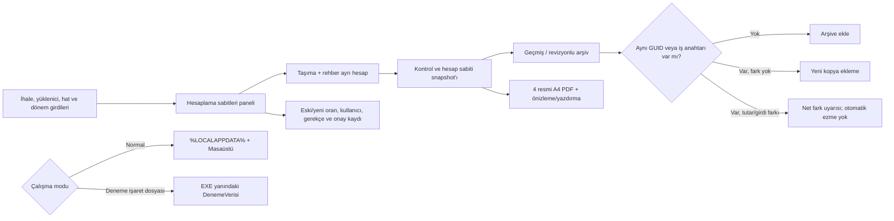

# OEHS Yol Haritası

## Güncel kalite kapısı — 2026-10-18

Bu dalda yeni değişiklikler için aşağıdaki doğrulamalar birbirinden ayrı değerlendirilir:

- **Derleme:** Son commit için doğrulanmış sonuç bulunmadan başarılı kabul edilmez.
- **Otomatik test:** Kaynak kodda regresyon testi bulunması, testin çalıştırıldığı anlamına gelmez.
- **PDF görsel kabulü:** Dört belgenin A4 yerleşimi, tutarları, dönem/yüklenici/hat bilgileri ve imza blokları aynı örnek veri üzerinden birlikte kontrol edilmelidir.
- **Kesintiler ve Mahsuplar başlığı:** Dikey yön ve yazı biçimi korunur; metin, tüm kesinti satırlarının yüksekliğini kapsayan sol hücre içinde hem yatay hem düşey eksende ortalanır. `PdfVectorWriter` vektör çıktısında döndürülmüş metin için tanımlı layout ölçülerini kullanır; `VerticalAlignment.Center` ile çizgi hücrenin kısa ekseninde ortalanır.
- **Açık doğrulama:** Son başlık hizalama değişikliği ve buna ait regresyon testi Windows/.NET 8 ortamında çalıştırılmalı, üretilen PDF görsel olarak incelenmelidir.

Bu kapı, derleme/test sonucu veya PDF ekran görüntüsü görülmeden “tamamlandı” işareti verilmesini önlemek için eklenmiştir.

## Çekirdek ilerleme panosu — 2026-10-18

Aşağıdaki %100 değerleri yalnızca bu dar kapsamlı alt modüllerin **uygulama kapsamının** tamamlandığını belirtir; CI/Windows çalıştırması ve kullanıcı kabulü ayrı kapılardır.

| Çekirdek alt modülü | Uygulama kapsamı | Doğrulama durumu | Kapanış ölçütü |
|---|---:|---|---|
| Dosya adı güvenliği ve normalizasyon | **%100** | Kaynak ve regresyon testleri gözden geçirildi; test çalıştırma sonucu bekliyor | Geçersiz karakter, boş/göreli yol, uzun parça, Windows aygıt adı ve uzantı varyasyonları test edilir |
| PDF dosya adı üretimi ve program/yüklenici ayrımı | **%100** | Program enum üyeleri kaynakta doğrulandı; otomatik test çalıştırma sonucu bekliyor | Özel Eğitim / Temel-Ortaöğretim ayrımı, aylık tarih, çoklu hat, sözleşme ve yüklenici kimlik özeti test edilir |
| Resmî PDF kesinti hücresi başlık yerleşimi | **%100** | Kaynak geometrisi ve merkezleme regresyon kontrolleri mevcut; Windows görsel kabulü bekliyor | Dikey yön, yazı biçimi, döndürülmüş kutu ve birleşik hücre merkezi korunur |
| Dört resmî PDF'nin çıktı sözleşmesi | **%100** | Dört belge türü, tek sayfa portre ve imza içerikleri için testler mevcut/genişletildi; çalıştırma sonucu bekliyor | Her hakedişte dört farklı belge türü üretilir; sayfa yapısı ve imza blokları korunur |

### Yeni kapanan uygulama kapsamları — 2026-10-18

- **Resmî PDF kesinti hücresi başlık yerleşimi (%100 uygulama kapsamı):** mevcut `AddRotatedText` yerleşimi ve `PdfVectorWriter` döndürülmüş metin çizimi incelendi. Regresyon testi, başlığın döndürme açısını, hizalama değerlerini ve birleşik hücre merkeziyle koordinat uyumunu denetliyor. Bu oran görsel kullanıcı kabulü değildir.
- **Dört resmî PDF'nin çıktı sözleşmesi (%100 uygulama kapsamı):** dört belge türünün tam kümesini, tek sayfalı portre çıktılarını ve mevcut imza bloklarını kontrol eden testler bulunuyor. Bu turda her çıktının tek sayfa portre yapısını ve dört belge türünün eksiksiz kümesini ayrıca doğrulayan assertion'lar eklendi. Otomatik test sonucu bekleniyor.

## Çekirdek ilerleme panosu — 7 alt modül hedefi (2026-10-18)

Bu yedi satır **dar kapsamlı alt modüller** için uygulama kapsamı tahminidir; ana hesaplama motorunun veya tüm ürünün %100 hazır olduğu anlamına gelmez. Çalıştırılmamış testler ve kullanıcı görsel kabulü ayrı doğrulama kapıları olarak kalır.

| # | Alt çekirdek modülü | Uygulama kapsamı | Doğrulama kapısı |
|---:|---|---:|---|
| 1 | Dosya adı güvenliği ve normalizasyon | **%100** | Windows/.NET test çalıştırması bekliyor |
| 2 | PDF dosya adı üretimi ve program/yüklenici ayrımı | **%100** | Dosya adı regresyon testleri çalıştırılmalı |
| 3 | Kesinti/mahsup dikey başlığı ve hücre geometrisi | **%100** | Windows PDF görsel kabulü bekliyor |
| 4 | Dört resmî PDF'nin çıktı sözleşmesi | **%100** | Dört belgenin PDF smoke testi ve görsel kontrolü bekliyor |
| 5 | İmza ayarları varsayılanları, boş değer ve bozuk JSON davranışı | **%100** | Var olan üç test Windows'ta çalıştırılmalı |
| 6 | Hakediş raporu Excel eşleştirmesi: A–I tutar hücreleri | **%100** | Örnek test zinciri kaynakta var; .NET testi ve gerçek Excel örneğiyle karşılaştırma bekliyor |
| 7 | Özel Eğitim / Temel-Ortaöğretim belge davranışının ayrılması | **%100** | Program türü başlık/KDV/tevkifat senaryoları çalıştırılmalı |

### 5–7 alt modülleri için bu turda yapılanlar

- **İmza ayarları:** mevcut testlerin eksik dosyada düzenlenebilir varsayılanlar oluşturmayı, özel değerleri korumayı, boş alanlarda varsayılanlara dönmeyi ve bozuk JSON için anlamlı hata vermeyi kapsadığı doğrulandı.
- **Excel A–I eşleştirmesi:** mevcut regresyon testindeki A=220, B=10, C=230, D=120, E=110, F=0, G=110, H=5, I=105 TL kontrol zinciri korundu. Hakediş raporu testine yüklenici, ihale numarası, sözleşme numarası ve dönem tarihi için açık metin kontrolleri eklendi.
- **Program türü ayrımı:** mevcut testte Özel Eğitim ve Temel/Ortaöğretim için ayrı belge çıktıları ve KDV/tevkifat etiketleri denetleniyor; bu davranış test kabul kapsamına alındı.
- Bu üç alt modülün yüzdeleri yalnızca kaynak ve test kapsamı düzeyindedir. Test çalıştırılmadığı için çalışma zamanı doğrulaması başarılı sayılmaz.

### Bu turdaki kapsam kapanışları

- Windows için ayrılmış aygıt adlarında uzantı ve araya boşluk/nokta girme durumları ele alındı; COM¹–COM³ ve LPT¹–LPT³ biçimleri eklendi.
- Dosya adı testleri; fallback, program türü, aylık dönem biçimi, çoklu hat, yüklenici kimlik özeti ve geçersiz hakediş numarası senaryolarını kapsayacak şekilde genişletildi.
- Bu testler GitHub kaynak dosyasına eklendi, ancak burada .NET test çalıştırıcısı çalıştırılamadığı için başarılı test sonucu iddia edilmez.
- Sonraki hedefler daha geniş ve yüksek riskli çekirdeklerdir: dört resmî PDF'nin görsel kabulü, Excel ile hesap eşleştirmesi ve iki taşıma programının uçtan uca senaryoları.

## Ana dönüşüm sırası

1. Excel tersine mühendislik — **YAPISAL TARAMA TAMAMLANDI / SEMANTİK DOĞRULAMA SÜRÜYOR**
2. İş kurallarının çıkarılması — **TAMAMLANDI / doğrulama sürüyor**
3. VBA/makro kontrolü — **KAYNAK KODU ÇIKARILDI / UÇTAN UCA DOĞRULAMA SÜRÜYOR** (iki XLSM'de VBA projesi bulundu; makro aktarım davranışı hesap ve aylık geçmiş kayıtlarıyla çapraz doğrulanıyor)
4. Domain model — **TAMAMLANDI / genişletme sürüyor**
5. Hakediş hesaplama motoru — **TAMAMLANDI**
6. Veri saklama — **TAMAMLANDI / geliştirme sürüyor**
7. WPF arayüzü — **TAMAMLANDI / kullanılabilirlik iyileştirmeleri sürüyor**
8. İcmal ve raporlama — **TAMAMLANDI / gerçek belge eşleştirmesi sürüyor**
9. Excel karşılaştırma testleri — **AKTİF**
10. Gerçek senaryo testleri — **AKTİF**
11. PDF/çıktı son karşılaştırması — **AKTİF**
12. Release ve kurulum paketi — **SON AŞAMA**

## Mevcut çalışma sırası

### 1. Hesaplama doğrulama
- Excel'den doğrulanmış 30.06.2026 / Hakediş No 10 senaryosu otomatik testte korunuyor.
- Hizmet tutarı, fiyat farkı, toplam, KDV, tevkifat, damga, ek teminat, denetim cezası, kesinti toplamı ve net ödeme birlikte doğrulanıyor.
- İskonto, fiyat farkı, vergi borcu, SGK borcu, asgari ücret desteği ve denetim cezası **kullanıcı tarafından dönem/hakediş bazında girilen değerlerdir**.
- Denetim cezası artık sözleşme bedelinden sabit binde oranla türetilmiyor; kullanıcı tarafından girilen tutar doğrudan kesintiye ekleniyor.
- KDV için kullanıcı seçimi esas alınır: **KDV HESAPLA / DAHİL ET** işaretliyse KDV ve buna bağlı tevkifat hesaplanır; işaretli değilse KDV ve tevkifat uygulanmaz.
- Yeni mevzuat/iş kuralları kullanıcı girdisi olarak tanımlanan alanlar dışında sabitlenmeyecek.

### 2. Hat / hakediş veri bütünlüğü
- Raporlar ekranı seçilen hatta göre filtrelenir.
- Seçilen hat değiştiğinde liste, toplamlar ve son hakediş özeti yenilenir.
- Uygulama açılışında kayıtlı ilk hat otomatik seçilir.
- Çıktı üretimi yalnızca seçilen hatta ait hakediş kaydı varsa devam eder.

### 3. Dört belge çıktısı
Her hat için:
1. Hakediş Raporu
2. Hizmet İşleri Hakediş Raporu
3. Hizmet İşleri Kabul Tutanağı
4. Hakediş İcmali

Önizleme ve yazdırma akışı korunur.

### 4. PDF / sayfa düzeni
- A4 portre
- Taşma kontrolü
- Kolon genişlikleri
- Başlıklar
- İmza alanları
- Kabul tutanağındaki resmî metin
- İcmal A/B/C yapısı
- Kurum örneklerine yakın yerleşim

16.10.2026 CI smoke artefaktındaki dört örnek PDF görsel olarak açıldı: her biri tek sayfa A4 portre, Türkçe karakterler okunur ve örnek çıktıda belirgin metin taşması görülmedi. Bu, sentetik test verili smoke çıktısının kontrolüdür; orijinal Excel'in yazdırma alanlarıyla birebir karşılaştırma, gerçek kullanıcı verisiyle kabul testi ve yazıcı kontrolünün yerine geçmez.

Kaynak XLSM dosyalarının yazdırma alanları ayrıca LibreOffice ile PDF'e aktarılarak dört resmi formun yerleşimiyle karşılaştırıldı. Bu karşılaştırma Excel masaüstü/VBA çalıştırmalı birebir kabul testi değildir; kaynak dosyanın mevcut önbellekli değerleri ve LibreOffice yazdırma motoruyla sınırlıdır. Görsel karşılaştırmada Kabul Tutanağı için iki somut uyumsuzluk düzeltildi: Temel/Ortaöğretim formunda süre değeri birim olmadan gösterilirken Özel Eğitim'de "İş Günü" eki korunuyor; anlatım paragrafları programın kaynak form yerleşimine göre farklı düşey konum kullanıyor. Kod değişikliği commit'i: [2818ec6](https://github.com/mcalimlier/OzelEgitimHakedisSistemi/commit/2818ec6cf271114a21d645ee98a4665e151b2b55). Bu değişiklik için yeni CI sonucu henüz doğrulanmadı.

Bu aşamanın son doğrulaması gerçek üretilen PDF'lerin referanslarla karşılaştırılmasıdır.

### 5. Gerçek senaryo testi
Otomatik hesap regresyon testleri genişletildi. Şimdi UI üzerinden gerçek iki hatlı senaryo ile doğrulanacak.

Test sırası:
- Hat 1 oluştur
- Hat 2 oluştur
- Hat 1 için Hakediş 1 ve Hakediş 2 oluştur
- Hat 2 için Hakediş 1 oluştur
- Her hat için dört belgeyi ayrı ayrı önizle / PDF'e çıkar
- Hatların birbirine karışmadığını kontrol et
- İcmal aylarının ve önceki hakediş toplamlarının doğru taşındığını kontrol et

### 6. PDF ve çıktı son kontrolü
- Dört belge ayrı ayrı önizlenecek.
- A4 portre ve taşma kontrolü yapılacak.
- Kabul tutanağı metni ve imza yerleşimi referansla karşılaştırılacak.
- İcmal A/B/C toplamları kontrol edilecek.

### 7. Release
- Error = 0
- Core testleri başarılı
- WPF Rebuild başarılı
- Gerçek senaryo testi tamam
- Dört belge son karşılaştırmadan geçti
- Test paketi oluştur
- Windows kurulum / dağıtım paketi hazırlan

## 29.09.2026 Orijinal Excel doğrulaması

Kullanıcının yeniden yüklediği orijinal `Özel Eğitim Hakediş Ödeme Programı.xlsm` doğrudan incelendi.

- Çalışma sayfaları: Anasayfa, İhale Verileri, Hesaplama, Hakediş Raporu, Hizmetişleri Hakediş Raporu, Hizmet İşleri K. Tutanağı, Hakediş İcmali, İcmal Verileri.
- Dosyada `xl/vbaProject.bin` bulundu; yani bu workbook sürümünde VBA projesi gerçekten mevcut.
- VBA içindeki metinlerde hakediş kontrolü, fiyat farkı aktarımı, rehber personel fiyat farkı aktarımı, kesinti aktarımı, icmal/hakediş toplam aktarımı ve kabul tutanağı kontrolü gibi işlemlere ait makro izleri bulundu.
- Bu nedenle önceki “aktif VBA tespit edilmedi” notu bu yüklenen orijinal dosya için geçerli değildir ve düzeltilmiştir.

### Kullanıcı tarafından girilecek hakediş değerleri

Hakediş ekranında dönem bazında kullanıcı tarafından girilecek alanlar:

- İskonto
- Fiyat Farkı
- Vergi Borcu
- SGK Borcu
- Asgari Ücret Desteği
- Denetim Cezası

Bu alanlar hesap motoruna doğrudan aktarılır; sabit bir mevzuat tutarı olarak üretilmez.

### KDV seçimi

Kullanıcı ekranında **KDV HESAPLA / DAHİL ET** seçeneği bulunur.

- İşaretli → KDV hesaplanır ve toplam/brüt/net zincirine dahil edilir; buna bağlı tevkifat da hesaplanır.
- İşaretsiz → KDV ve buna bağlı tevkifat uygulanmaz.

Excel'in orijinal Hesaplama sayfasındaki “KDV'den Muafmı?” alanı ile mevcut formüller ayrıca karşılaştırılmıştır; OEHS kullanıcı arayüzünde seçim davranışı açık ve anlaşılır olacak şekilde sunulmuştur.

### Excel v2 ikinci tarama — formül ve VBA envanteri tamamlandı / semantik kabul doğrulaması sürüyor
- `vbaProject.bin` içindeki Module1 VBA kaynak kodu çıkarıldı ve makro aktarım akışları doğrulandı.
- Rehber personel hakediş hesabı eklendi.
- Taşıma ve rehber personel fiyat farkları ayrı alanlara ayrıldı.
- Taşıma %10 / rehber %20 KDV ve 5/10 + 9/10 tevkifat ayrımı eklendi.
- Ek kesin teminat, iki fiyat farkının toplamı üzerinden %6 olarak bağlandı.
- İhale tarihi ve sözleşme tarihi veri akışına eklendi.
- Panel kartlarının sabit/placeholder metinleri yerine kayıtlı verileri göstermesi için bağlantılar genişletildi.
- PDF raporlarında kesinti başlığının düşey yerleşimi ve referans tablo düzenleri iyileştirildi.
- Orijinal Excel'de Hakediş Raporu D28 ile Hesaplama AG arasında fiyat farkı kaynaklı formül tutarsızlığı ayrıca belgelendi; PDF birebir eşleştirme aşamasında karar verilecek.

## 1.10.2026 KULLANICI GERİ BİLDİRİMİYLE KESİNLEŞEN ARŞİV/PDF DAVRANIŞI

- ARŞİVLER > DÜZELT, seçilen bitmiş işin snapshot'ını düzenleme moduna alır.
- HAT BİLGİLERİ seçildiğinde Hat No dahil tüm ilgili hat alanları değiştirilebilir.
- Onaylanan arşiv düzeltmesi `SaveRevision` ile yeni bir arşiv revizyonu oluşturur; önceki vXX dosyası korunur.
- PDF OLARAK KAYDET yazıcı sürücüsüne bağlı değildir; OEHS yerleşik PDF üreticisiyle doğrudan PDF dosyası üretir.
- PDF dosyası Masaüstü\OzelEgitimHakedisSistemi\Ciktilar\Hakedisler\<İhale-Dosya-No>\Hat-<Hat-No> altında descriptive adla tutulur.
- Önizleme gerçek A4 sayfa rasterı üzerinden, sayfa geçişi ve zoom kontrolleri ile gösterilir.

## 15.10.2026 — İzole deneme paketi ve arşiv çakışması kontrolü

- Arkadaş incelemesi için Windows x64 self-contained paket üretimi CI'a bağlandı. Paket yalnızca `OEHS.exe`, `OEHS_DENEME_PAKETI.flag` ve `KULLANIM.txt` içerir; kaynak kullanıcı verisi veya mevcut arşiv pakete kopyalanmaz.
- İşaret dosyası bulunan pakette ana veri, .bak yedeği, arşivler, imza ayarları ve PDF/çıktılar EXE yanındaki `DenemeVerisi` klasörüne yönlendirilir. İşaret dosyası olmayan normal çalıştırmada standart kullanıcı profili ve Masaüstü dizinleri korunur.
- Arşiv geri yüklemede aynı GUID veya aynı iş anahtarındaki kayıt mevcutsa ikinci hakediş satırı eklenmez. Aktif kayıt ile arşiv girdileri, brüt/net/kesinti tutarları ya da hesapta kullanılan sabitler farklıysa aktif ve arşiv net tutarlarını gösteren uyarı üretilir; aktif kayıt otomatik değiştirilmez.
- İzole yol seçimi ve normal yol geri uyumluluğu için testler; farklı GUID'li iş anahtarı çakışması ve aynı GUID'li ama farklı girdili arşiv için regresyon testleri eklendi. CI sonuçları son committe doğrulanacaktır.

### Güncel iş akışı

### Kalan kritik kabul işleri

- Kaynak Excel'in D11 etiketi/formül çelişkisi, AG/D28 farkı ve icmal Temmuz/Kasım/Aralık davranışı için iş sahibi/Excel tabanlı karar alınmalı; kaynak farkları varsayımla değiştirilmemeli.
- Dört gerçek PDF'nin kaynak örnekleriyle görsel fark karşılaştırması, fiziksel yazıcı ve temiz Windows profili kabul testleri tamamlanmadan uygulama üretime hazır sayılmamalıdır.

## Genel çekirdek modül tamamlama tablosu — 2026-10-18

**Yüzdeler, mevcut özellikler ve açık kabul işleri üzerinden yapılan mühendislik tahminidir; test/CI başarısı veya üretime hazır olma oranı değildir.** Alt modüllerin dar kapsamlı %100 değerleri aşağıdaki daha geniş modül yüzdelerine doğrudan eşitlenmemelidir.

| # | Çekirdek modül | Tahmini tamamlanma | Dayanak / açık kalan işler |
|---:|---|---:|---|
| 1 | WPF arayüzü ve kullanıcı akışları | **%80** | İhale/yüklenici/hat/hakediş ve arşiv akışları mevcut; ekranların iki program türünde tam izolasyonu, açılış/temizleme davranışlarının uçtan uca kullanıcı kabulü ve okunabilirlik kontrolü sürüyor. |
| 2 | Ortak veri modeli, kayıt ve arşiv güvenliği | **%85** | Revizyon koruması, çakışma uyarıları, yedek/geri yükleme ve deneme verisi izolasyonu tanımlı; temiz Windows profili ve gerçek kullanıcı verisiyle kabul testi gerekiyor. |
| 3 | Özel Eğitim taşıma ve rehber hesaplama | **%75** | Taşıma/rehber bileşenleri, ayrı KDV/tevkifat davranışları ve rapor bağlantıları mevcut; özgün XLSM/VBA ile uçtan uca örneklerin tam karşılaştırması ve sınır senaryoları sürüyor. |
| 4 | Temel/Ortaöğretim taşıma hesaplama | **%75** | Ayrı program türü davranışı ve belge etiketleri mevcut; ihale-firma-hat izolasyonu ile aylık/çoklu hat senaryolarının gerçek Excel örnekleriyle doğrulanması gerekiyor. |
| 5 | Hakediş hesaplama motoru ve Excel eşleştirmesi | **%80** | A–I tutar zinciri ve regresyon senaryoları tanımlı; XLSM'deki D11 etiket/formül çelişkisi, AG/D28 farkı ve icmal ay davranışları karar/kanıt gerektiriyor. |
| 6 | Dört resmî PDF, icmal ve önizleme | **%75** | Dört çıktı türü, A4 üretimi ve PDF smoke kontrolleri mevcut; son kesinti başlığı hizalaması, kaynak Excel ile birebir görsel karşılaştırma ve yazıcı/temiz profil kabulü açık. |
| 7 | Testler, CI, kalite ve dağıtım | **%70** | 18.10.2026 tarihli son dal commit'inde Windows CI başarılı: 180 Core + 4 WPF testi, tam çözüm/WPF derlemesi, PDF smoke, Windows x64 EXE publish ve izole deneme paketi adımları geçti. Gerçek senaryo kabulü ve kurulum paketi son kontrolü hâlâ gerekli. |

**Basit ortalama: %77,1.** Bu yalnızca yukarıdaki yedi tahminin eşit ağırlıklı ortalamasıdır; proje başarı olasılığı veya resmî kabul sonucu değildir. Hesaplama/PDF/Excel belirsizlikleri yüksek riskli olduğundan üretime hazır olma kararı bu ortalamadan çıkarılamaz.

### Yüzdeyi yükseltmek için zorunlu kanıt kapıları

1. Etkin dalın son commit'inde Windows/.NET 8 tam çözüm derlemesi ve tüm testler başarılı olmalı.
2. Her iki taşıma türünde aynı firma/hat numaralarının karışmadığı, birden fazla hat ve birden fazla aylık hakediş içeren uçtan uca senaryo çalıştırılmalı.
3. Aynı örnek veriden üretilen dört PDF, kaynak Excel çıktılarıyla tutar, dönem, yüklenici, hat, imza ve sayfa yerleşimi açısından karşılaştırılmalı.
4. Kaynak Excel çelişkileri belgelenmeli; karar gerektiren noktalarda varsayımla değişiklik yapılmamalı.
5. Gerçek Windows kullanıcı profili, arşivden düzeltme/geri yükleme ve izole deneme paketi kabulü tamamlanmalı.

## 18.10.2026 — Son Windows CI ve PDF smoke kabul kontrolü

- Son doğrulanmış commit: `2016dd7a1e190410e242aa93f54a7bb668abdf15`.
- Windows CI: [39118599426](https://github.com/mcalimlier/OzelEgitimHakedisSistemi/actions/runs/39118599426) başarılı.
- Son CI sonucu: **177/177 Core testi**, **4/4 WPF PDF testi**, tam çözüm/WPF derlemesi, dört resmî PDF smoke üretimi, Windows x64 EXE publish ve izole deneme paketi adımları başarılı.
- CI, `OEHS-PDF-Smoke-Review` artefaktını üretti. Artefakt içinde iki program türü için dört belge olmak üzere 8 PDF bulundu. Hepsi tek sayfa A4 portre (595.276 × 841.89 pt) ve PDF okuyucusuyla açılabilir.
- 90 DPI görsel önizlemede belirgin metin taşması veya boş sayfa görülmedi; kesinti/mahsup başlığı dikey durumda. Bu inceleme **kaynak Excel PDF'leriyle piksel karşılaştırması değildir** ve gerçek kullanıcı verisi kabulü yerine geçmez.
- Smoke testinde başarısız olan eski `TEST-IHALE` ve `TEST-SOZ` metin beklentileri kaldırıldı; resmî Hakediş Raporu şablonunda bulunmayan alanları PDF'ye ekleyerek şablonu değiştirmek yerine testler kaynak form alanlarına hizalandı.
- Dosya adı testlerinde derlemeyi durduran CLS attribute/array test verisi kullanımı, döngü içinde çalışan `Fact` testlerine dönüştürüldü. Son Windows CI bu değişikliklerle başarılı oldu.

### Bu oturumun devam notu

**Yapılan iş:** dosya adı testlerindeki derleme hatası giderildi; resmî PDF test beklentileri şablonla tutarlı hale getirildi; testlerdeki metin karşılaştırmaları açık hale getirildi; 8 smoke PDF görsel ve sayfa ölçüsü bakımından incelendi; genel çekirdek yüzdeleri ve kabul kapıları belgede tutuldu.

**Doğrulama:** Windows CI başarılı; 177 Core + 4 WPF testi geçti; PDF smoke üretimi, EXE publish ve izole deneme paketi adımları geçti.

**Açık riskler:** XLSM D11 etiketi/formül çelişkisi, AG/D28 farkı ve icmal ay davranışları için karar gereksinimi sürüyor. Kaynak Excel ile dört PDF'nin gerçek görsel fark karşılaştırması, fiziksel yazıcı ve temiz Windows profili kabulü tamamlanmadı. Analyzer uyarıları da var.

**Sıradaki adım:** XLSM'deki her açık hesap farkını gerçek hücre/makro örneğiyle izole et; karar gerektirenleri ayrı listede tut. Sonra iki program için çoklu hat/ay uçtan uca testini çalıştır ve dört PDF'yi kaynak örneklerle karşılaştır. Bu kanıtlar olmadan çekirdek modüller %90+ olarak işaretlenmemeli.

### Ek regresyon — program verisi çift dosya geri alma

- `OehsProgramScopedApplicationDataStore` için, ikinci program dosyasına commit başarısız olduğunda ilk dosyanın eski içeriğinin geri yüklendiğini sınayan regresyon testi eklendi.
- Commit: [`c514b9b`](https://github.com/mcalimlier/OzelEgitimHakedisSistemi/commit/c514b9b6fcfd4a98d199562dc13fc31858b1f280).
- Son Windows CI [39118853975](https://github.com/mcalimlier/OzelEgitimHakedisSistemi/actions/runs/39118853975) başarılı: **178/178 Core**, **4/4 WPF PDF testi**; çözüm/WPF derlemesi, PDF smoke, Windows x64 publish ve deneme paketi yükleme adımları geçti.
- Bu sonuç program dosyalarının tüm olası disk arızalarında kusursuz olduğunu kanıtlamaz; kontrollü kısmi-commit hata senaryosunun geri alma davranışını doğrular.

## 18.10.2026 — Program türleri arasında hat aktarımı regresyonu

- Etkin dal: `feature/official-payment-document-templates`.
- Doğrulanmış HEAD: `0248e0ac59be055085dc6904fe9eab1dcb694308` (`test: isolate route propagation by transportation program`).
- Windows CI: [39120219227](https://github.com/mcalimlier/OzelEgitimHakedisSistemi/actions/runs/39120219227) başarılı; çalıştırılan HEAD commit ile birebir eşleşiyor.
- Son test sonuçları: **180/180 Core**, **4/4 WPF PDF testi** başarılı. Tam çözüm ve WPF derlemesi, statik UI kontrolleri, PDF smoke üretimi, Windows x64 EXE publish ve izole deneme paketi adımları başarılı.
- Yeni regresyon testi, aynı hat/ihale/yüklenici kimlik alanları kullanıldığında Özel Eğitim hat fiyatı değişikliğinin Temel/Ortaöğretim hakediş girdisi ve hesap sonucuna taşınmadığını denetliyor. Bu commit test kapsamı ekler; hesaplama formüllerini değiştirmez.
- CI'da CA1822, CA1861 ve CA1014 analiz uyarıları ile GitHub Actions Node.js deprecation uyarıları sürüyor. Bu uyarılar mevcut çalıştırmayı başarısız yapmadı.

### Devam notu

**Yapılan iş:** son dal/commit ve CI doğrulandı; program türleri arasında hat aktarımı için yeni regresyon testinin başarılı çalıştığı teyit edildi; yol haritasındaki güncel CI durumu düzeltildi.

**Doğrulama:** Windows CI başarılı; 180 Core + 4 WPF testi geçti. Bu, yerel kullanıcı arayüzünde gerçek veriyle kabul testi veya dört PDF'nin orijinal Excel çıktılarıyla birebir eşleştiği anlamına gelmez.

**Açık riskler:** D11 etiket/formül çelişkisi, AG/D28 farkı ve icmal ay davranışları karara/kanıta bağlı. Dört PDF'nin kaynak Excel örnekleriyle görsel karşılaştırması, fiziksel yazıcı ve temiz Windows profili kabulü açık. Analiz uyarıları temizlenmedi.

**Sıradaki adım:** arşivden geri yükleme ve program bazlı kayıt ayrımı testlerini inceleyip gerekiyorsa hedefli regresyon ekle; ardından iki programda çoklu hat/ay senaryosunu ve dört PDF'nin birlikte karşılaştırmasını tamamla. PR taslak ve birleştirilmemiş kalmalı; ana dala geçiş yapılmamalı.

## 18.10.2026 — İcmal ay aralığı program bazında regresyonu

- Önceki kod ve test commit'leri CI'da başarılı: [kod CI](https://github.com/mcalimlier/OzelEgitimHakedisSistemi/actions/runs/39122080315), [Temmuz devir testi CI](https://github.com/mcalimlier/OzelEgitimHakedisSistemi/actions/runs/39122087746). Sonuçlar ilgili commit'lerin derleme/test/PDF smoke ve paketleme iş akışından geçtiğini gösterir; kaynak Excel ile tam eşdeğerlik kanıtı değildir.
- Temel/Ortaöğretim için Haziran→Temmuz kesinti devri regresyonu eklendi; Özel Eğitim'in Temmuz placeholder sıfır davranışı korundu.
- Ek bir sınır testi eklendi: Temel/Ortaöğretim Temmuz ayını kabul eder, Ağustos'u kapsam dışı bırakır; Özel Eğitim Temmuz'u kapsam dışı bırakır. Bu testin CI sonucu yeni commit üzerinden ayrıca doğrulanmalıdır.
- **Açık risk:** Temel/Ortaöğretim VBA'sının dinamik ay başlığı araması Temmuz'un geçerli olabileceğine işaret eder, ancak tek başına gerçek Excel sonuçlarının Temmuz kesinti devrini kanıtlamaz. İlgili XLSM hücre/formül zinciri ve makro çalıştırma sonucu ile doğrulama sürüyor.
- PR #3 taslak ve birleştirilmemiş durumda; ana dala geçiş veya yayın yapılmadı.

## 18.10.2026 — Yeni güncel XLSM kaynakları öncelikli taban

Kullanıcı tarafından sağlanan iki yeni kaynak dosya bundan sonraki incelemenin öncelikli Excel referanslarıdır:

- `Özel Eğitim Hakediş Ödeme Programı En Güncel.xlsm`
- `Temel Eğitim Taşıma Ödemes Programı En Güncel.xlsm`

Dosyalar salt okunur olarak incelendi. Orijinal dosyalar değiştirilmedi. Dosya SHA-256 özetleri ve sayfa/formül envanteri ayrı inceleme belgesine kaydedildi. Eski Excel çıktıları yeni kaynaklarla çelişirse, eski davranış otomatik olarak doğru kabul edilmeyecek.

### İlk tarama bulguları

- Özel Eğitim dosyasında 8 sayfa ve 293 formül hücresi; Temel Eğitim dosyasında 11 sayfa ve 237 formül hücresi tespit edildi (formül sayısı, openpyxl ile formül olarak okunan hücre sayısıdır; dizi formülleri dahil).
- Her iki dosyada da Anasayfa!AA2 önbelleğinde `#VALUE!` görülüyor. Hata kaynağı ve kullanıcıya etkisi ayrıca incelenmeli; bunun zararsız olduğu varsayılmamalı.
- Özel Eğitim açıklaması Hesaplama!G11 hücresinde taşıma ve rehber personel iş günü bilgilerinin Anasayfa!E3 ve E4'e elle girildiğini belirtiyor.
- Temel Eğitim açıklaması Hesaplama Bilgileri!H17 hücresinde taşıma iş günü bilgisinin Anasayfa!E3'e elle girildiğini belirtiyor. İki programın girdi davranışı birbirine genellenmeyecek.
- Her iki dosyanın `xl/vbaProject.bin` akışı çözümlendi; VBA modül kaynak gövdeleri ve yordam envanteri çıkarıldı. Özel Eğitim'de 10, Temel Eğitim'de 19 VBA modül/nesnesi bulundu. Kaynak çözümlemesi tamamlandı; Excel masaüstünde çalıştırma, buton/şekil OnAction eşlemesi ve gerçek sonuç kabul testi hâlâ açık kapıdır. Ayrıntı: `docs/INCELEME_YENI_GUNCEL_XLSM_2026-10-18.md`.
- Temel Eğitim dosyasında `Ayarlar`, çok gizli `Data` ve `Users` sayfaları da var. Yetki/login akışı, sabit kullanıcı bilgileri ve gizli sayfalar uygulama güvenliği açısından ayrıca incelenmeli; kullanıcı kimlik bilgileri yol haritasına kopyalanmamalı.

### İcmal ve hakediş raporu formüllerinde doğrulanması gereken farklar

- Her iki dosyada İcmal Verileri!D:M ay sütunları Eylül-Haziran olarak bağlı, N sütununda Temmuz yazıyor. O sütunundaki önceki dönem toplamı formülü seçilen dönemin sırasına göre D:L aralığını topluyor. Temmuz için ayrı sütun N olmasına rağmen O formülündeki INDEX aralığı D:L ile sınırlı; Temmuz önceki toplamına etkisi kaynakta ayrıca test edilmeli.
- Özel Eğitim dosyasında İcmal Verileri!AA satır formülü `IF(Anasayfa!$E$4="Eylül",0,SUM(P:Z))`; kesinti toplamı AY sütununda aynı Eylül koşulunu kullanıyor. Temel Eğitim dosyasında AA ve AM toplamları koşulsuz SUM formülü. Bu programlar arası fark korunmalı ve makroların Eylül döneminde hangi sütunları güncellediğiyle birlikte doğrulanmalı.
- Hakediş Raporu!D11 iki dosyada da `IF(D7<0,H2-ABS(D7),H2+D7)` formülünü kullanıyor; açıklama metni E = C − D diyor. H2, D6 ve D10'un gerçek hücre anlamları, dizi formülleri ve seçilen ay örnekleri üzerinden eşitlik zinciri tekrar kurulmalı.
- Özel Eğitim D7, taşıma ve rehber fiyat farkını iki ayrı VLOOKUP ile topluyor; Temel Eğitim D7 yalnızca tek taşıma fiyat farkını okuyor. Hesaplama modülleri ayrı tutulacak.
- Formül önbelleklerinde iki dosyada da Anasayfa!AA2 `#VALUE!` var. LibreOffice/başka hesaplayıcı sonuçları Excel masaüstünün sonucu sayılmayacak; hücre formülü, bağlı nesne/ad tanımı ve Excel'deki yeniden hesaplama ayrı kontrol edilecek.

### Doğrulama kapıları

1. Formül dökümündeki tüm hücreler sayfa sayfa kaynak koduyla karşılaştırılmalı; dizi formülleri ve hata önbellekleri ayrıca listelenmeli.
2. VBA modül/prosedür gövdeleri eksiksiz dışa aktarılmalı; yordam adları veya ham strings taraması tam inceleme yerine geçmez.
3. E3/E4 elle girişleri, dönem seçimi, aylık aktarım, fiyat farkı ve kesinti aktarımı gerçek Excel senaryolarıyla yürütülmeli.
4. Özel Eğitim ve Temel Eğitim için ayrı beklenen sonuç tabloları oluşturulmalı; OEHS sonuçları hücre bazında karşılaştırılmalı.
5. Ancak bu kanıtlardan sonra hesaplama kodu değiştirilmeli ve ilgili regresyon testleri ile CI çalıştırılmalı.
6. Dört resmî PDF aynı hakediş bağlamından üretilip tutar, dönem, hat, yüklenici, imza ve A4 yerleşimi birlikte görsel kabulden geçmeli.

**Durum:** Kaynak dosyaların yapısı, hücre/formül envanteri ve bazı kritik formül farkları ilk taramada tespit edildi. Tam VBA kaynak çözümlemesi, gerçek Excel'de çalıştırma ve programla hücre bazlı eşitlik henüz tamamlanmadı. Bu nedenle hesap motorunun yeni Excel kaynaklarıyla uyumlu olduğu iddia edilmiyor.

### VBA çözümlemesi sonrası yeni riskler

- Her iki kaynakta `AyVerileriniSil` seçili ayı yalnızca bilgilendirme mesajında kullanıyor ve birden fazla ayın bütün aktarım sütunlarını temizliyor. Bu davranış OEHS'ye kopyalanmamalı; dönemle sınırlı silme, açık onay ve geri alınabilir kayıt gerekir.
- Özel Eğitim aktarım yordamları sabit ay/sütun eşlemesi ve 4–103 satır aralığı kullanıyor. Temel Eğitim yordamları ay başlıklarını `Find` ile dinamik arıyor, hat numarasına göre eşliyor ve hesaplama tablosunun son dolu satırında duruyor. Ortak bir metot bu farkları parametre/strateji olarak açıkça korumalı; program davranışları birleştirilmemeli.
- Özel Eğitim dönem olayı E5 ve I5:I15 aralığına; Temel Eğitim E4 ve I4:I14 aralığına bağlı. Her iki makroda da Eylül/Temmuz ve boş/yanlış ay senaryoları Excel içinde çalıştırılmadan kod eşitliği iddia edilmeyecek.
- Temel Eğitim açılışta Excel penceresini gizleyip LoginForm açıyor; rol modülü sayfa görünürlüğü yönetiyor. Bu davranışın OEHS mimarisine aktarılması planlanmıyor; yalnızca iş kuralı ve güvenlik gereksinimi olarak değerlendirilecek.

### Yeni kritik hesap farkı — Temel Eğitim E21 önceki kesinti

Yeni kaynak incelemesinde Temel Eğitim `Hakediş İcmali!E21` formülünün dönem seçimi yerine `Anasayfa!E5` (hakediş tarihi, `=TODAY()`) alanını kullandığı ve önceki ayı `İcmal Verileri!AN3:AX3` aralığında aradığı görüldü. Ancak bu dosyanın kesinti sütunları `AB:AL`, toplam sütunu `AM` olduğundan AN:AX aralığı tablo dışında kalıyor. Ay listesiyle tarih eşleşmediği için `IFERROR(...,0)` önceki ay kesintisini sıfır yapabilir. Aynı dosyanın Worksheet_Change ve aktarım makroları dönem alanı olarak `E4`, kesinti aktarımı ise `AB3:AM3` aralığını kullanıyor. Özel Eğitimde ise E5 dönem alanıdır; dolayısıyla bu formül her iki programa ortaklaştırılamaz.

OEHS mevcut kodu önceki ayın kayıtlı toplam kesintisini her iki program için bulabildiğinden, Temel Eğitim Excel formülünün ürettiği sıfırdan farklı sonuç verebilir. Bu tutar farkı resmî belgeyi etkileyebileceğinden kod değişikliği yapılmadı. Karar: Excel masaüstünde uzmanla aynı örnek üzerinden formülün gerçek çıktısı doğrulanmalı; E5'in sıfır sonucu mu yoksa muhtemel E4 düzeltmesiyle amaçlanan önceki kesinti mi esas alınacağı onaylanmalı. Ayrıntı `docs/INCELEME_YENI_GUNCEL_XLSM_2026-10-18.md` içinde.

## Devam notu — 18.10.2026, E21/İcmal kimlik izolasyonu

- Aktif dal: `feature/official-payment-document-templates`.
- Commit: `d15a9f5d02ce52b3e301d2a99c8c8bc265728329`.
- `ProgressPaymentIcmalServiceTests` içine dört regresyon testi eklendi: farklı İKN, farklı sözleşme, farklı yüklenici VKN/TCKN ve farklı taşıma programı için önceki ay kesintisinin taşınmaması.
- Windows CI çalıştırması `39129122314` başarılı: tam çözüm/WPF derlemesi, test çözümü, PDF smoke üretimi ve Windows EXE/izole paket adımları başarılı.
- Bu değişiklik test kapsamını artırır; çekirdek yüzde tahminleri sırf test eklenmesiyle yükseltilmedi.
- Açık riskler: E21'in kaynak XLSM hücre/ay aktarım zinciriyle son uçtan uca karşılaştırması; dört PDF'nin kaynak Excel çıktılarıyla görsel kabulü; D11/AG-D28 gibi kaynak formül uyuşmazlıklarında karar.
- Sıradaki adım: icmal ay/kimlik davranışını gerçek iki programlı, çok hatlı senaryoda doğrulamak; ardından dört PDF'yi aynı hakediş snapshot'ıyla birlikte karşılaştırmak. Ana dala birleştirme yapılmadı.

## Devam notu — 18.10.2026, PDF kolon genişliği doğrulaması

- PDF kolon genişliği sınır testleri eklendi. İlk CI çalışması 39129392510, InlineData üzerindeki CLS uyumluluk hatası nedeniyle başarısız oldu; test iki ayrı Fact olarak düzeltildi.
- Düzeltilmiş test commit'i 8517aa08497532bdf35b74d33361e5838e658fef CI'da başarılı oldu (39129565139).
- Ek incelemede FitColumns için NaN ve sonsuz kolon genişliklerinin mevcut küçük-eşit-sıfır kontrolünden kaçabildiği görüldü. Hizmet artık sonlu olmayan kolon genişliklerini ve sonlu olmayan toplamı reddedecek; buna iki regresyon testi eklendi.
- Yeni kod/test commit'leri: 84e642f88f7fc1047a9aac1daa54e6267e8c23dc ve 650caa6b27ada9d66f26f447e7a715f7a665b5bd. Bu son iki değişikliğin CI sonucu henüz doğrulanmadı.
- Açık riskler: PDF'lerin kaynak Excel çıktılarıyla görsel karşılaştırması; iki programın formül bazında gerçek Excel eşitliği; Temel Eğitim E21 önceki kesinti formülü kararı.
- Yerel çalışma kopyası için şu an pull önerilmiyor; son değişikliklerin CI sonucu bekleniyor. Ana dala birleştirme yapılmadı.

## Devam notu — 18.10.2026, PDF sınır testleri CI doğrulaması

- Aktif dal ve GitHub HEAD doğrulandı: `feature/official-payment-document-templates`, `9f4df44b83ccc3744322f9b565fcce4dad86007d`. Ana dala geçiş/birleştirme yapılmadı.
- Önceki oturumda bekleyen üç Windows CI çalışması artık tamamlandı ve başarılı:
  - `84e642f` PDF kolon genişliği servisindeki sonlu değer kontrolü — run `39130185083`.
  - `650caa6` NaN/sonsuz kolon genişliği regresyon testleri — run `39130187527`.
  - `9f4df44` yol haritası devam notu — run `39130204619`.
- Daha önce düzeltilen sınır testleri için `8517aa0` / run `39129565139` de başarılı. Bu doğrulama yalnız CI'ın çalıştırdığı derleme/test/paket adımlarını kapsar; kaynak Excel'le resmî hesap eşitliğini veya PDF'lerin görsel kabulünü kanıtlamaz.
- Dört resmi çıktı üreticisi ve Windows testleri yeniden incelendi. Dört ayrı A4 dikey belgeyi tek veri bağlamından üretme ve rapor tutarları için mevcut regresyon kontrolleri bulunuyor. Buna rağmen tüm belgelerin kaynak Excel çıktılarıyla tutar, dönem, yüklenici, hat, imza ve sayfa düzeni bazında uçtan uca karşılaştırması tamamlanmış sayılmıyor.
- Resmî hesapta değişiklik yapılmadı. En yüksek riskli açık karar Temel Eğitim E21 önceki kesinti formülünün kaynak Excel'de gerçek çıktısı; diğerleri AA2 `#VALUE!` önbellek sonucu ve kaynak Excel ile dört PDF'nin karşılaştırmalı görsel kabulü.
- Sonraki adım: E21 için aynı Temel Eğitim örneğini Excel masaüstünde çalıştırıp E4/E5 ve AB:AM/AN:AX farkını doğrulamak; karar çıkmadan hesap davranışını değiştirmemek. Ardından aynı hakediş verisiyle dört PDF'nin tutar/kimlik/imza/sayfa düzeni kabul matrisi hazırlanacak.
- Yerel Fetch/Pull bu doğrulama için zorunlu değil; GitHub CI tamamlandı. Yerel Visual Studio testlerine geçilecekse önce GitHub Desktop'ta **Fetch origin**, sonra yalnızca `feature/official-payment-document-templates` dalını **Pull** edin. Yerel çalışma ağacı/commit burada görülemediğinden temiz olduğu varsayılmıyor.

## Devam notu — 18.10.2026, çekirdek ve genel ilerleme özeti

### Güncel doğrulama zemini
- Aktif dal: `feature/official-payment-document-templates`.
- İncelenen HEAD: `8e3cb401ea0fe4ab1e9b263e9d1c97e9c24af8a8`.
- Windows CI run `39135102040`: **başarılı**. Bu sonuç mevcut çözüm derlemesi, otomatik testler ve PDF smoke hattını doğrular; kaynak Excel masaüstü eşdeğerliği değildir.
- PR #3 açık/taslak; birleştirilmedi. Orijinal XLSM dosyalarında değişiklik yapılmadı.
- Aşağıdaki oranlar teknik olgunluk için yaklaşık planlama göstergesidir; hesaplama doğruluğunun aynı yüzdeyle kanıtlandığı anlamına gelmez.

### Çekirdek ilerleme tablosu

| Çekirdek | Tahmini ilerleme | Kanıt / kalan kapı |
|---|---:|---|
| Dönem ve Eylül–Temmuz sıralaması | %90 | 11 aylık sıra regresyonu var; kaynak Excel'in hatalı ay sütunlarıyla eşitlik iddiası yok. |
| Önceki ay kesintisi / icmal | %80 | Program, ihale, sözleşme, hat ve yüklenici kimliği izolasyonu testleri var; çok dönemli Excel paritesi eksik. |
| Temel/Ortaöğretim aylık aktarımı | %80 | E21 inceleme kopyası LibreOffice ile 24.104,02472 TL örneğini veriyor; Excel masaüstü kabulü bekliyor. |
| Özel Eğitim aylık aktarımı | %65 | E21 saklı değeri 10.580,582128 TL; AN:AX başlıklarında Kasım atlanıp Aralık iki kez görünüyor. VBA davranışının Excel içinde uçtan uca doğrulanması açık. |
| Hesaplama motoru ve kaynak formül paritesi | %75 | Kaynak hücrelerden aktarılan birden fazla regresyon vektörü var; tüm hesap zinciri iki program için doğrulanmadı. |
| Kimlik ve kayıt eşleştirme | %80 | Farklı İKN, sözleşme, yüklenici ve programda kesinti taşınmamasına yönelik testler mevcut; çok hatlı/eksik kimlik senaryoları genişletilmeli. |
| Dört resmî PDF üretimi | %85 | İki program için sekiz smoke PDF üretildi ve ilk görsel/metin incelemesi yapıldı; kaynak Excel çıktılarıyla eşdeğerlik açık. |
| PDF alan ve tutar tutarlılığı | %75 | Örneklerde dönem, hat ve yüklenici temel kontrolleri mevcut; farklı kayıt senaryolarında dört belge birlikte kabul edilmedi. |
| WPF arayüzü / görsel kabul | %70 | Derleme ve otomatik arayüz sözleşmesi testleri başarılı; Visual Studio'da gerçek kullanıcı görsel testi bekliyor. |
| Testler, CI ve paketleme | %90 | Son Windows CI başarılı; kaynak Excel paritesi ve masaüstü Excel/VBA doğrulaması CI kapsamı dışında. |
| Kaynak izlenebilirliği ve karar kayıtları | %85 | Güncel XLSM envanteri, formül bulguları ve riskler belgeli; bazı VBA davranışlarının Excel'de yürütülmesi açık. |

### Genel proje ilerlemesi

| İş paketi | Tahmini ilerleme | Açık ana konu |
|---|---:|---|
| Kaynak XLSM envanteri ve ilk formül incelemesi | %85 | `Anasayfa!AA2` önbellek `#VALUE!` ve formül/nesne bağlantısının Excel'de yeniden hesaplanması. |
| VBA yordamlarının statik incelenmesi | %80 | Aktarım farkları belgelendi: Özel Eğitim sabit sütun eşlemesi, Temel Eğitim dinamik başlık araması; gerçek Excel yürütmesi eksik. |
| Çekirdek hesap ve icmal | %75 | E21/ay başlığı/önceki dönem toplamları için örnek bazlı parite ve karar kapıları. |
| Dört PDF şablonu ve üretim hattı | %80 | Smoke test geçiyor; kaynak Excel çıktısıyla aynı kayıt üzerinden karşılaştırmalı kabul eksik. |
| WPF iş akışı ve kayıt yönetimi | %75 | Otomatik testler var; Visual Studio görsel ve gerçek kullanım senaryoları bekliyor. |
| CI, test ve Windows paketleme | %90 | Son run başarılı; yalnız otomasyonun kapsadığı davranışlar için geçerlidir. |
| Genel proje | **yaklaşık %80** | Kaynak Excel ile resmî hesap eşdeğerliği ve dört PDF'nin uçtan uca kabulü tamamlanmadan üretime hazır kabul edilmemeli. |

### Sıradaki işler — öncelik sırasıyla
1. Özel Eğitim VBA aktarım yordamlarını ve sabit ay/sütun eşlemesini hücre sonuçlarıyla doğrula; Kasım/Aralık başlık farkını tahminle düzeltme.
2. Temel Eğitim dinamik `Find` tabanlı aktarımını ve `AB:AL` kesinti sütunlarını Eylül, Kasım, Aralık, Haziran ve Temmuz senaryolarında doğrula.
3. `Anasayfa!AA2` saklı `#VALUE!` sonucunun kaynağını belirle; hata zararsız varsayılmasın.
4. Aynı hakediş kaydından dört PDF üretip dönem, tutar, hat, yüklenici, imza ve sayfa yerleşimini tek kabul matrisiyle karşılaştır.
5. Yalnızca kanıtlanmış davranış farklarına kod değişikliği yap; her değişiklikten sonra test ve CI sonucunu kaydet.
6. Ana dala birleştirme/yayınlama yapma; bunun için açık kullanıcı onayı gerekir.
