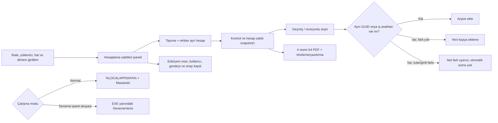

# OEHS Yol Haritası

## Güncel kalite kapısı — 2026-10-18

Bu dalda yeni değişiklikler için aşağıdaki doğrulamalar birbirinden ayrı değerlendirilir:

- **Derleme:** Son commit için doğrulanmış sonuç bulunmadan başarılı kabul edilmez.
- **Otomatik test:** Kaynak kodda regresyon testi bulunması, testin çalıştırıldığı anlamına gelmez.
- **PDF görsel kabulü:** Dört belgenin A4 yerleşimi, tutarları, dönem/yüklenici/hat bilgileri ve imza blokları aynı örnek veri üzerinden birlikte kontrol edilmelidir.
- **Kesintiler ve Mahsuplar başlığı:** Dikey yön ve yazı biçimi korunur; metin, tüm kesinti satırlarının yüksekliğini kapsayan sol hücre içinde hem yatay hem düşey eksende ortalanır. `PdfVectorWriter` vektör çıktısında döndürülmüş metin için tanımlı layout ölçülerini kullanır; `VerticalAlignment.Center` ile çizgi hücrenin kısa ekseninde ortalanır.
- **Açık doğrulama:** Son başlık hizalama değişikliği ve buna ait regresyon testi Windows/.NET 8 ortamında çalıştırılmalı, üretilen PDF görsel olarak incelenmelidir.

Bu kapı, derleme/test sonucu veya PDF ekran görüntüsü görülmeden “tamamlandı” işareti verilmesini önlemek için eklenmiştir.

## Çekirdek ilerleme panosu — 2026-10-18

Aşağıdaki %100 değerleri yalnızca bu dar kapsamlı alt modüllerin **uygulama kapsamının** tamamlandığını belirtir; CI/Windows çalıştırması ve kullanıcı kabulü ayrı kapılardır.

| Çekirdek alt modülü | Uygulama kapsamı | Doğrulama durumu | Kapanış ölçütü |
|---|---:|---|---|
| Dosya adı güvenliği ve normalizasyon | **%100** | Kaynak ve regresyon testleri gözden geçirildi; test çalıştırma sonucu bekliyor | Geçersiz karakter, boş/göreli yol, uzun parça, Windows aygıt adı ve uzantı varyasyonları test edilir |
| PDF dosya adı üretimi ve program/yüklenici ayrımı | **%100** | Program enum üyeleri kaynakta doğrulandı; otomatik test çalıştırma sonucu bekliyor | Özel Eğitim / Temel-Ortaöğretim ayrımı, aylık tarih, çoklu hat, sözleşme ve yüklenici kimlik özeti test edilir |

### Bu turdaki kapsam kapanışları

- Windows için ayrılmış aygıt adlarında uzantı ve araya boşluk/nokta girme durumları ele alındı; COM¹–COM³ ve LPT¹–LPT³ biçimleri eklendi.
- Dosya adı testleri; fallback, program türü, aylık dönem biçimi, çoklu hat, yüklenici kimlik özeti ve geçersiz hakediş numarası senaryolarını kapsayacak şekilde genişletildi.
- Bu testler GitHub kaynak dosyasına eklendi, ancak burada .NET test çalıştırıcısı çalıştırılamadığı için başarılı test sonucu iddia edilmez.
- Sonraki hedefler daha geniş ve yüksek riskli çekirdeklerdir: dört resmî PDF'nin görsel kabulü, Excel ile hesap eşleştirmesi ve iki taşıma programının uçtan uca senaryoları.

## Ana dönüşüm sırası

1. Excel tersine mühendislik — **YAPISAL TARAMA TAMAMLANDI / SEMANTİK DOĞRULAMA SÜRÜYOR**
2. İş kurallarının çıkarılması — **TAMAMLANDI / doğrulama sürüyor**
3. VBA/makro kontrolü — **KAYNAK KODU ÇIKARILDI / UÇTAN UCA DOĞRULAMA SÜRÜYOR** (iki XLSM'de VBA projesi bulundu; makro aktarım davranışı hesap ve aylık geçmiş kayıtlarıyla çapraz doğrulanıyor)
4. Domain model — **TAMAMLANDI / genişletme sürüyor**
5. Hakediş hesaplama motoru — **TAMAMLANDI**
6. Veri saklama — **TAMAMLANDI / geliştirme sürüyor**
7. WPF arayüzü — **TAMAMLANDI / kullanılabilirlik iyileştirmeleri sürüyor**
8. İcmal ve raporlama — **TAMAMLANDI / gerçek belge eşleştirmesi sürüyor**
9. Excel karşılaştırma testleri — **AKTİF**
10. Gerçek senaryo testleri — **AKTİF**
11. PDF/çıktı son karşılaştırması — **AKTİF**
12. Release ve kurulum paketi — **SON AŞAMA**

## Mevcut çalışma sırası

### 1. Hesaplama doğrulama
- Excel'den doğrulanmış 30.06.2026 / Hakediş No 10 senaryosu otomatik testte korunuyor.
- Hizmet tutarı, fiyat farkı, toplam, KDV, tevkifat, damga, ek teminat, denetim cezası, kesinti toplamı ve net ödeme birlikte doğrulanıyor.
- İskonto, fiyat farkı, vergi borcu, SGK borcu, asgari ücret desteği ve denetim cezası **kullanıcı tarafından dönem/hakediş bazında girilen değerlerdir**.
- Denetim cezası artık sözleşme bedelinden sabit binde oranla türetilmiyor; kullanıcı tarafından girilen tutar doğrudan kesintiye ekleniyor.
- KDV için kullanıcı seçimi esas alınır: **KDV HESAPLA / DAHİL ET** işaretliyse KDV ve buna bağlı tevkifat hesaplanır; işaretli değilse KDV ve tevkifat uygulanmaz.
- Yeni mevzuat/iş kuralları kullanıcı girdisi olarak tanımlanan alanlar dışında sabitlenmeyecek.

### 2. Hat / hakediş veri bütünlüğü
- Raporlar ekranı seçilen hatta göre filtrelenir.
- Seçilen hat değiştiğinde liste, toplamlar ve son hakediş özeti yenilenir.
- Uygulama açılışında kayıtlı ilk hat otomatik seçilir.
- Çıktı üretimi yalnızca seçilen hatta ait hakediş kaydı varsa devam eder.

### 3. Dört belge çıktısı
Her hat için:
1. Hakediş Raporu
2. Hizmet İşleri Hakediş Raporu
3. Hizmet İşleri Kabul Tutanağı
4. Hakediş İcmali

Önizleme ve yazdırma akışı korunur.

### 4. PDF / sayfa düzeni
- A4 portre
- Taşma kontrolü
- Kolon genişlikleri
- Başlıklar
- İmza alanları
- Kabul tutanağındaki resmî metin
- İcmal A/B/C yapısı
- Kurum örneklerine yakın yerleşim

16.10.2026 CI smoke artefaktındaki dört örnek PDF görsel olarak açıldı: her biri tek sayfa A4 portre, Türkçe karakterler okunur ve örnek çıktıda belirgin metin taşması görülmedi. Bu, sentetik test verili smoke çıktısının kontrolüdür; orijinal Excel'in yazdırma alanlarıyla birebir karşılaştırma, gerçek kullanıcı verisiyle kabul testi ve yazıcı kontrolünün yerine geçmez.

Kaynak XLSM dosyalarının yazdırma alanları ayrıca LibreOffice ile PDF'e aktarılarak dört resmi formun yerleşimiyle karşılaştırıldı. Bu karşılaştırma Excel masaüstü/VBA çalıştırmalı birebir kabul testi değildir; kaynak dosyanın mevcut önbellekli değerleri ve LibreOffice yazdırma motoruyla sınırlıdır. Görsel karşılaştırmada Kabul Tutanağı için iki somut uyumsuzluk düzeltildi: Temel/Ortaöğretim formunda süre değeri birim olmadan gösterilirken Özel Eğitim'de "İş Günü" eki korunuyor; anlatım paragrafları programın kaynak form yerleşimine göre farklı düşey konum kullanıyor. Kod değişikliği commit'i: [2818ec6](https://github.com/mcalimlier/OzelEgitimHakedisSistemi/commit/2818ec6cf271114a21d645ee98a4665e151b2b55). Bu değişiklik için yeni CI sonucu henüz doğrulanmadı.

Bu aşamanın son doğrulaması gerçek üretilen PDF'lerin referanslarla karşılaştırılmasıdır.

### 5. Gerçek senaryo testi
Otomatik hesap regresyon testleri genişletildi. Şimdi UI üzerinden gerçek iki hatlı senaryo ile doğrulanacak.

Test sırası:
- Hat 1 oluştur
- Hat 2 oluştur
- Hat 1 için Hakediş 1 ve Hakediş 2 oluştur
- Hat 2 için Hakediş 1 oluştur
- Her hat için dört belgeyi ayrı ayrı önizle / PDF'e çıkar
- Hatların birbirine karışmadığını kontrol et
- İcmal aylarının ve önceki hakediş toplamlarının doğru taşındığını kontrol et

### 6. PDF ve çıktı son kontrolü
- Dört belge ayrı ayrı önizlenecek.
- A4 portre ve taşma kontrolü yapılacak.
- Kabul tutanağı metni ve imza yerleşimi referansla karşılaştırılacak.
- İcmal A/B/C toplamları kontrol edilecek.

### 7. Release
- Error = 0
- Core testleri başarılı
- WPF Rebuild başarılı
- Gerçek senaryo testi tamam
- Dört belge son karşılaştırmadan geçti
- Test paketi oluştur
- Windows kurulum / dağıtım paketi hazırlan

## 29.09.2026 Orijinal Excel doğrulaması

Kullanıcının yeniden yüklediği orijinal `Özel Eğitim Hakediş Ödeme Programı.xlsm` doğrudan incelendi.

- Çalışma sayfaları: Anasayfa, İhale Verileri, Hesaplama, Hakediş Raporu, Hizmetişleri Hakediş Raporu, Hizmet İşleri K. Tutanağı, Hakediş İcmali, İcmal Verileri.
- Dosyada `xl/vbaProject.bin` bulundu; yani bu workbook sürümünde VBA projesi gerçekten mevcut.
- VBA içindeki metinlerde hakediş kontrolü, fiyat farkı aktarımı, rehber personel fiyat farkı aktarımı, kesinti aktarımı, icmal/hakediş toplam aktarımı ve kabul tutanağı kontrolü gibi işlemlere ait makro izleri bulundu.
- Bu nedenle önceki “aktif VBA tespit edilmedi” notu bu yüklenen orijinal dosya için geçerli değildir ve düzeltilmiştir.

### Kullanıcı tarafından girilecek hakediş değerleri

Hakediş ekranında dönem bazında kullanıcı tarafından girilecek alanlar:

- İskonto
- Fiyat Farkı
- Vergi Borcu
- SGK Borcu
- Asgari Ücret Desteği
- Denetim Cezası

Bu alanlar hesap motoruna doğrudan aktarılır; sabit bir mevzuat tutarı olarak üretilmez.

### KDV seçimi

Kullanıcı ekranında **KDV HESAPLA / DAHİL ET** seçeneği bulunur.

- İşaretli → KDV hesaplanır ve toplam/brüt/net zincirine dahil edilir; buna bağlı tevkifat da hesaplanır.
- İşaretsiz → KDV ve buna bağlı tevkifat uygulanmaz.

Excel'in orijinal Hesaplama sayfasındaki “KDV'den Muafmı?” alanı ile mevcut formüller ayrıca karşılaştırılmıştır; OEHS kullanıcı arayüzünde seçim davranışı açık ve anlaşılır olacak şekilde sunulmuştur.

### Excel v2 ikinci tarama — formül ve VBA envanteri tamamlandı / semantik kabul doğrulaması sürüyor
- `vbaProject.bin` içindeki Module1 VBA kaynak kodu çıkarıldı ve makro aktarım akışları doğrulandı.
- Rehber personel hakediş hesabı eklendi.
- Taşıma ve rehber personel fiyat farkları ayrı alanlara ayrıldı.
- Taşıma %10 / rehber %20 KDV ve 5/10 + 9/10 tevkifat ayrımı eklendi.
- Ek kesin teminat, iki fiyat farkının toplamı üzerinden %6 olarak bağlandı.
- İhale tarihi ve sözleşme tarihi veri akışına eklendi.
- Panel kartlarının sabit/placeholder metinleri yerine kayıtlı verileri göstermesi için bağlantılar genişletildi.
- PDF raporlarında kesinti başlığının düşey yerleşimi ve referans tablo düzenleri iyileştirildi.
- Orijinal Excel'de Hakediş Raporu D28 ile Hesaplama AG arasında fiyat farkı kaynaklı formül tutarsızlığı ayrıca belgelendi; PDF birebir eşleştirme aşamasında karar verilecek.

## 1.10.2026 KULLANICI GERİ BİLDİRİMİYLE KESİNLEŞEN ARŞİV/PDF DAVRANIŞI

- ARŞİVLER > DÜZELT, seçilen bitmiş işin snapshot'ını düzenleme moduna alır.
- HAT BİLGİLERİ seçildiğinde Hat No dahil tüm ilgili hat alanları değiştirilebilir.
- Onaylanan arşiv düzeltmesi `SaveRevision` ile yeni bir arşiv revizyonu oluşturur; önceki vXX dosyası korunur.
- PDF OLARAK KAYDET yazıcı sürücüsüne bağlı değildir; OEHS yerleşik PDF üreticisiyle doğrudan PDF dosyası üretir.
- PDF dosyası Masaüstü\OzelEgitimHakedisSistemi\Ciktilar\Hakedisler\<İhale-Dosya-No>\Hat-<Hat-No> altında descriptive adla tutulur.
- Önizleme gerçek A4 sayfa rasterı üzerinden, sayfa geçişi ve zoom kontrolleri ile gösterilir.

## 15.10.2026 — İzole deneme paketi ve arşiv çakışması kontrolü

- Arkadaş incelemesi için Windows x64 self-contained paket üretimi CI'a bağlandı. Paket yalnızca `OEHS.exe`, `OEHS_DENEME_PAKETI.flag` ve `KULLANIM.txt` içerir; kaynak kullanıcı verisi veya mevcut arşiv pakete kopyalanmaz.
- İşaret dosyası bulunan pakette ana veri, .bak yedeği, arşivler, imza ayarları ve PDF/çıktılar EXE yanındaki `DenemeVerisi` klasörüne yönlendirilir. İşaret dosyası olmayan normal çalıştırmada standart kullanıcı profili ve Masaüstü dizinleri korunur.
- Arşiv geri yüklemede aynı GUID veya aynı iş anahtarındaki kayıt mevcutsa ikinci hakediş satırı eklenmez. Aktif kayıt ile arşiv girdileri, brüt/net/kesinti tutarları ya da hesapta kullanılan sabitler farklıysa aktif ve arşiv net tutarlarını gösteren uyarı üretilir; aktif kayıt otomatik değiştirilmez.
- İzole yol seçimi ve normal yol geri uyumluluğu için testler; farklı GUID'li iş anahtarı çakışması ve aynı GUID'li ama farklı girdili arşiv için regresyon testleri eklendi. CI sonuçları son committe doğrulanacaktır.

### Güncel iş akışı

### Kalan kritik kabul işleri

- Kaynak Excel'in D11 etiketi/formül çelişkisi, AG/D28 farkı ve icmal Temmuz/Kasım/Aralık davranışı için iş sahibi/Excel tabanlı karar alınmalı; kaynak farkları varsayımla değiştirilmemeli.
- Dört gerçek PDF'nin kaynak örnekleriyle görsel fark karşılaştırması, fiziksel yazıcı ve temiz Windows profili kabul testleri tamamlanmadan uygulama üretime hazır sayılmamalıdır.
