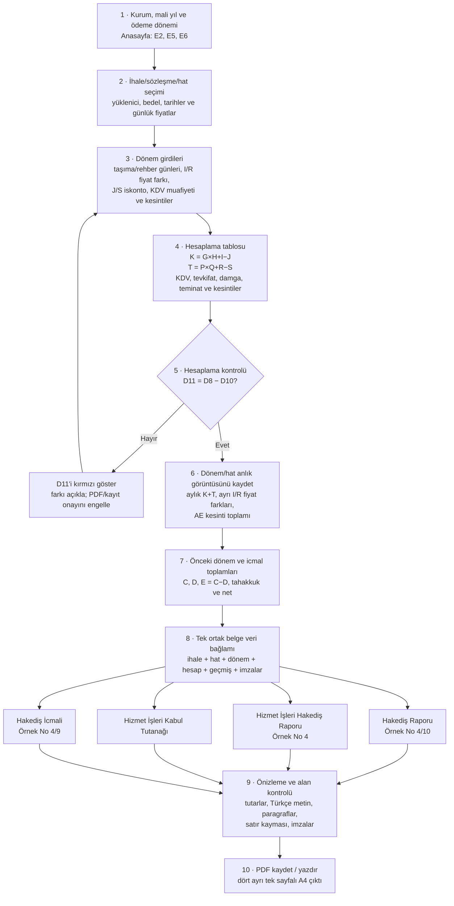

# Orijinal XLSM İncelemesi ve Hakediş İş Akışı

> **Kaynak önceliği (20.10.2026):** Bu dosyanın tarihsel XLSM/PDF gözlemleri arka plan niteliğindedir. Kullanıcının en son yüklediği Temel Eğitim ve Özel Eğitim XLSM dosyaları ile bunların formülleri/VBA akışı çelişirse, en son XLSM geçerlidir. Eski dosya adlarına, hücre sonuçlarına veya geçmiş kabul varsayımlarına dayanarak yeni Excel davranışı çıkarımı yapılmaz.

**Kaynak dosya:** Özel Eğitim Hakediş Ödeme Programı (2).xlsm  
**Kaynak yaklaşımı:** Çalışma kitabındaki formüller ve VBA aktarım davranışı esas alınır. Dört PDF'nin tamamı aynı ödeme anlık görüntüsünden üretilmelidir.

## 1. Sonuç: E satırındaki 120 TL sorunu

Orijinal VBA'daki HesapKontrol yordamı, Hakediş Raporu!D11 değerini D8 − D10 ile karşılaştırır. Eşitse “Hesaplama doğru!” mesajı ve beyaz arka plan; eşit değilse “Hesaplama hatalı!” mesajı ve kırmızı arka plan kullanır. Bu, rapordaki E satırının kesin kontrol ilişkisini verir: **E = C − D**.

Asıl hata, önceki C# eşlemesinin aylık hakediş tutarından fiyat farkını yeniden çıkarmasıydı. Excel'deki HakedişToplamlariniAktar makrosu aylık tutara doğrudan Hesaplama!K + Hesaplama!T değerini yazar. K ve T zaten fiyat farkı/iskonto işlemlerini içerir. Bu yüzden C# aylık geçmiş tutarı da K+T toplamını aynen taşımalıdır.

| Excel hücresi / kural | Kaynak anlamı | OEHS eşlemesi |
|---|---|---|
| Hesaplama!K | G × H + I − J; taşıma hakediş tutarı | Taşıma bileşeni |
| Hesaplama!T | P × Q + R − S; rehber hakediş tutarı | Rehber bileşeni |
| HakedişToplamlariniAktar | K + T, seçili ay için İcmal Verileri D:N'ye yazılır | Calculation.TotalAmount aylık değere aynen yansır |
| Hakediş Raporu!D6 (A) | Önceki dönem K+T toplamı + güncel dönem hizmet tabanı; güncel ham I+R bu hücrede ayrı tutulur | CumulativeServiceAmount |
| Hakediş Raporu!D7 (B) | Güncel ham fiyat farkı I + R | CurrentPriceDifference |
| Hakediş Raporu!D8 (C) | D6 + D7 | CumulativeTotal |
| Hakediş Raporu!D10 (D) | Güncel dönemden önceki aylık K+T toplamı (İcmal Verileri!O) | PreviousTotal |
| Hakediş Raporu!D11 (E) | HesapKontrol'ün doğruladığı D8 − D10 | CurrentTotal = CumulativeTotal − PreviousTotal |
| Hakediş Raporu!D28 (I) | ROUND(D13,2) − ROUND(D26,2) | CalculateReportNetPayable |

### Somut sayı örneği

Önceki dönem K+T tutarı 100 TL, güncel dönem K+T tutarı 110 TL ve güncel ham fiyat farkı I+R 10 TL ise:

1. A = D6 = önceki K+T (100 TL) + güncel hizmet tabanı (100 TL) = **200 TL**
2. B = D7 = güncel ham fiyat farkı = **10 TL**
3. C = D8 = A + B = **210 TL**
4. D = D10 = önceki K+T = **100 TL**
5. E = D11 = C − D = **110 TL**

Örnek, D6/D7 ayrımını göstermek içindir; gerçek kabul için son XLSM'nin hesaplanmış hücreleri kullanılmalıdır. D6 güncel dönemin ham I+R fiyat farkını dışarıda bırakır; D7 bu farkı bir kez ekler. Bu nedenle C# rapor servisi hizmet tabanını ve fiyat farkını ayrı hesaplayıp rapor toplamında birleştirir. Bu örnek, kaynak Excel'de gerçek bir uyuşmazlık bulunduğunun kanıtı değildir.

Orijinal D11 formülü IF(D7<0,H2-ABS(D7),H2+D7), H2 ise Hesaplama K+T toplamıdır. Formülün iki dalı da matematiksel olarak H2+D7 sonucunu verir. Aylık aktarım doğru yapıldığında bu, D8−D10 eşitliğini karşılamalıdır; HesapKontrol makrosu tam da bu ilişkiyi doğrular.

### 1.1 Mevzuat kaynaklı istisna — negatif fiyat farkı ve ek kesin teminat

Kaynak Hesaplama!AC formülü =(I*6/100)+R*6/100 olduğundan negatif I/R için matematiksel olarak negatif ek kesin teminat kesintisi üretir. Bu formül kayıtta aynen belgelenmiştir; ancak 4735 sayılı Kamu İhale Sözleşmeleri Kanunu'nun 12. maddesi, ek kesin teminatı **fiyat farkı nedeniyle sözleşme bedelinde artış meydana gelmesi halinde** artış tutarının %6'sı olarak tanımlar. Bu nedenle OEHS'de:

- I/R fiyat farkları negatif olabilir ve K/T, KDV, tevkifat ve damga hesabında işaretli kalır.
- **Yetkili kaynak formülü aynen uygulanır:** Temel Eğitim için `T = I × %6`; Özel Eğitim için `AC = (I × %6) + (R × %6)`. Taşıma ve rehber fiyat farkları birbirine netlenmez; negatif I/R bileşenleri de kaynak Excel formülünde işaretli olarak kalır. `MAX(0, I+R)` veya yalnızca pozitif toplam üzerinden hesaplama, son Excel formülünün davranışı değildir ve uygulanmamalıdır.
- J/S iskontoları AC teminat tabanından düşülmez.
- Bu teknik eşleştirme, negatif ek kesin teminatın hukuken nasıl uygulanacağına dair onay değildir. Hukuki/ihale yorumu ayrı karar olarak kaydedilir; Excel'deki hesap formülü bu karar beklenirken sessizce değiştirilmez.

Kaynak ile mevzuatın farklılaştığı bu istisna, hesaplama servisinde ve negatif/karma işaretli fiyat farkı testlerinde açıkça belirtilmelidir.

Kaynak kontrol referansı: 4735 sayılı Kanun m. 12; Kamu İhale Kurulu kararı içindeki 4735 m. 12 / Hizmet Alımları İhaleleri Uygulama Yönetmeliği m. 55 alıntısı:
https://ekap.kik.gov.tr/EKAP/Vatandas/KurulKararGoster.aspx?KararId=5a55fc2e4d77a80d4646eb11537c79a3f55aca0b0f11934f4313f5be1b4ea587

## 2. Sekiz çalışma sayfası — tek tek görevleri

| Sayfa | Girdi/çıktı görevi | Kod eşlemesi ve dikkat noktası |
|---|---|---|
| **1. Anasayfa** | Kurum, taşıma/rehber günleri, dönem, hakediş tarihi, seçili hat ve imza/unvan bilgileri | E3 taşıma günü, E4 rehber günü, E5 ödeme dönemi, E6 tarih, K17 seçili hat. E9:E10 tutanak inceleyenleri; C13:E15 hakediş imzacıları. B18:B21 seçili hat/yüklenici, iş günü ve net tutarı gösterir. |
| **2. İhale Verileri** | Hat/yüklenici/sözleşme ana kaydı, A:P, en çok 100 hat | Hat adı, yüklenici, kimlik/vergi, taşıma/rehber gün ve günlük fiyatları, yıllık tutar, sözleşme bedeli ve tarihler buradan okunur. G = E×F; J = H×I; L = G+J. |
| **3. Hesaplama** | Hat satırı başına taşıma, rehber, KDV/tevkifat ve kesinti hesabı, satırlar 4:103 | Taşıma G:O; rehber P:X; kesinti Y:AE; brüt AF; net AG. K = G×H+I−J; T = P×Q+R−S; L KDV %10; U KDV %20; M = L/2; V = U×9/10; AC ek kesin teminat; AD damga vergisi; AE kesinti toplamı; AF brüt; AG net. |
| **4. Hakediş Raporu** | A–I resmî özeti, kesinti dökümü, yüklenici ve Örnek No 4/10 | Aylık K+T, güncel ham fiyat farkı, önceki toplam, E kontrolü ve net tutar aynı ödeme anlık görüntüsünden hesaplanır. Baskı alanı A1:F42. |
| **5. Hizmetişleri Hakediş Raporu** | İş/sözleşme/yüklenici bilgileri, sözleşme artışları ve süre uzatımı çizelgeleri, imzalar | Baskı alanı A1:J45. Veri yokken sözleşme artış ve süre uzatımı alanları kaynak şablondaki gibi noktalı/boş kalır. Tescil ve avans satırlarında kaynak sayfanın sabit metinleri korunur. |
| **6. Hizmet İşleri K. Tutanağı** | Kabul tutanağı, dönem paragrafı, yüklenici ve imzalar | B2:B10 sözleşme/iş alanları; A12 paragrafı seçili ihale, yüklenici, imzacı ve dönem tarihlerini birleştirir. Anasayfa E5 değişince ve son hakediş yanıtı “Evet” olunca B8 metni B7 bitiş tarihiyle güncellenir. Baskı alanı A1:B34. |
| **7. Hakediş İcmali** | Ay bazında aylık K+T, ayrı fiyat farkı ve kesinti dökümü; toplam/önceki kesinti/net toplam | Aylık hizmet tutarı, fiyat farkı ve net/tahakkuk toplamı ayrı alanlardır. Baskı alanı A1:E42. |
| **8. İcmal Verileri** | 100 hat × 11 dönem için kalıcı aylık hareket tablosu | D:N = aylık K+T; P:Z = taşıma ham fiyat farkı I; AB:AL = rehber ham fiyat farkı R; AN:AX = kesinti toplamı AE. O/AA/AM ara toplamları üretir. |

## 3. VBA makroları ve olayları — tek tek inceleme

Bu özet, yüklenen dosyanın vbaProject.bin içinden çıkarılan VBA kaynak metnine dayanır.

| Makro/olay | Kaynakta yaptığı işlem | OEHS için karar |
|---|---|---|
| HakedişToplamlariniAktar | Onay ister; Anasayfa!E5 ayını D:N sütununa çevirir; satır 4:103 için Hesaplama!K + Hesaplama!T yazar. | Aylık K+T eşlemesi C#'ta aynen uygulanır. |
| FiyatFarkıVerileriniAktar | Hesaplama!I değerlerini seçili ayın P:Z sütununa aktarır. | Taşıma fiyat farkı ayrı tutulur. |
| RehberPersonelFiyatFarkıVerileriniAktar | Hesaplama!R değerlerini seçili ayın AB:AL sütununa aktarır. | Rehber fiyat farkı ayrı tutulur. |
| KesintiBilgileriniAktarAktar | Hesaplama!AE değerlerini seçili ayın AN:AX sütununa aktarır ve onay sorar. | Kesinti tarihçesi aylık/hat bazında tutulur. |
| TumFiyatFarkiAktarimlari | Taşıma ve rehber fiyat farkı aktarım yordamlarını sırayla çağırır. | İki fiyat farkı türü birlikte güncellenir. |
| HesapKontrol | D8, D10, D11 hata/sayısallık kontrolü yapar; boş D10'u 0 sayar; D8−D10 ile D11'i karşılaştırır. Eşleşmede beyaz/doğru; farkta kırmızı/hatalı yapar. | C# testleri aynı E=C−D eşitliğini doğrular. |
| SayfaYazdir | Dört resmî sayfayı yazdırır, sonra Anasayfa'ya döner. | Önizleme, ayrı PDF ve toplu çıktı aynı veri bağlamından oluşturulmalı. |
| AyVerileriniSil | E5 dönemini mesajda kullanır; ancak D4:N103, P4:Z103, AB4:AL103 ve AN4:AX103 aralıklarının tamamını temizler; tek aya sınırlı değildir ve silmeden önce onay sormaz. | Bu davranış aynen kopyalanmamalı. OEHS yalnızca seçili dönem sütunlarını temizlemeli, açık onay ve geri alma/yedek sağlamalı. |
| DonemSiraNo | E4 hücresini dönem gibi okuyup I5:I14 içinde arar. Kaynakta çağrı noktası görünmeyen yardımcı yordamdır; E4 gerçek dosyada rehber iş günü alanıdır. | Doğrudan taşınmamalı; gerekiyorsa E5 üzerinden yeniden tasarlanmalı. |
| Anasayfa.Worksheet_Change | I5 değişikliğini geri alır; E5 değişince ayı I5:I15'te arar ve L sütununa yazar; “son ay mı?” sorusunda B8'i B7 tarihinden üretir. | Dönem değişimi tek onaylı komut olmalı; sözleşme bitişi ve fiilî hizmet bitişi ayrı alanlardır. |
| Diğer sayfa modülleri / ThisWorkbook | Çıkarılan kaynaklarda ek olay yordamı görünmüyor. | İş kuralları esas olarak Module1 ve hücre formüllerinde bulunuyor. |

## 4. Tek diyagram: kullanıcı verisinden dört PDF'ye

## 5. Bu kaynağa göre önerilen arayüz adımları

| Sıra | Kullanıcı ne yapar? | Uygulama ne yapar? | İlerlemeden önce kontrol |
|---:|---|---|---|
| 1 | Kurum, mali yıl ve ödeme dönemini seçer. | Ay başlangıç/bitiş tarihlerini ve dönem kimliğini hazırlar. | Geçerli dönem; aynı hat/dönem için mükerrer kayıt uyarısı. |
| 2 | İhale/dosya ve hat/yüklenici seçer. | Sözleşme bedeli, tarihler, günlük fiyatlar ve gün sınırlarını sözleşmeden getirir. | Eksik sözleşme/hat bağlantısında hesaplama açılmaz. |
| 3 | Dönem taşıma/rehber günlerini, fiyat farkı, iskonto, KDV muafiyeti ve kesintileri girer/doğrular. | K/T, KDV/tevkifat, teminat, damga ve kesinti toplamlarını hesaplar. | Kaynak Excel sütunlarına birebir eşleme; negatif/eksik değer uyarısı. |
| 4 | Hesaplamayı Kontrol Et komutunu çalıştırır. | E=C−D eşitliğini ve fark tutarını gösterir. | Kontrol başarısızsa kaydetme/PDF/yazdırma bloke edilir. |
| 5 | Kontrol edilen hakedişi kaydeder. | Dönem anlık görüntüsü ve önceki dönem bağlantısını saklar; icmale K+T, I, R, AE'yi ayrı aktarır. | Aynı döneme ikinci kayıt varsa güncelle/iptal seçeneği. |
| 6 | İcmali gözden geçirir. | Aylık K+T, ham fark ve kesintileri ayrı gösterir. | Önceki mali yıl, boş aylar ve aynı hatın dönem sırası kontrol edilir. |
| 7 | Dört belgeyi önizler, PDF kaydeder/yazdırır. | Tek ortak bağlamdan dört şablon üretir. | Tarih/tutar, Türkçe karakter, paragraf kayması, imza ve A4 sayfa kontrolü. |

### Önerilen arayüz değişiklikleri

1. Üste 7 adımlı görünür ilerleme çubuğu ekleyin; tamamlanan, bekleyen ve hatalı adımlar ayrışsın. Özet kartları süreç adımlarının yerine geçmemeli.
2. Hesaplamayı Kontrol Et düğmesini hesapla/kaydet bölümünde sabitleyin. Sonuç paneli C, D, beklenen E, hesaplanan E ve farkı TL olarak göstersin.
3. Sözleşme ve hat seçiminden sonra bedel/tarih/günlük fiyatlar otomatik getirilsin; kullanıcı yalnızca dönemsel verileri doğrulasın.
4. Dört aktarım makrosunun mantığı tek bir güvenli kayıt işlemi olsun. Düğmeye iki kez basmak aynı dönemi iki kez yazmamalı.
5. Kaynaktaki toplu temizleme davranışı taşınmasın. OEHS'de yalnızca seçili dönemin sütunları, açık onay ve geri alma/yedekle temizlenmeli.
6. PDF'lerin tümü aynı veri bağlamından oluşturulsun; farklı belgelerde yüklenici/hat/dönem/tutar/isimler bağımsız tekrar sorgulanıp farklılaşmamalı.

## 6. Kaynak dosyada ayrıca doğrulanması gerekenler

- Anasayfa'nın LibreOffice tabanlı önizlemesinde B21'deki net tutarı metne dönüştüren formül ve AA2 alanı hata gösteriyor. XML'deki önbellek değerleriyle önizleme sonucu farklı olduğundan, Excel masaüstünde aynı hücrelerin tekrar hesaplanıp hesaplanmadığı doğrulanmalı; bu dosyayı değiştirerek tahmin yürütmedik.
- HesapKontrol VBA kaynağı incelendi ve matematiksel kural C# testlerine taşındı. Bu ortamda Windows Excel içinde düğmeye fiziksel tıklama çalıştırılmadı.
- Kabul tutanağında kaynak Excel'in mevcut eşlemesi korunur: iş süresi etiketinde “takvim günü” yazmasına rağmen değer “181 İş Günü” biçiminde gelir; “süre uzatımı dahil tarih” ve “işin bitirildiği tarih” hücreleri sözleşme bitiş tarihi formülünü kullanır. Bunlar kaynak şablon tutarsızlıklarıdır; farklı bir iş kuralı kararı verilmeden sessizce değiştirilmemelidir.
- Hizmet İşleri Hakediş Raporu sayfasında “Tescile Dahil Değil”, “Avans verilmeyecektir.” ve “Yoktur.” sabit metinleri kaynak Excel'de açıkça vardır ve bu şablonda korunmalıdır. Kabul tutanağında bu metinler yer almaz; iki belge birbirine karıştırılmamalıdır.
- Son kabul için test amaçlı PDF'lere ek olarak OEHS ÇIKTILAR ekranından gerçek kayıtla üretilmiş dört PDF de incelenmeli.

## 7. Son kayıt düzenleme akışı

Ana ekrana altı tıklanabilir adımlı bir iş akışı eklendi: Sözleşme → Yüklenici → Hat → Hakediş → Arşiv → Çıktılar.

Arşivden açılan bir hakediş düzeltildiğinde OEHS güncel girdilerden yeniden hesaplama yapar ve eski/yeni net tutarı göstererek onay ister. Onay verilirse seçilen arşiv dosyası aynı revision numarasıyla güncellenir. Onay reddedilirse kayıt korunur. Sözleşme, firma ve hat kayıtlarında da kaydetme başarılı olduğunda form alanları temizlenir; kayıtlı öğe listede kalır.

### Son kullanıcı giriş akışı

- Uygulama açıldığında kayıtlı ihale/firma/hat/hakediş bilgileri özet ve listelerde kalır; yeni kayıt giriş alanları boş başlar.
- Hakediş ekranında önce kullanıcı ihale/dosya numarasını, ardından o ihaleye bağlı hattı kendisi seçer. İhale seçilince hat listesi doldurulur ancak ilk hat otomatik seçilmez. Hat seçilmeden hesaplama yapılamaz.
- İskonto, fiyat farkı ve borç/kesinti gibi isteğe bağlı tutar alanları boş bırakılabilir; boş değer hesaplamada sıfır kabul edilir. Zorunlu gün/tarih ve bağlı ihale/hat bilgilerinin doğrulaması devam eder.
- Arşivde veya hakediş geçmişinde kayıtlı bir hakediş düzenlenirken bir alan değiştiği anda üstte “DEĞİŞİKLİK ALGILANDI” uyarısı ve net ödeme önizlemesi güncellenir. Bu önizleme kaydedilmemiştir; son kayıt öncesi eski/yeni tutarları gösteren ayrı onay gerekir.
- Onay verilirse seçilen arşiv dosyası aynı revision numarasıyla güncellenir ve eşleşen ana hakediş geçmişi satırı da senkronize edilir. Onay reddedilirse dosya değiştirilmez ve düzeltme ekranı kullanıcının tekrar gözden geçirebilmesi için açık kalır. Arşivi bulunmayan geçmiş satırları normal kayıt düzenleme akışında kalır.
- İhale, yüklenici, hat ve hakediş panellerinde alan aralıkları daraltıldı; yazı boyutu korunarak gereksiz dikey boşluk azaltıldı. Uzun kayıt listelerinde kayıtlara erişimi kaybetmemek için kaydırma yalnızca gerekli olduğu yerlerde tutulur.
